<p align="center">
  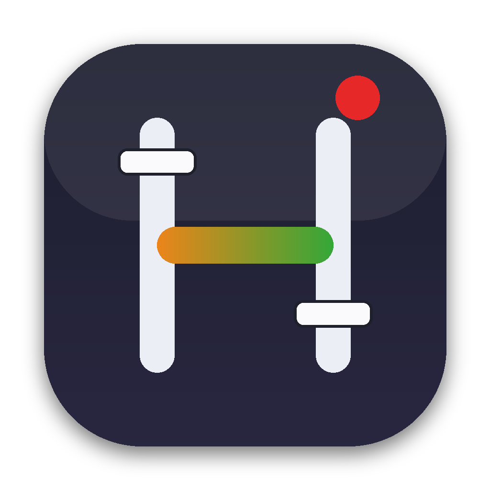
</p>

<h1 align="center">HongMix</h1>

<p align="center">
  <b>맥용 무료 라이브 방송·송출 스위처. M1 이후 모든 맥북 하나로 충분합니다. 윈도우 PC는 이제 필요 없습니다.</b><br>
  vMix 스타일 화면 · vMix 호환 API · SRT · RTMP · NDI® · DeckLink
</p>

<p align="center">
  <a href="https://github.com/HongMix/HongMix/releases/latest"><b>⬇️ HongMix 2.2.3 다운로드</b></a>
  &nbsp;·&nbsp; <a href="README.md">English</a>
  &nbsp;·&nbsp; <a href="https://github.com/HongMix/HongMix/issues">의견 남기기</a>
</p>

> **처음 실행할 때 “열지 않음” 또는 “휴지통으로 이동”만 보이면:** **시스템 설정 › 개인정보 보호 및 보안**의 아래쪽에서 **그래도 열기**를 누르세요. 고급 사용자는 `xattr -dr com.apple.quarantine /Applications/HongMix.app`을 실행해도 됩니다. HongMix는 공개용 임시 서명이며 아직 Apple 공증 전입니다.

### 최신 업데이트 · 2.2.3
- **SRT 수신이 몇 분마다 끊기던 문제 해결:** 60fps 라이브 입력을 실제보다 약 2.7% 느리게 소비해 수신 버퍼가 넘치던 문제를 수정했습니다.
- **끊김 원인을 블랙박스에 자동 기록:** 버퍼·Latency·RTT·손실·재전송·전송률·fps와 판정을 남기고, 직전 30초를 `srt.txt`로 저장합니다.
- SRT 입력을 더블클릭하면 연결 설정을 바로 엽니다. 최근 연결과 이름 붙인 즐겨찾기에서 값을 채우거나 재연결하고, 현재 회선 상태와 권장 Latency를 확인합니다.
- 여러 화면이 SRT 통계를 읽을 때 값을 서로 초기화해 전송률·손실·재전송이 0 또는 잘못된 값으로 보이던 문제를 수정했습니다.
- 실제 회선과 로컬 SRT 시험에서 수정 후 수신 버퍼가 일정하고 드롭이 0이었습니다. 송신 중단과 대역폭 제한 시험은 각각 연결 끊김과 보내는 쪽 드롭으로 판정했습니다. [한국어 릴리스 노트](docs/RELEASE-NOTES-2.2.3.ko.md) · [English](docs/RELEASE-NOTES-2.2.3.md)

<table>
  <tr>
    <td colspan="2" align="center">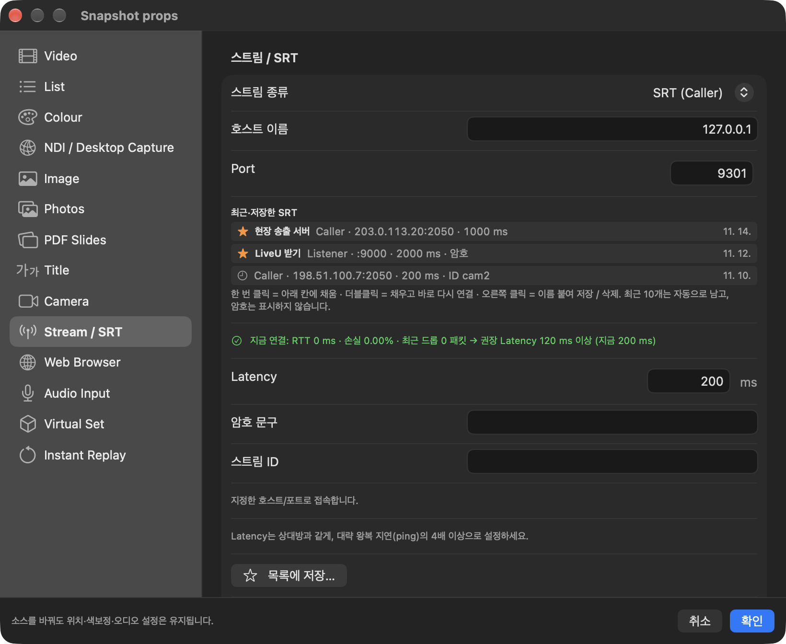<br><sub>최근·저장한 SRT 연결과 실시간 회선 안내</sub></td>
  </tr>
</table>

<details>
<summary>HongMix의 다른 화면 캡처 보기</summary>

<table>
  <tr>
    <td width="50%" align="center">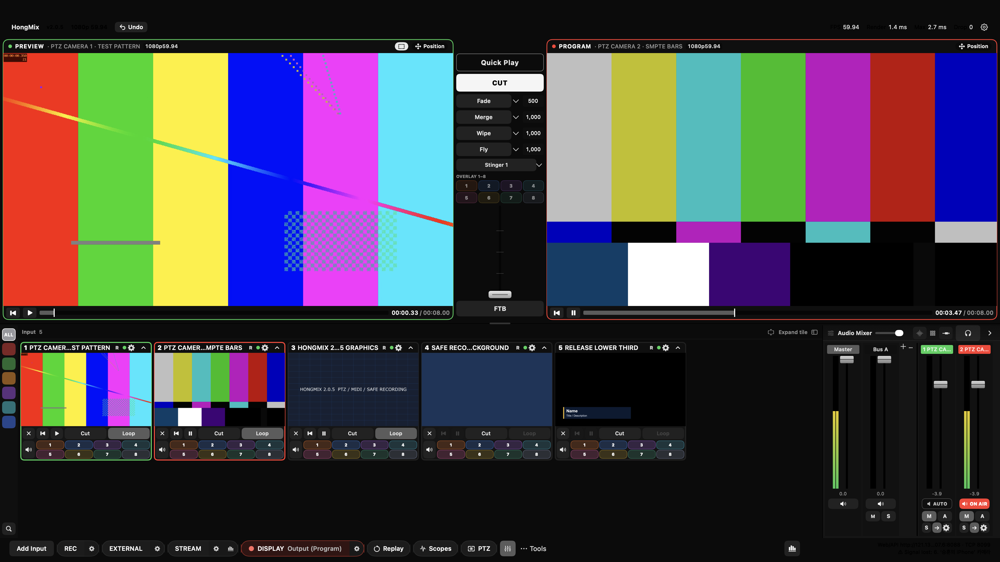<br><sub>메인 스위처 · 생성한 테스트 패턴</sub></td>
    <td width="50%" align="center">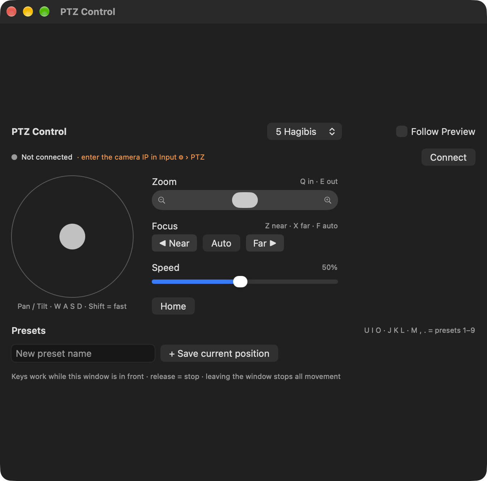<br><sub>독립된 다중 카메라 PTZ 제어</sub></td>
  </tr>
  <tr>
    <td width="50%" align="center">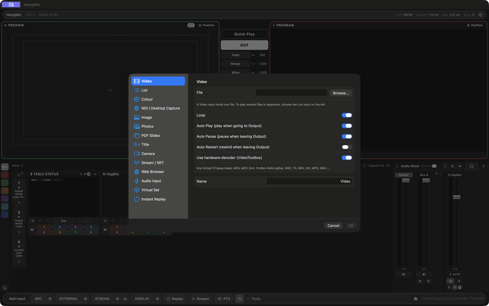<br><sub>Photos·PDF 슬라이드·Virtual Set 입력</sub></td>
    <td width="50%" align="center">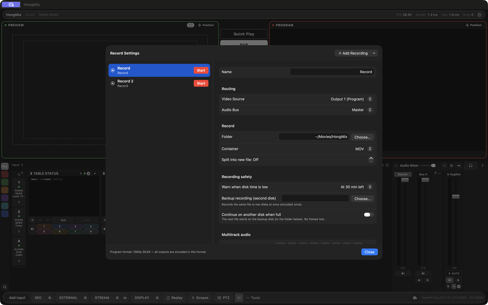<br><sub>백업 녹화와 디스크 이어쓰기</sub></td>
  </tr>
  <tr>
    <td width="50%" align="center">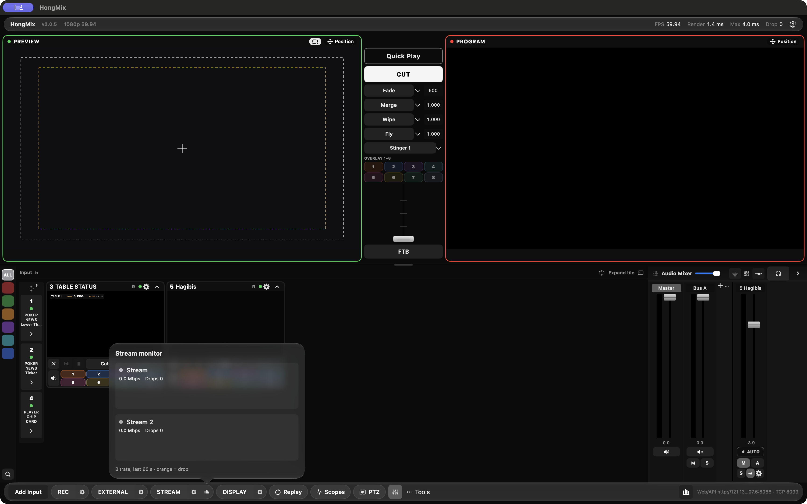<br><sub>목적지별 송출 상태</sub></td>
    <td width="50%" align="center">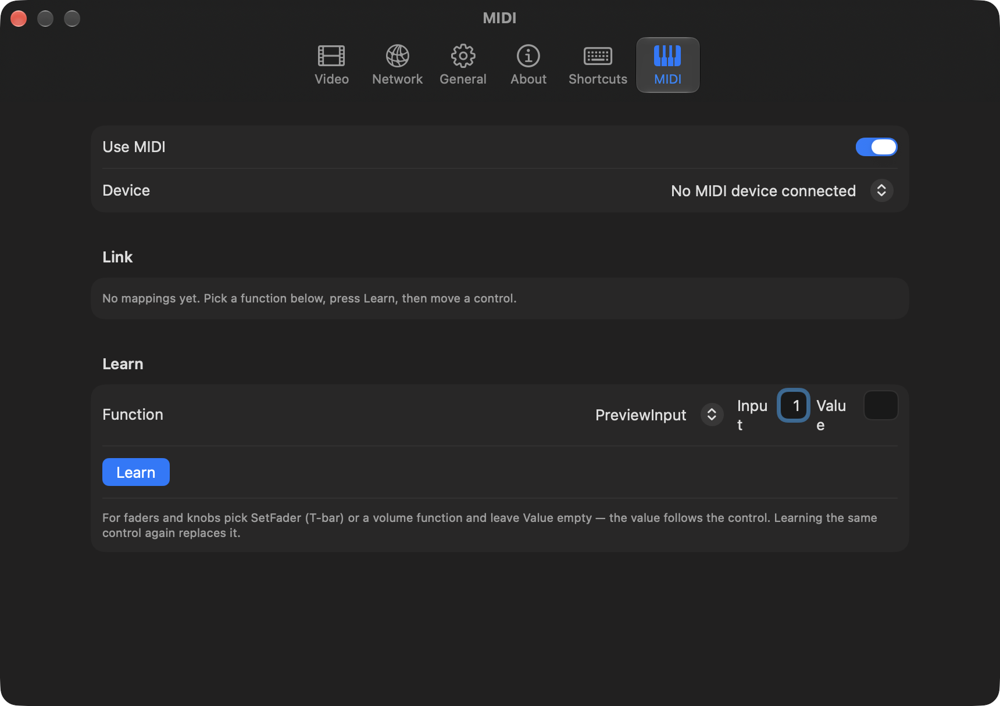<br><sub>MIDI 학습·템플릿·LED 탤리</sub></td>
  </tr>
</table>

</details>

### 1.4.2
- **macOS Space에 맞춘 Display 출력:** Output Window와 디스플레이 채우기가 현재 데스크톱에 그대로 열립니다. 초록 버튼은 검은 전체화면 Space를 남기지 않으며 Esc·더블클릭·우클릭으로 일반 창에 복귀합니다.
- **출력 설정 분리:** Record, External(NDI·DeckLink), Stream 설정을 각각 분리했습니다. External은 Output 2–4 라우팅, Stream은 이중 백업 경로를 함께 설정합니다.
- **Monochrome 운영 스킨:** Preview·Program·ON AIR·경고처럼 의미가 있는 상태에만 색을 사용합니다. 기존 기본 스킨도 설정에서 선택할 수 있습니다.
- **모니터링 작업 흐름:** Display 설정, Replay, Scopes를 하단 버튼으로 바로 열 수 있습니다. Statistics & Monitoring은 다른 모니터·데스크톱으로 옮길 수 있는 별도 창입니다.
- **검증:** 일반 창과 macOS 전체화면 스위처 상태에서 Display 회귀 테스트 총 16/16 단계를 통과했습니다. 다중 모니터 실제 장비 검증은 남아 있습니다.
- 공개 캡처에는 생성한 테스트 패턴만 사용했습니다. 사람 얼굴·타사 방송 영상·스트림 키는 포함하지 않았습니다. [한국어 릴리스 노트](docs/RELEASE-NOTES-1.4.2.ko.md) · [English release notes](docs/RELEASE-NOTES-1.4.2.md)

<table>
  <tr>
    <td width="50%" align="center">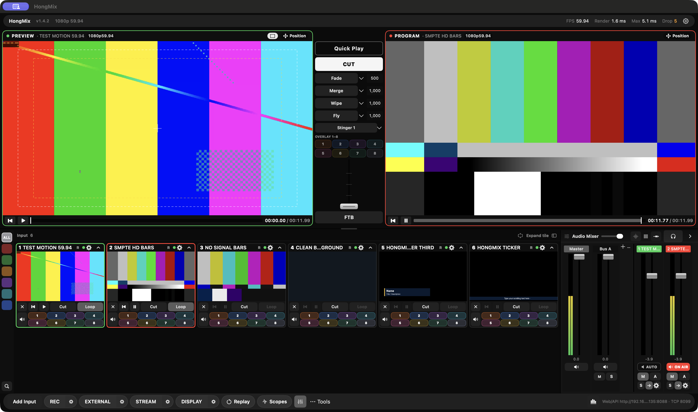<br><sub>Monochrome 스위처 · 생성한 59.94p 테스트 패턴</sub></td>
    <td width="50%" align="center">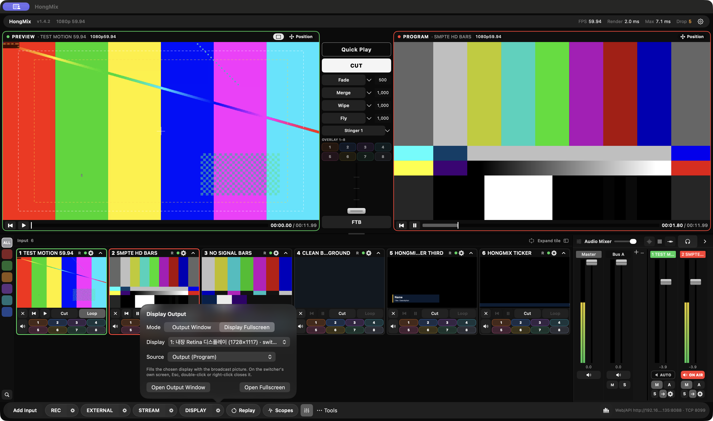<br><sub>별도 출력 창·디스플레이 채우기·소스 선택</sub></td>
  </tr>
  <tr>
    <td width="50%" align="center">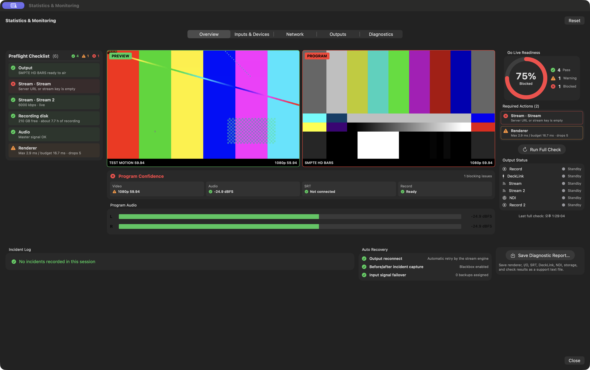<br><sub>독립된 Statistics &amp; Monitoring 창</sub></td>
    <td width="50%" align="center">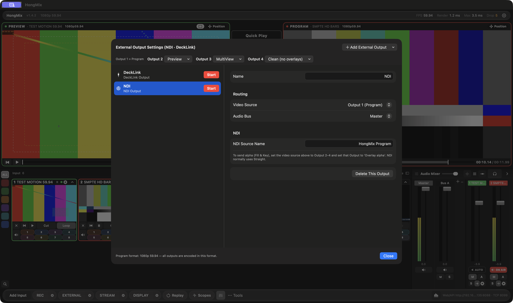<br><sub>NDI·DeckLink와 Output 2–4 라우팅</sub></td>
  </tr>
  <tr>
    <td colspan="2" align="center">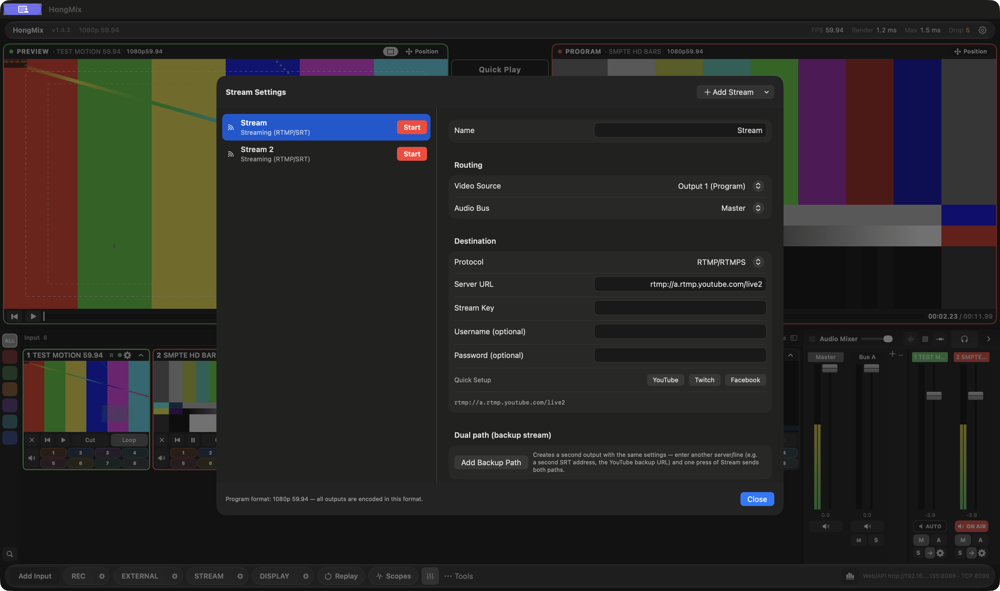<br><sub>분리된 RTMP/SRT 설정과 이중 백업 경로</sub></td>
  </tr>
</table>


---

## 이제 맥북이 스위처입니다.

"맥으로 라이브 방송 할 수 있어요?" 이 질문에 대한 답은 오랫동안 **"윈도우 PC 하나 사세요"**였습니다.

HongMix는 그 답을 바꾸려고 만든 프로그램입니다. Apple Silicon용으로 처음부터 새로 짠 라이브 프로덕션 스위처입니다.
- 화면은 Metal로 처리합니다.
- 인코딩은 VideoToolbox를 씁니다.
- 소리는 CoreAudio로 다룹니다.

윈도우 PC도, 가상머신도, Rosetta도 필요 없습니다.

뚜껑을 열고 카메라, SRT, NDI를 꽂으면 바로 온에어입니다.

- **프레임당 평균 1.5ms 렌더**: 1080p59.94에서 M 시리즈 맥 기준 **프레임 드롭 0**
- **설치 한 번으로 끝**: FFmpeg, SRT, NDI® 런타임, Chromium 웹 엔진이 설치 파일 하나에 다 들어 있습니다.
- **손에 익은 그대로**: vMix와 같은 화면 구성·단축키·HTTP/TCP API를 씁니다. 그래서 Companion이나 Stream Deck을 그대로 연결할 수 있습니다.

## 만든 이유

안녕하세요. 한국에서 조그맣게 방송 기술을 하고 있는 **홍승훈**입니다. 라이브 프로덕션과 SRT·LiveU 원격 송출, 그리고 그 뒤의 시스템을 다룹니다.

저는 맥을 사랑합니다. 그리고 **vMix**도 사랑합니다. vMix는 많은 방송인에게 라이브 프로덕션이 어떠해야 하는지 알려 준 프로그램입니다. HongMix는 vMix를 **레퍼런스로 삼아, 존경하는 마음으로** 만들었습니다. 화면 구성도, 운영 흐름도, API도 vMix를 기준으로 했습니다. 그 경험을 제가 매일 들고 다니는 맥에서도 누리고 싶었습니다.

팔려고 만든 프로그램이 아닙니다. "내 맥으로도 이게 됐으면…" 하고 한 번쯤 생각해 본 **전 세계의 방송 기술자들을 위해** 만들었습니다. 이제 여러분 손에 드립니다. 마음껏 써 보시고, 부숴 보시고, 의견을 들려주세요.

> 나는 방송을 사랑하고, 기술을 사랑합니다. 당신들의 의견을 존중합니다. — 홍승훈

<p align="center">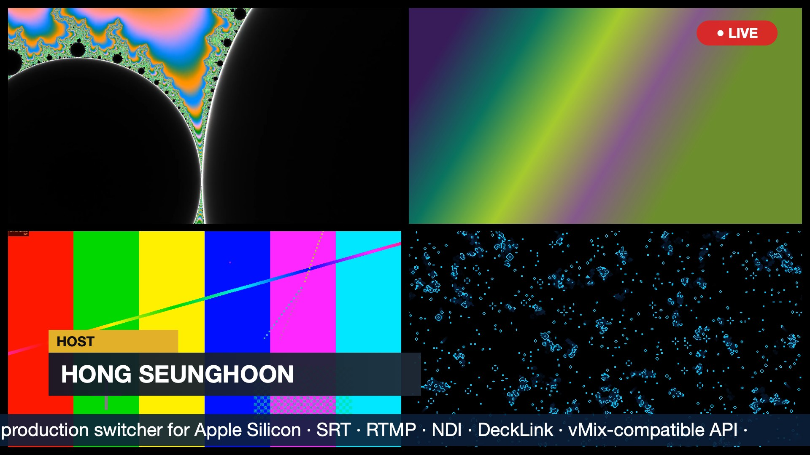<br><sub>프로그램 출력 (1080p59.94)</sub></p>

## 들어 있는 기능

| 구분 | 기능 |
|---|---|
| **입력** | 카메라·캡처카드(FaceTime, 아이폰 연속성 카메라, USB HDMI), **SRT**(리스너/콜러/랑데부), **RTMP** 수신 서버, URL/UDP/HLS, **NDI®**, **Blackmagic DeckLink**, 재생 바가 있는 미디어 파일, **리스트(플레이리스트) 입력**, 컬러/투명, 이미지, **자막 템플릿 24종**, 화면 캡처, **웹 브라우저**(Chromium, 소리 포함), 오디오 장치 |
| **스위칭** | Cut, 전환 4슬롯, T‑바, 스팅어, 오버레이 4채널, FTB, **트리거**, **런다운(큐시트)**, 스케줄러 |
| **화면** | Metal GPU 합성, **레이어**(2·4·9·16분할, PIP, 마우스로 위치 조정), 색보정, 크로마키, **3D LUT(.cube)**, **스코프**(웨이브폼·RGB 퍼레이드·벡터스코프·히스토그램) |
| **오디오** | 마스터 + 버스 A~G, EQ·컴프·게이트·딜레이, **자동 더킹**, EBU R128 **LUFS** 미터, 헤드폰 모니터 |
| **출력** | RTMP·SRT 송출(**이중 경로**, **리턴 피드**), 녹화(H.264·HEVC·ProRes, **멀티트랙 오디오**), **방송 딜레이 + DUMP**, MultiCorder(입력별 녹화), NDI 출력, DeckLink 출력, 풀스크린 |
| **운영 도구** | 송출 전 점검, SRT 상황판, 사고 기록(블랙박스), 실시간 자막(CC), 온에어 시 자동 시작하는 카운트다운 |
| **제어** | vMix 호환 HTTP 8088 / TCP 8099 API, 휴대폰 탤리, 웹 리모트, **접근 제어**(IP 제한·비밀번호) |
| **언어** | 한국어 / English (설정에서 바로 전환) |

## 지금까지 확인된 것

Apple Silicon 맥에서 동작을 확인했습니다.
- SRT 입력·송출
- RTMP 입력·송출
- NDI® 송수신(NDI 6)
- 맥 내장 FaceTime 카메라, 아이폰 카메라 인식
- **USB HDMI 캡처카드(하기비전)** 인식
- **Blackmagic DeckLink:** SDK 빌드 연동과 입출력 설정 구현, 실제 장비 검증 전
- 웹 브라우저 입력(소리 포함)
- 미디어·리스트 재생
- H.264 녹화와 멀티트랙 오디오
- 레이어, LUT
- 방송 딜레이
- vMix 호환 API(Companion 방식 연결)

**테스트를 부탁드립니다.** 아직 베타이고, 제 책상 위에 있는 장비로만 시험할 수 있었습니다. 특히 이런 환경에서 써 보시고 알려 주세요.
- 갖고 계신 캡처카드와 카메라
- 현장의 SRT / RTMP / NDI 연결(LiveU, OBS, 다른 스위처 등)
- Companion / Stream Deck 연결
- 몇 시간 이상 이어지는 방송
- 다른 맥 모델

"M2 Air + 엘가토에서 잘 됨" 같은 짧은 제보도 큰 도움이 됩니다. → **[의견 남기기 (Issues)](https://github.com/HongMix/HongMix/issues/new/choose)**

## 자주 묻는 질문

**윈도우에서 vMix를 쓰는데, 맥에서도 같은 방식으로 할 수 있나요?**
HongMix는 vMix의 화면 구성과 API를 존경하는 마음으로 참고했습니다. 그래서 맥에서도 손에 익은 흐름 그대로 운영할 수 있습니다. vMix를 대체하려는 게 아니라, 맥북밖에 없는 순간을 위한 프로그램입니다. vMix는 훌륭한 프로그램입니다.

**맥북에서 쓸 수 있는 무료 라이브 스위처, SRT·NDI 되는 거 없나요?**
HongMix가 바로 그겁니다.
- SRT 리스너/콜러 입·출력(링크 통계 포함)
- NDI® 입·출력
- RTMP 입·출력
- 녹화
- 이 모든 게 무료 설치 파일 하나에 들어 있습니다.

**Companion · Stream Deck 연결되나요?**
됩니다. vMix HTTP(8088)/TCP(8099) API를 그대로 지원합니다. Companion의 vMix 모듈에서 IP만 이 맥으로 바꾸면 연결됩니다.

**LiveU·SRT 피드, 캡처카드, DeckLink, 아이폰 카메라도 되나요?**
- SRT 피드(LiveU 등): 콜러·리스너로 연결됩니다.
- Blackmagic DeckLink: SDK 연동과 입출력 설정은 구현됐으며 실제 장비 검증 전입니다.
- USB HDMI 캡처카드: 표준(UVC) 캡처카드는 카메라처럼 잡힙니다. 하기비전 캡처카드로 확인했고, 엘가토·매그웰 등도 같은 방식이라 될 것으로 보입니다(제보 부탁드립니다).
- 아이폰: 연속성 카메라로 바로 쓸 수 있습니다.

**OBS랑 뭐가 달라요?**
OBS는 훌륭한 송출 프로그램입니다. HongMix는 vMix 계열의 프로덕션 스위처입니다. Preview/Program, 전환, 오버레이, 멀티 버스 오디오, 자막, 제어 API 중심이라 쓰는 방식이 다릅니다.

**어떤 맥에서 되나요?** macOS 14 이상의 Apple Silicon 맥(M1 이후 전 모델)입니다. 인텔 맥은 지원하지 않습니다.

## 설치

1. [Releases](https://github.com/HongMix/HongMix/releases/latest)에서 최신 **HongMix DMG 또는 PKG**를 받습니다. macOS 14 이상, Apple Silicon 맥이 필요합니다.
2. 더블클릭해서 설치합니다.
3. 처음 열 때만 응용 프로그램 폴더에서 HongMix를 우클릭 → **열기** → **열기** 하세요. 아직 Apple 공증을 받지 않은 앱이라 macOS가 한 번 확인합니다.

설명서: `docs/HongMix-설명서.txt` (한국어) · `docs/HongMix-Manual-EN.txt` (English)

## macOS 권한

각 기능을 처음 쓸 때 macOS가 허용을 묻습니다 (시스템 설정 › 개인정보 보호 및 보안):

| 기능 | 권한 |
|---|---|
| Desktop Capture 입력, 시스템 오디오 | **화면 및 시스템 오디오 녹음** |
| 카메라 / 캡처 카드 입력 | 카메라 |
| Audio Input (마이크, 오디오 인터페이스) | 마이크 |
| NDI 검색, 원격 제어 | 로컬 네트워크 |

권한을 켠 뒤에는 **HongMix를 종료했다가 다시 실행**하세요. 화면 녹음 권한은 앱을 다시 켤 때 적용됩니다.

**HongMix를 켜 두었는데도 Desktop Capture에 "Screen Recording permission needed"가 나오나요?**
macOS는 권한을 앱의 서명에 기록합니다. 배포판은 아직 공증 없이 임시(ad-hoc) 서명이라, 업데이트 후 macOS가 HongMix를
새 앱으로 볼 수 있습니다. 설정 화면에는 예전 "HongMix"가 켜진 것처럼 보입니다. 업데이트 후 한 번 이렇게 하세요:

1. HongMix를 종료합니다.
2. 터미널에서: `tccutil reset ScreenCapture com.hongseunghoon.HongMix` (HongMix 항목만 지웁니다)
3. HongMix를 열고 **Desktop Capture**를 추가 → **시스템 설정 열기** → HongMix를 켭니다.
4. HongMix를 종료했다가 다시 실행합니다.

## 소스로 빌드하기

```bash
xcode-select --install                 # Command Line Tools (Xcode 없어도 됨)
./scripts/build-ffmpeg-lgpl.sh         # LGPL FFmpeg → build/ffmpeg-lgpl (한 번만)
./scripts/build-cli.sh                 # → build/cli/HongMix.app
./scripts/make-dmg.sh                  # → build/dist/HongMix-<버전>.dmg / .pkg
```

`make-dmg.sh`는 기본으로 ad-hoc 서명합니다. 내 맥에서 빌드할 때마다 권한을 유지하려면 코드 서명 인증서를 만들어
키체인 접근에서 *코드 서명: 항상 신뢰*로 지정한 뒤 `SIGN_ID="<인증서 이름>"`으로 빌드하세요.
직접 만든 인증서로 공개 배포하지는 마세요. 그 인증서를 신뢰하지 않는 맥에서는 화면 녹음 권한이 적용되지 않습니다.

선택 SDK (저장소에 포함하지 않음):
- [NDI SDK for Apple](https://ndi.video/for-developers/ndi-sdk/): 설치할 때 라이선스에 직접 동의해야 합니다.
- Blackmagic DeckLink SDK: `ThirdParty/DeckLinkSDK/README.md`를 따라 하세요.
- 웹 브라우저 입력용 CEF: `scripts/fetch-cef.sh`

## 원격 제어 보안

원격 제어는 **기본으로 꺼집니다.** Companion·Stream Deck·웹 리모트를 쓸 때 **설정 › 네트워크 › 원격 제어**에서 켜세요. 켠 뒤 보안 설정에서 HTTP 8088 / TCP 8099의 범위를 정할 수 있습니다.
- 허용 범위: 같은 네트워크 / 이 맥에서만
- 허용할 IP 목록
- 웹·HTTP 비밀번호

다른 웹사이트가 브라우저를 통해 보내는 명령은 항상 차단됩니다.

## 의견 보내기

버그, 아이디어, "이건 불편해요", "덕분에 방송 살렸어요", 무엇이든 **[Issues](https://github.com/HongMix/HongMix/issues)**에 남겨 주세요. 메일 주소는 스팸 방지를 위해 공개하지 않습니다.

## 라이선스와 고지

- 서드파티 고지: [`docs/THIRD-PARTY-NOTICES.txt`](docs/THIRD-PARTY-NOTICES.txt)
- FFmpeg는 GPL 부품 없는 **LGPL v3**로 빌드해 동적 링크합니다.
- NDI®는 Vizrt NDI AB의 등록 상표입니다. HongMix는 NDI의 제품이 아닙니다.
- DeckLink는 Blackmagic Design Pty Ltd의 상표입니다.
- vMix는 StudioCoast Pty Ltd의 상표입니다. HongMix는 vMix를 존경하는 마음으로 만든 독립 프로젝트로, StudioCoast와 관계가 없으며 승인이나 후원을 받지 않았습니다. vMix의 코드나 자산은 사용하지 않았습니다.
