<p align="center">
  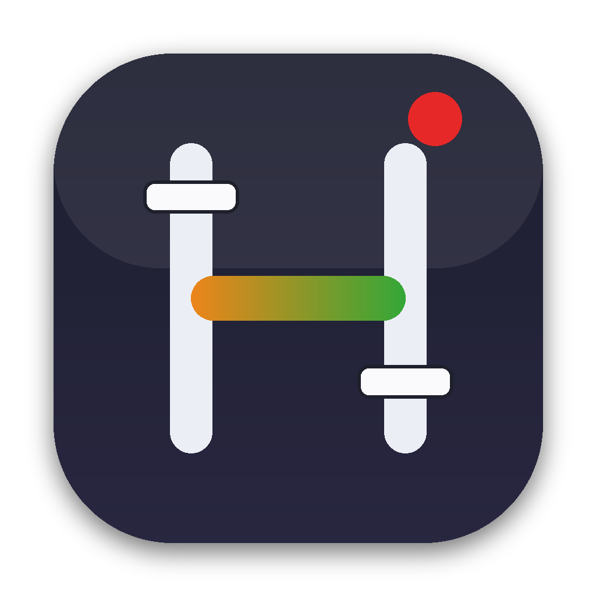
</p>

<h1 align="center">HongMix</h1>

<p align="center">
  <b>A free live streaming &amp; broadcast switcher for Mac. Native on every Apple Silicon Mac (M1 and later). No Windows box required.</b><br>
  vMix-style layout · vMix-compatible API · SRT · RTMP · NDI® · DeckLink
</p>

<p align="center">
  <a href="https://github.com/HongMix/HongMix/releases/latest"><b>⬇️ Download HongMix 2.1.4</b></a>
  &nbsp;·&nbsp; <a href="README.ko.md">한국어</a>
  &nbsp;·&nbsp; <a href="https://github.com/HongMix/HongMix/issues">Feedback</a>
</p>

> **If macOS shows “Move to Trash” or “Cancel” on first launch:** open **System Settings › Privacy & Security**, scroll down and click **Open Anyway**. Advanced users can instead run `xattr -dr com.apple.quarantine /Applications/HongMix.app`. HongMix is ad-hoc signed and not yet notarized.

### Latest update · 2.1.4
- **Remote control is now off by default.** Companion, Stream Deck and web-remote users should turn it on once in Settings › Network after updating.
- Right-click an input to create a Virtual Input with its own position, crop and layers, without opening a second decoder.
- Crop individual layers in the Layers editor with Move/Crop modes, canvas handles and per-edge sliders.
- Input Settings now shows crop and position live; double-clicking an input opens its settings.
- Choose 6, 15 or 30 fps for input thumbnails. Program, recording and outputs always remain full rate.
- ⌘W safely closes tool windows and sheets, while the switcher and Display output stay open.
- Korean and English UI coverage, display-lag alerts, recent renderer health and audio-underrun diagnostics were improved. See the [English release notes](docs/RELEASE-NOTES-2.1.4.md) or [한국어 릴리스 노트](docs/RELEASE-NOTES-2.1.4.ko.md).

<table>
  <tr>
    <td width="50%" align="center">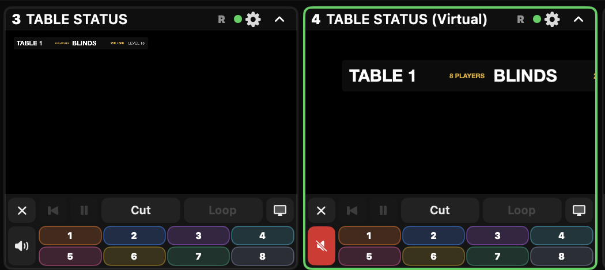<br><sub>Virtual Input without a second decoder</sub></td>
    <td width="50%" align="center">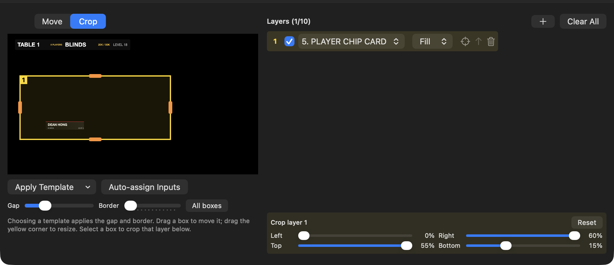<br><sub>Move/Crop modes and per-layer crop controls</sub></td>
  </tr>
  <tr>
    <td width="50%" align="center">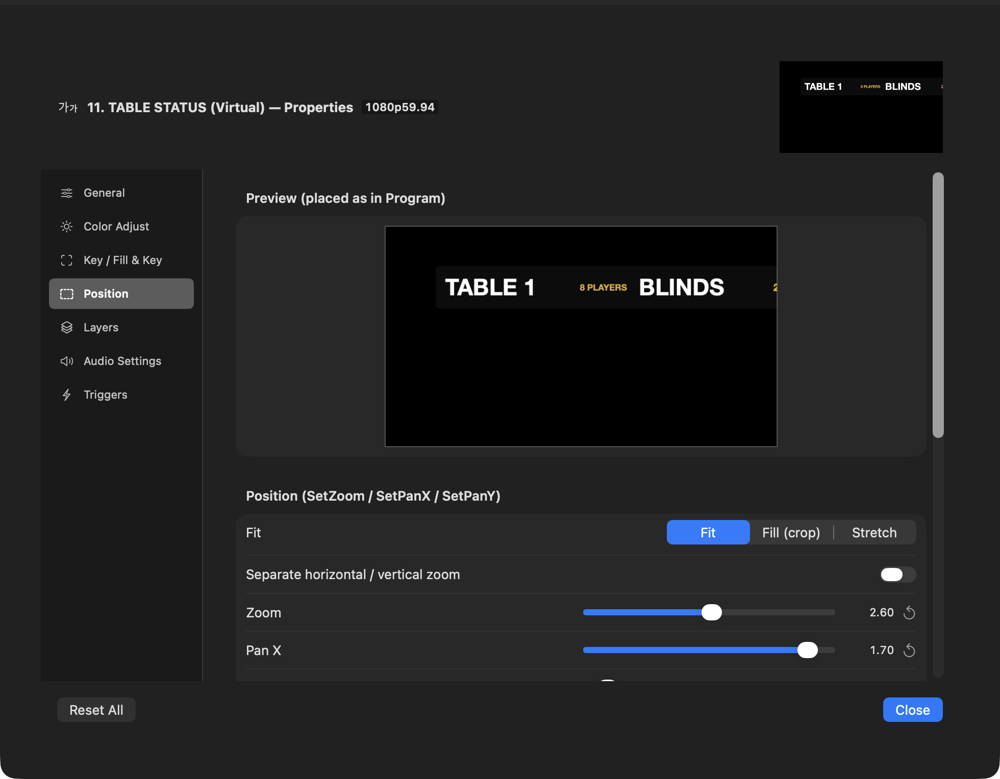<br><sub>Crop and position shown live in Input Settings</sub></td>
    <td width="50%" align="center">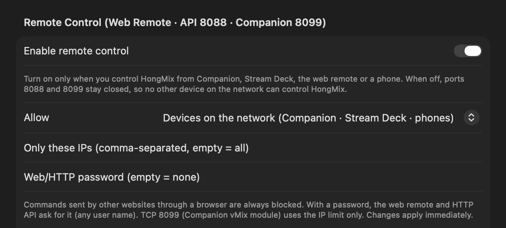<br><sub>Remote control switch, off by default</sub></td>
  </tr>
</table>

<details>
<summary>More HongMix interface screenshots</summary>

<table>
  <tr>
    <td width="50%" align="center">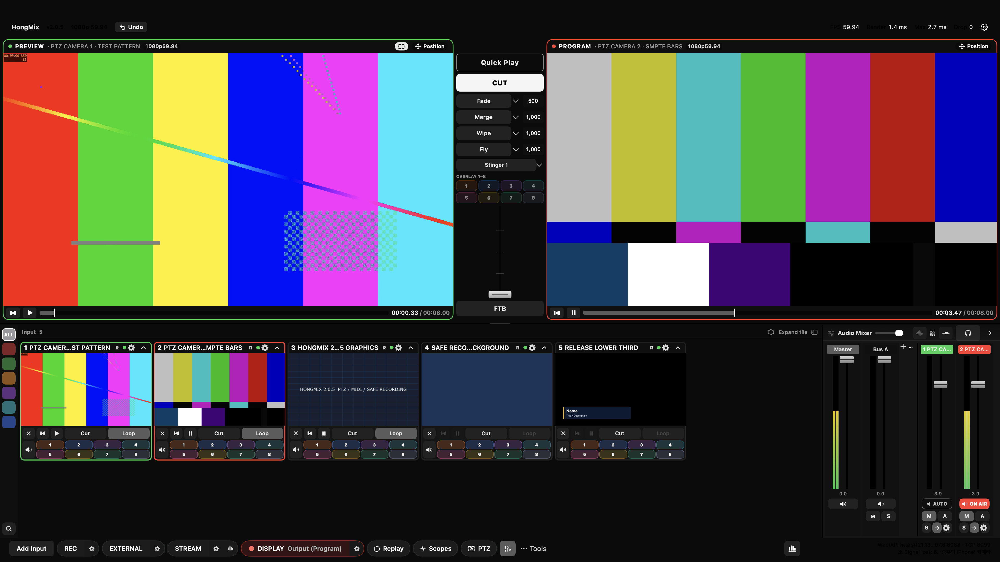<br><sub>Main switcher · generated test patterns</sub></td>
    <td width="50%" align="center">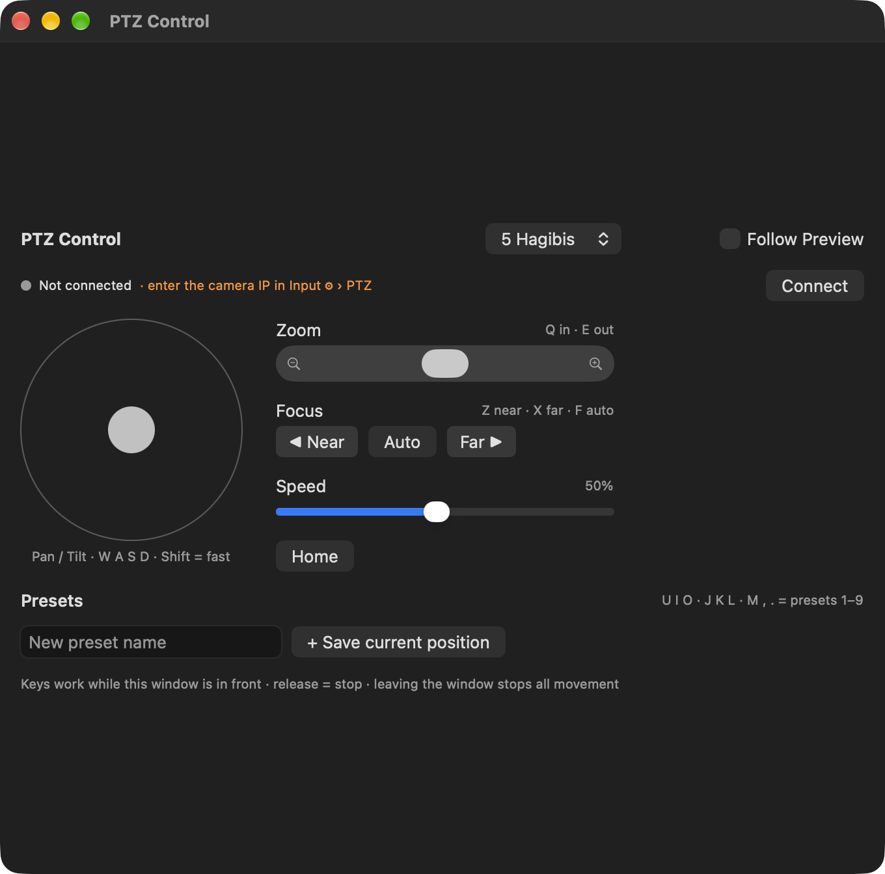<br><sub>Independent multi-camera PTZ control</sub></td>
  </tr>
  <tr>
    <td width="50%" align="center">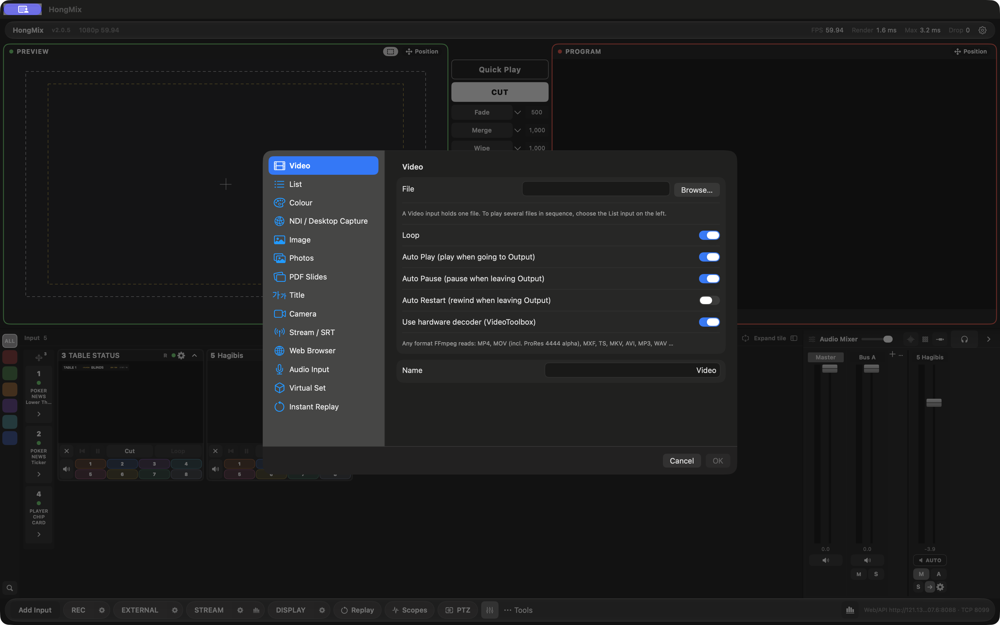<br><sub>Photos, PDF Slides and Virtual Set inputs</sub></td>
    <td width="50%" align="center">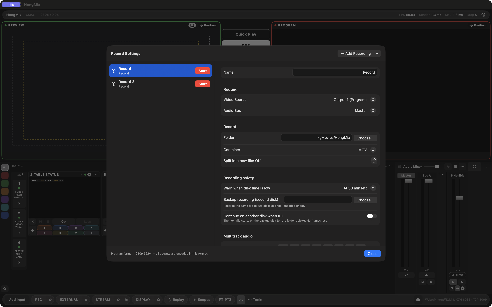<br><sub>Backup recording and disk rollover</sub></td>
  </tr>
  <tr>
    <td width="50%" align="center">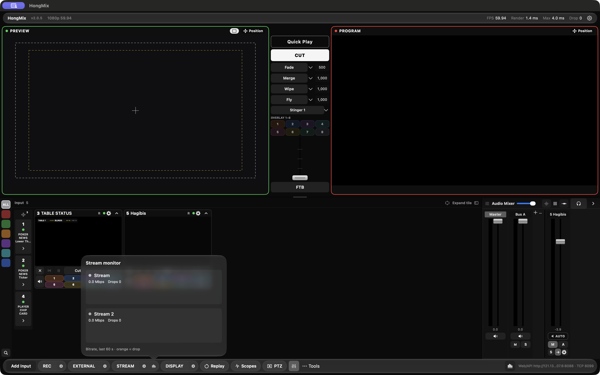<br><sub>Per-destination stream health</sub></td>
    <td width="50%" align="center">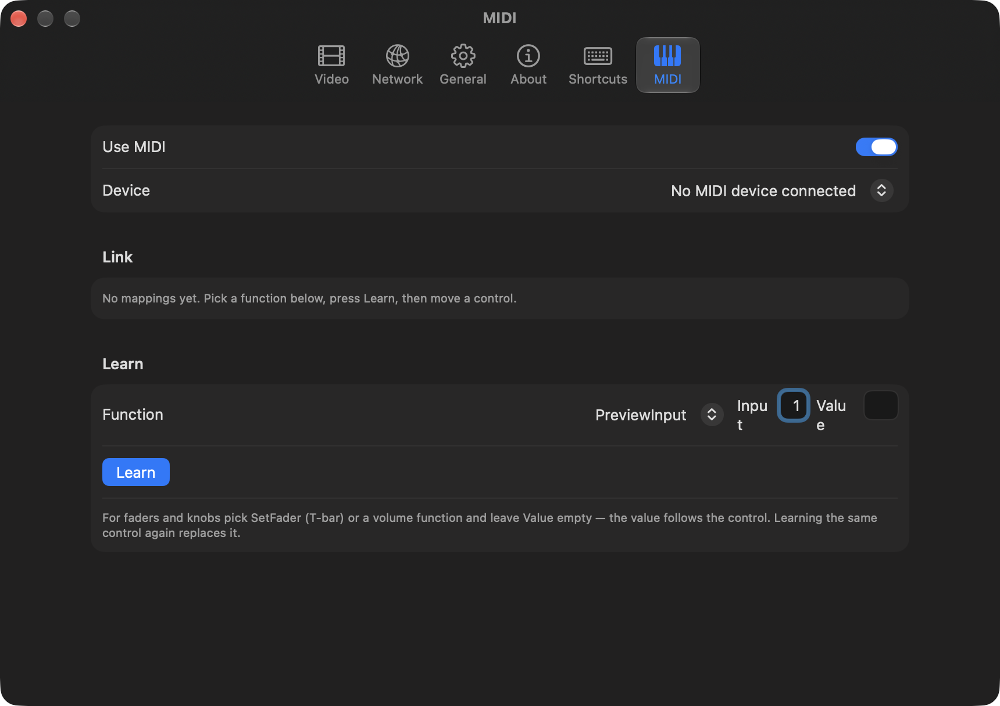<br><sub>MIDI learn, templates and LED tally</sub></td>
  </tr>
</table>

</details>

### 1.4.2
- **Display output fixed for macOS Spaces:** Output Window and borderless Display Fullscreen stay on the active desktop. The green button fills the current display without creating a stranded black full-screen Space; Esc, double-click or right-click returns to a window.
- **Focused output settings:** Record, External (NDI / DeckLink) and Stream each have their own settings window. External also routes Output 2–4; Stream includes dual-path backup controls.
- **Monochrome operator skin:** a restrained black-and-white skin uses colour only for Preview, Program, ON AIR and warnings. The original skin remains available in Settings.
- **Monitoring workflow:** Display settings, Replay and Scopes are now direct bottom-bar controls. Statistics & Monitoring runs in an independent movable window.
- **Validated:** the display regression suite passed 16/16 steps in both normal and macOS full-screen switcher states. Multi-display hardware testing is still pending.
- Public screenshots use generated test patterns only—no people, third-party programme footage or stream keys. See the [English release notes](docs/RELEASE-NOTES-1.4.2.md) or [한국어 릴리스 노트](docs/RELEASE-NOTES-1.4.2.ko.md).

<table>
  <tr>
    <td width="50%" align="center">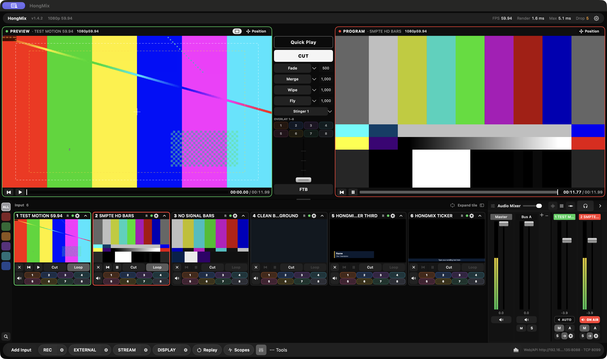<br><sub>Monochrome switcher · generated 59.94p test patterns</sub></td>
    <td width="50%" align="center">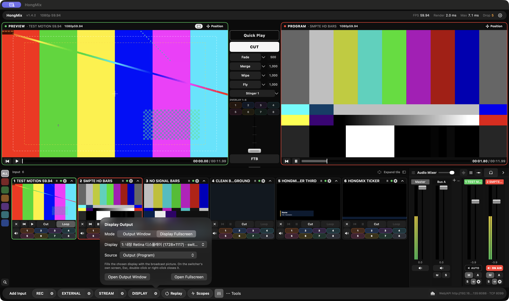<br><sub>Output Window / Display Fullscreen and source selection</sub></td>
  </tr>
  <tr>
    <td width="50%" align="center">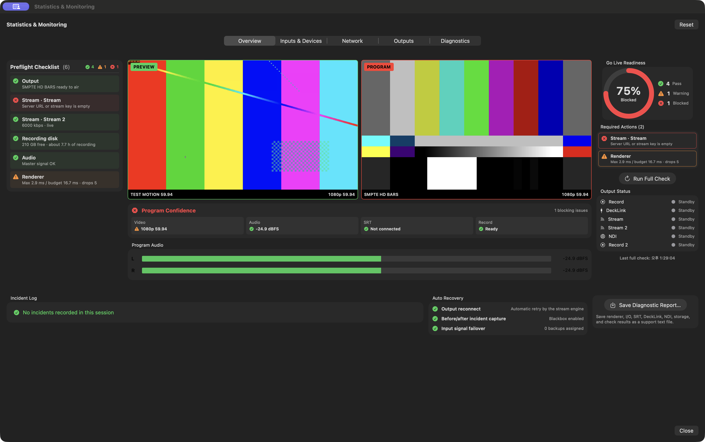<br><sub>Independent Statistics &amp; Monitoring window</sub></td>
    <td width="50%" align="center">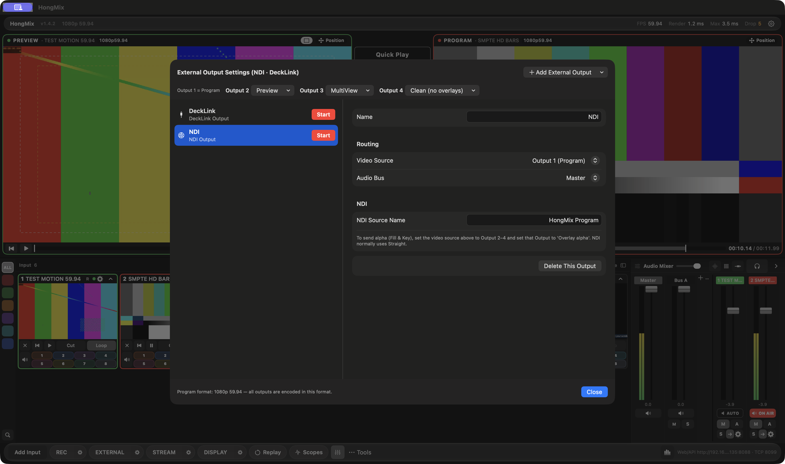<br><sub>NDI / DeckLink and Output 2–4 routing</sub></td>
  </tr>
  <tr>
    <td colspan="2" align="center">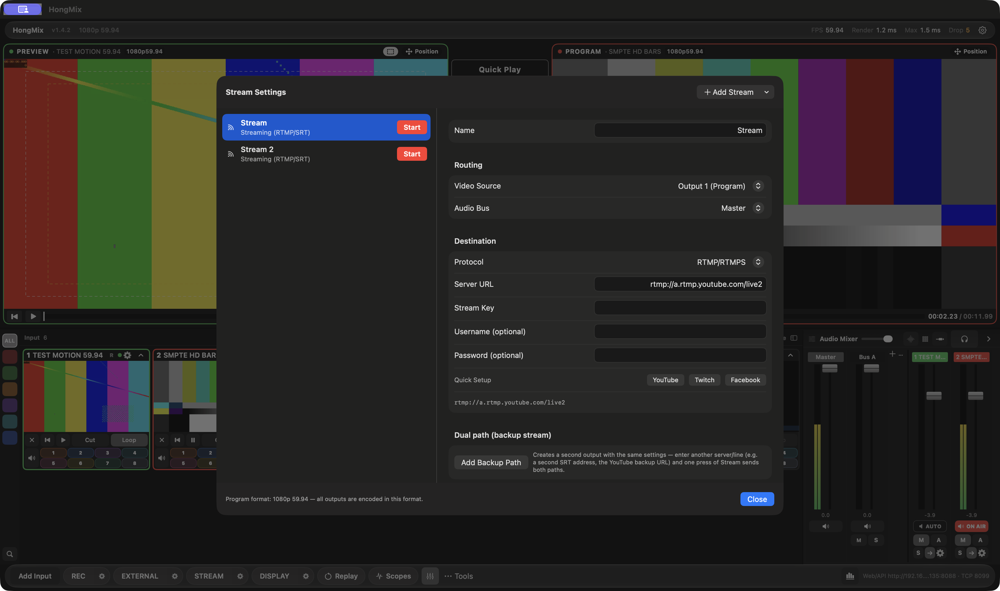<br><sub>Dedicated RTMP/SRT settings and dual-path backup stream</sub></td>
  </tr>
</table>


---

## Your MacBook is now a switcher.

For years, the answer to "can I run my live show on a Mac?" was **"get a Windows PC."**

HongMix changes that. It is a live production switcher written from scratch for Apple Silicon:
- Metal for the picture
- VideoToolbox for encoding
- CoreAudio for the sound

No Windows PC. No virtual machine. No Rosetta.

Open the lid. Plug in your camera, your SRT feed and your NDI sources. Go live.

- **1.5 ms** average render per frame at 1080p59.94, **0 dropped frames** on an M‑series Mac
- **Zero setup:** FFmpeg, SRT, the NDI® runtime and a Chromium web engine are all inside one installer
- **Your muscle memory still works:** the layout, the shortcuts and the HTTP/TCP API follow vMix, so Bitfocus Companion and Stream Deck connect as they are

## Why I built this

Hi, I'm **Hong Seunghoon (홍승훈)**, a broadcast engineer from Korea. I work on live productions, SRT/LiveU remote contribution and the systems behind them.

I love the Mac. And I love **vMix**. For many of us it's the tool that taught us how live production should feel. HongMix is built with deep respect for it: vMix was my reference for the layout, the workflow and the API. I wanted that same experience on the machine I carry every day.

I didn't build this to sell anything. I built it **for broadcast engineers around the world** who have wished, at least once, that their Mac could do the job. Now it's in your hands. Please break it, push it, and tell me what you think.

> I love broadcasting, and I love technology. I respect your opinions. — Hong Seunghoon

<p align="center">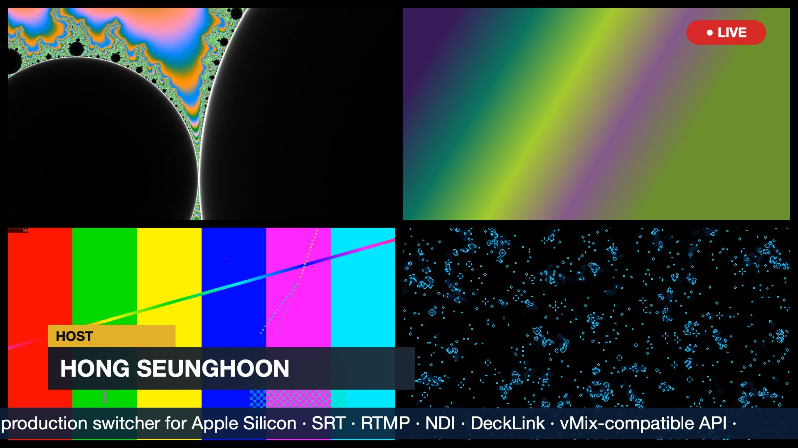<br><sub>Program output (1080p59.94)</sub></p>

## What's inside

| Area | Features |
|---|---|
| **Inputs** | Cameras & capture cards (FaceTime, iPhone Continuity, USB HDMI), **SRT** listener/caller/rendezvous, **RTMP** server, URL/UDP/HLS, **NDI®**, **Blackmagic DeckLink**, media files with transport bar, **list (playlist) input**, colour/transparent, images, 24 **title templates**, screen capture, **web browser** (Chromium, with audio), audio devices |
| **Switching** | Cut, 4 transition slots, T‑bar, stingers, 4 overlay channels, FTB, **triggers**, **rundown (cue sheet)**, scheduler |
| **Picture** | Metal GPU compositing, **layers** (2/4/9/16‑split, PIP) with drag‑to‑position, colour correction, chroma key, **3D LUTs (.cube)**, **scopes** (waveform, RGB parade, vectorscope, histogram) |
| **Audio** | Master + buses A–G, EQ / compressor / gate / delay, **auto ducking**, EBU R128 **LUFS** meter, headphone monitor |
| **Output** | RTMP / SRT streaming with **dual path** and **return feed**, recording (H.264 / HEVC / ProRes) with **multitrack audio**, **broadcast delay + DUMP**, MultiCorder ISO recording, NDI out, DeckLink out, fullscreen |
| **Ops tools** | Pre‑flight check, SRT link dashboard, incident blackbox, live captions (CC), countdown titles that start on air |
| **Control** | vMix‑compatible HTTP 8088 / TCP 8099 API, phone tally, web remote, **access control** (IP allow list, password) |
| **Language** | English / 한국어, switchable live |

## Tested so far

Confirmed working on Apple Silicon:
- SRT in/out
- RTMP in/out
- NDI® send/receive (NDI 6)
- Built-in FaceTime camera, iPhone camera and a low-cost **USB HDMI capture card** are detected
- **Blackmagic DeckLink:** SDK build integration and input/output configuration are implemented; physical hardware validation is pending
- Web browser input with audio
- Media and list playback
- H.264 recording with multitrack audio
- Layers and LUTs
- Broadcast delay
- vMix-compatible API with Companion-style clients

**Please help test.** It's a beta, and I can only test what's on my desk:
- Your capture cards and cameras
- Real-world SRT / RTMP / NDI links (LiveU, OBS, other switchers)
- Companion / Stream Deck
- Multi‑hour shows
- Other Mac models

"It works on my M2 Air with an Elgato" is a great report too. → **[Open an issue](https://github.com/HongMix/HongMix/issues/new/choose)**

## FAQ

**I use vMix on Windows. Can I work the same way on a Mac?**
HongMix borrows vMix's layout and API with deep respect, so the workflow feels familiar on a Mac. It isn't meant to replace vMix, which is an excellent product. It's for the times when all you have is a MacBook.

**Is there a free live switcher for MacBook with SRT and NDI?**
Yes, that's exactly what HongMix is:
- SRT listener/caller in and out, with link stats
- NDI® in/out
- RTMP in/out
- Recording
- All in one free installer

**Does it work with Bitfocus Companion and Stream Deck?**
Yes. HongMix speaks the vMix HTTP (8088) and TCP (8099) API, so the Companion vMix module connects by pointing it at your Mac's IP.

**Can I use LiveU / SRT feeds, capture cards, DeckLink or an iPhone as a camera?**
- SRT feeds (e.g. LiveU): connect as caller or listener.
- Blackmagic DeckLink: SDK integration and input/output configuration are implemented; physical hardware validation is pending.
- USB HDMI capture cards: standard (UVC) cards show up as cameras. A low-cost USB card has been confirmed; Elgato, Magewell and others should work the same way, and reports are welcome.
- iPhone: works via Continuity Camera.

**Is it OBS?**
No. OBS is a great streaming encoder. HongMix is a production switcher in the vMix tradition: Preview/Program, transitions, overlays, multi-bus audio, titles and a control API.

**Which Macs?** Any Apple Silicon Mac on macOS 14 or later. Intel Macs are not supported.

## Install

1. Download the latest **HongMix DMG or PKG** from [Releases](https://github.com/HongMix/HongMix/releases/latest). Requires macOS 14+ and an Apple Silicon Mac.
2. Double‑click it and install.
3. The first time you open HongMix, right‑click it in Applications → **Open** → **Open**. It isn't notarized by Apple yet, so macOS asks once.

Manuals: `docs/HongMix-Manual-EN.txt` (English) · `docs/HongMix-설명서.txt` (Korean)

## macOS permissions

HongMix asks macOS the first time you use each feature (System Settings › Privacy & Security):

| Feature | Permission |
|---|---|
| Desktop Capture input, system audio | **Screen & System Audio Recording** |
| Camera / capture-card input | Camera |
| Audio Input (microphone, interface) | Microphone |
| NDI discovery, remote control | Local Network |

After switching a permission on, **quit and reopen HongMix**; macOS applies screen recording only when an app starts.

**Desktop Capture says "Screen Recording permission needed" although HongMix is switched on?**
macOS ties the permission to the app's signature. Releases are ad-hoc signed (not notarised yet), so after an update
macOS may treat HongMix as a new app while System Settings still shows the old "HongMix" switched on. Fix it once per update:

1. Quit HongMix.
2. In Terminal: `tccutil reset ScreenCapture com.hongseunghoon.HongMix` (clears HongMix's entry only).
3. Open HongMix, add **Desktop Capture**, choose **Open System Settings** and switch HongMix on.
4. Quit and reopen HongMix.

## Build from source

```bash
xcode-select --install                 # Command Line Tools (Xcode not required)
./scripts/build-ffmpeg-lgpl.sh         # LGPL FFmpeg → build/ffmpeg-lgpl (once)
./scripts/build-cli.sh                 # → build/cli/HongMix.app
./scripts/make-dmg.sh                  # → build/dist/HongMix-<version>.dmg / .pkg
```

`make-dmg.sh` signs ad-hoc by default. To keep macOS permissions across your own local builds, create a code-signing
certificate, set it to *Always Trust for code signing* in Keychain Access and build with `SIGN_ID="<certificate name>"`.
Don't use a self-signed certificate for public releases: Macs that don't trust it won't apply Screen Recording permission.

Optional SDKs (not included in this repository):
- [NDI SDK for Apple](https://ndi.video/for-developers/ndi-sdk/): accept its license yourself
- Blackmagic DeckLink SDK: see `ThirdParty/DeckLinkSDK/README.md`
- CEF for the web browser input: `scripts/fetch-cef.sh`

## Remote control & security

Remote control is **off by default**. Enable it in **Settings › Network › Remote Control** if you use Companion, Stream Deck or the web remote. When enabled, use its security settings to limit HTTP 8088 / TCP 8099:
- Network / this Mac only
- IP allow list
- Web/HTTP password

Cross‑site requests from other websites in a browser are always blocked.

## Feedback

Bugs, ideas, "this is awkward", "this saved my show": everything is welcome in **[Issues](https://github.com/HongMix/HongMix/issues)**. My e‑mail isn't published here to avoid spam.

## License & notices

- Third‑party components: [`docs/THIRD-PARTY-NOTICES.txt`](docs/THIRD-PARTY-NOTICES.txt)
- FFmpeg is built as **LGPL v3** (no GPL parts) and dynamically linked.
- NDI® is a registered trademark of Vizrt NDI AB. HongMix is not a product of NDI.
- DeckLink is a trademark of Blackmagic Design Pty Ltd.
- vMix is a trademark of StudioCoast Pty Ltd. HongMix is an independent project, made out of respect for vMix, and is not affiliated with or endorsed by StudioCoast. No vMix code or assets are used.
