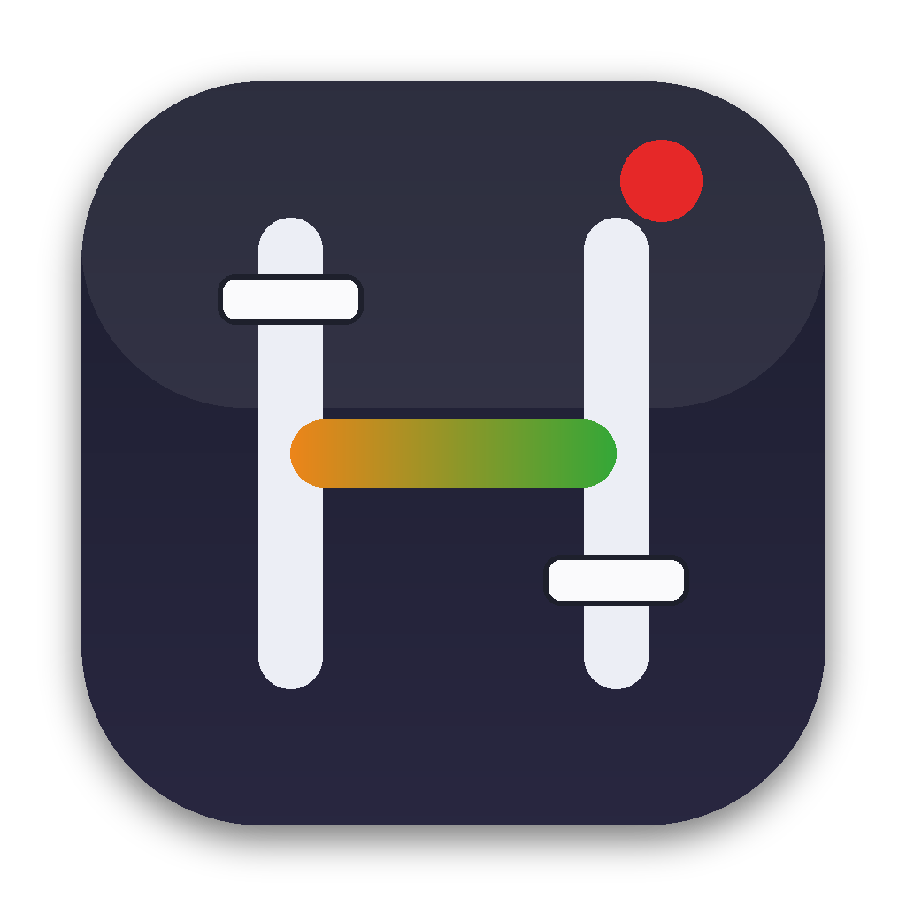
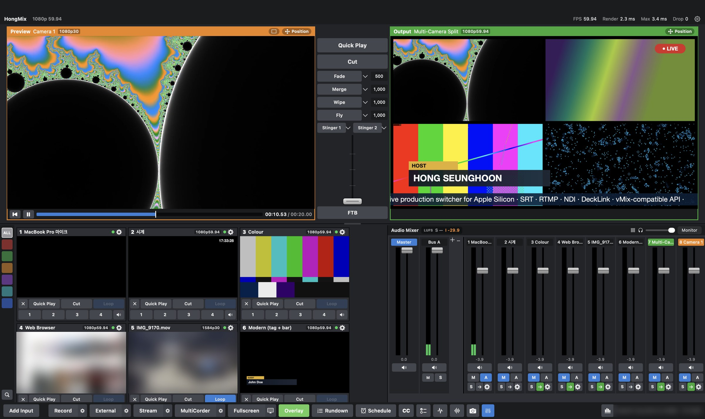
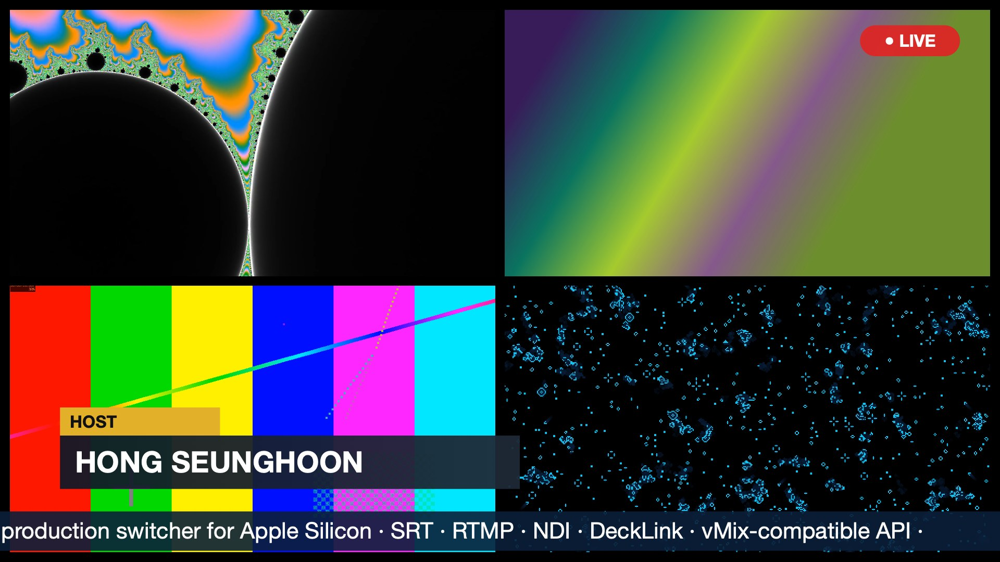

<p align="center">
  
</p>

<h1 align="center">HongMix</h1>

<p align="center">
  <b>The free vMix alternative for Mac. A full live production &amp; streaming switcher, native on Apple Silicon (M1–M4). No Windows box required.</b><br>
  vMix-style layout · vMix-compatible API · SRT · RTMP · NDI® · DeckLink
</p>

<p align="center">
  <a href="https://github.com/HongMix/HongMix/releases/latest"><b>⬇️ Download HongMix 1.2 (beta)</b></a>
  &nbsp;·&nbsp; <a href="README.ko.md">한국어</a>
  &nbsp;·&nbsp; <a href="https://github.com/HongMix/HongMix/issues">Feedback</a>
</p>


<p align="center">
  
</p>
<p align="center"><sub>HongMix main window: multi-camera split with lower third, LIVE bug and ticker on air</sub></p>

---

## Your MacBook is now a switcher.

For years, the answer to "can I run my live show on a Mac?" was **"get a Windows PC."**

HongMix changes that. It is a live production switcher written from scratch for Apple Silicon:
- Metal for the picture
- VideoToolbox for encoding
- CoreAudio for the sound

No Boot Camp. No virtual machine. No Rosetta.

Open the lid. Plug in your camera, your SRT feed and your NDI sources. Go live.

- **1.5 ms** average render per frame at 1080p59.94, **0 dropped frames** on an M‑series Mac
- **Zero setup:** FFmpeg, SRT, the NDI® runtime and a Chromium web engine are all inside one installer
- **Your muscle memory still works:** the layout, the shortcuts and the HTTP/TCP API follow vMix, so Bitfocus Companion and Stream Deck connect as they are

## Why I built this

Hi, I'm **Hong Seunghoon (홍승훈)**, a broadcast engineer from Korea. I work on live productions, SRT/LiveU remote contribution and the systems behind them.

I love the Mac. And I love **vMix**. For many of us it's the tool that taught us how live production should feel. HongMix is built with deep respect for it: vMix was my reference for the layout, the workflow and the API. I wanted that same experience on the machine I carry every day.

I didn't build this to sell anything. I built it **for broadcast engineers around the world** who have wished, at least once, that their Mac could do the job. Now it's in your hands. Please break it, push it, and tell me what you think.

> I love broadcasting, and I love technology. I respect your opinions. — Hong Seunghoon

<p align="center"><br><sub>Program output (1080p59.94)</sub></p>

## What's inside

| Area | Features |
|---|---|
| **Inputs** | Cameras & capture cards (FaceTime, iPhone Continuity, USB HDMI), **SRT** listener/caller/rendezvous, **RTMP** server, URL/UDP/HLS, **NDI®**, **Blackmagic DeckLink**, media files with transport bar, **list (playlist) input**, colour/transparent, images, 24 **title templates**, screen capture, **web browser** (Chromium, with audio), audio devices |
| **Switching** | Cut, 4 transition slots, T‑bar, stingers, 4 overlay channels, FTB, **triggers**, **rundown (cue sheet)**, scheduler |
| **Picture** | Metal GPU compositing, **layers** (2/4/9/16‑split, PIP) with drag‑to‑position, colour correction, chroma key, **3D LUTs (.cube)**, **scopes** (waveform, RGB parade, vectorscope, histogram) |
| **Audio** | Master + buses A–G, EQ / compressor / gate / delay, **auto ducking**, EBU R128 **LUFS** meter, headphone monitor |
| **Output** | RTMP / SRT streaming with **dual path** and **return feed**, recording (H.264 / HEVC / ProRes) with **multitrack audio**, **broadcast delay + DUMP**, MultiCorder ISO recording, NDI out, DeckLink out, fullscreen |
| **Ops tools** | Pre‑flight check, SRT link dashboard, incident blackbox, live captions (CC), countdown titles that start on air |
| **Control** | vMix‑compatible HTTP 8088 / TCP 8099 API, phone tally, web remote, **access control** (IP allow list, password) |
| **Language** | English / 한국어, switchable live |

## Tested so far

Confirmed working on Apple Silicon:
- SRT in/out
- RTMP in/out
- NDI® send/receive (NDI 6)
- Built-in FaceTime camera, iPhone camera, **Blackmagic DeckLink** and a low-cost **USB HDMI capture card** are detected
- Web browser input with audio
- Media and list playback
- H.264 recording with multitrack audio
- Layers and LUTs
- Broadcast delay
- vMix-compatible API with Companion-style clients

**Please help test.** It's a beta, and I can only test what's on my desk:
- Your capture cards and cameras
- Real-world SRT / RTMP / NDI links (LiveU, OBS, other switchers)
- Companion / Stream Deck
- Multi‑hour shows
- Other Mac models

"It works on my M2 Air with an Elgato" is a great report too. → **[Open an issue](https://github.com/HongMix/HongMix/issues/new/choose)**

## FAQ

**Can I run vMix on a Mac?**
vMix runs on Windows. People usually try Boot Camp (gone on Apple Silicon), Parallels (no GPU passthrough, unstable for live video) or carry a second PC. HongMix is a native Mac switcher with a vMix-style layout and API, so you keep the workflow without the Windows box.

**Is there a free live switcher for MacBook with SRT and NDI?**
Yes, that's exactly what HongMix is:
- SRT listener/caller in and out, with link stats
- NDI® in/out
- RTMP in/out
- Recording
- All in one free installer

**Does it work with Bitfocus Companion and Stream Deck?**
Yes. HongMix speaks the vMix HTTP (8088) and TCP (8099) API, so the Companion vMix module connects by pointing it at your Mac's IP.

**Can I use LiveU / SRT feeds, capture cards, DeckLink or an iPhone as a camera?**
- SRT feeds (e.g. LiveU): connect as caller or listener.
- Blackmagic DeckLink: detected.
- USB HDMI capture cards (Elgato, Magewell, generic UVC): detected.
- iPhone: works via Continuity Camera.

**Is it OBS?**
No. OBS is a great streaming encoder. HongMix is a production switcher in the vMix tradition: Preview/Program, transitions, overlays, multi-bus audio, titles and a control API.

**Which Macs?** Any Apple Silicon Mac on macOS 14 or later. Intel Macs are not supported.

## Install

1. Download **HongMix-1.2.pkg** from [Releases](https://github.com/HongMix/HongMix/releases/latest). Requires macOS 14+ and an Apple Silicon Mac.
2. Double‑click it and install.
3. The first time you open HongMix, right‑click it in Applications → **Open** → **Open**. It isn't notarized by Apple yet, so macOS asks once.

Manuals: `docs/HongMix-Manual-EN.txt` (English) · `docs/HongMix-설명서.txt` (Korean)

## Build from source

```bash
xcode-select --install                 # Command Line Tools (Xcode not required)
./scripts/build-ffmpeg-lgpl.sh         # LGPL FFmpeg → build/ffmpeg-lgpl (once)
./scripts/build-cli.sh                 # → build/cli/BraceletMix.app
./scripts/make-dmg.sh                  # → build/dist/HongMix-<version>.dmg / .pkg
```

Optional SDKs (not included in this repository):
- [NDI SDK for Apple](https://ndi.video/for-developers/ndi-sdk/): accept its license yourself
- Blackmagic DeckLink SDK: see `ThirdParty/DeckLinkSDK/README.md`
- CEF for the web browser input: `scripts/fetch-cef.sh`

## Remote control & security

HTTP 8088 / TCP 8099 are open on the local network, like vMix. Use **Settings › Network › Remote control security** to limit them:
- Network / this Mac only / off
- IP allow list
- Web/HTTP password

Cross‑site requests from other websites in a browser are always blocked.

## Feedback

Bugs, ideas, "this is awkward", "this saved my show": everything is welcome in **[Issues](https://github.com/HongMix/HongMix/issues)**. My e‑mail isn't published here to avoid spam.

## License & notices

- Third‑party components: [`docs/THIRD-PARTY-NOTICES.txt`](docs/THIRD-PARTY-NOTICES.txt)
- FFmpeg is built as **LGPL v3** (no GPL parts) and dynamically linked.
- NDI® is a registered trademark of Vizrt NDI AB. HongMix is not a product of NDI.
- DeckLink is a trademark of Blackmagic Design Pty Ltd.
- vMix is a trademark of StudioCoast Pty Ltd. HongMix is an independent project, made out of respect for vMix, and is not affiliated with or endorsed by StudioCoast. No vMix code or assets are used.
