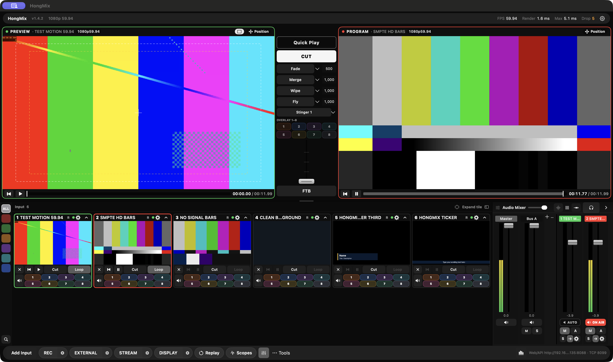
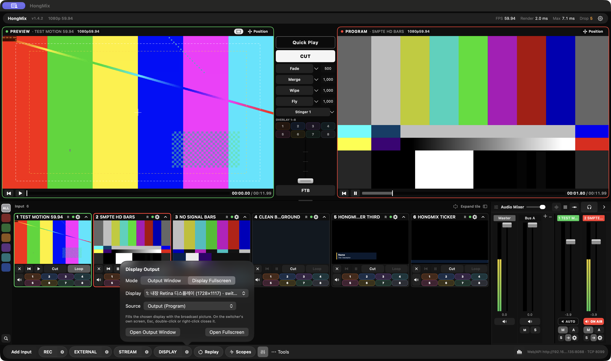
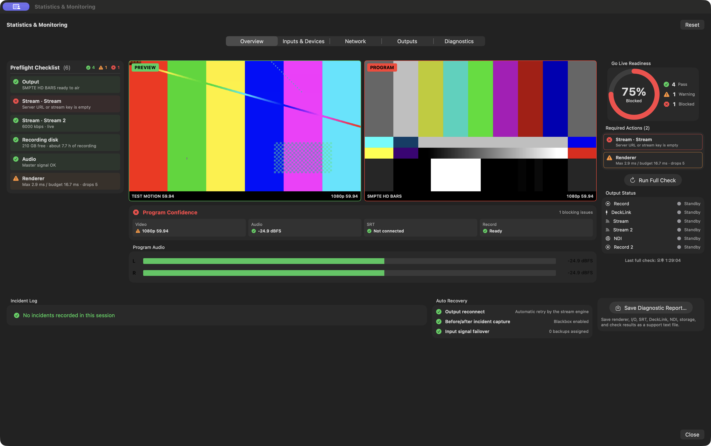
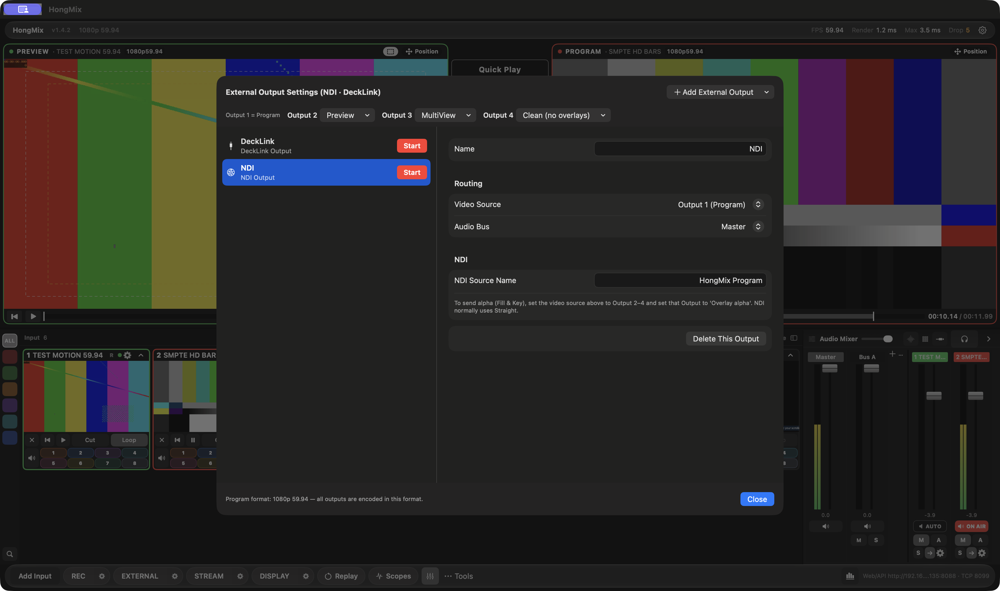
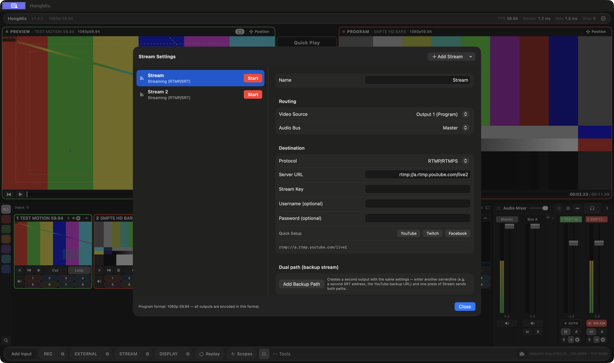

# GitHub 릴리스 초안 — HongMix 1.4.2

## 릴리스 제목

`HongMix 1.4.2 — Display 출력, Monochrome UI, 독립 모니터링`

## 태그

`v1.4.2`

## 릴리스 파일

- `HongMix-1.4.2.dmg`
- `HongMix-1.4.2.pkg`
- `SHA256.txt`

## 릴리스 본문

HongMix 1.4.2는 macOS의 Display 출력 동작을 개선하고, 작업별 출력 설정을 분리했으며, 절제된 Monochrome 운영 스킨을 추가했습니다.

### 변경 사항

- **macOS Space에 맞춘 Display 출력**
  - 스위처가 macOS 전체화면이어도 Output Window가 현재 데스크톱에 열립니다.
  - 초록 버튼은 별도의 전체화면 Space를 만들지 않고 현재 디스플레이를 채웁니다.
  - Esc·더블클릭·우클릭으로 이전 창 크기와 위치에 복귀합니다.
  - Display를 닫은 뒤 검은 전체화면 데스크톱이 남던 문제를 수정했습니다.
- **작업별 출력 설정**
  - Record, External, Stream 설정을 각각 분리했습니다.
  - External에서 NDI·DeckLink와 Output 2–4 라우팅을 설정합니다.
  - Stream에서 RTMP/SRT와 이중 백업 경로를 설정합니다.
- **Monochrome UI**
  - Preview·Program·ON AIR·경고처럼 의미가 있는 상태에만 색을 사용하는 흑백 운영 스킨입니다.
  - 기존 Default 스킨도 설정에서 선택할 수 있습니다.
  - 하단에서 Display, Replay, Scopes를 바로 열 수 있습니다.
- **모니터링**
  - Statistics & Monitoring을 다른 디스플레이나 macOS 데스크톱으로 옮길 수 있는 독립 창으로 만들었습니다.
  - Preview, Program, 프로그램 오디오, 송출 전 점검, 출력 상태와 자동 복구 정보를 표시합니다.
- **한·영 지원과 테스트**
  - 새 UI를 한국어와 영어로 제공합니다.
  - 반복 가능한 Display 창 회귀 테스트와 `tests/window/test-display-output.sh`를 추가했습니다.

### 검증 결과

- 버전 1.4.2, 빌드 61.
- 릴리스 빌드와 핵심 테스트 완료.
- 일반 창과 macOS 전체화면 스위처 상태에서 Display 회귀 테스트 16/16 단계 통과.
- DMG 체크섬 검증 통과.
- 번들 앱 코드 서명 검증 통과(임시 서명).
- 배포 앱에 개발 Mac의 외부 라이브러리 경로가 남아 있지 않음.

### 공개 캡처

모든 릴리스 이미지는 이 Mac에서 생성한 1080p59.94 테스트 패턴을 사용했습니다. 사람 얼굴·타사 방송 영상·스트림 키는 포함하지 않았습니다.

### 남은 검증

- 실제 모니터를 2대 이상 연결한 다중 디스플레이 테스트가 필요합니다.
- 실제 DeckLink 입력·출력·Fill/Key 검증이 남아 있습니다.
- PKG와 앱은 Apple Developer ID 공증이 아닌 임시 서명입니다.
- 프로덕션 인증 전 장시간 송출, 재연결, A/V 드리프트 테스트를 계속해야 합니다.
- Blackmagic SDK 파일은 저장소와 설치 파일에 포함하지 않습니다.

