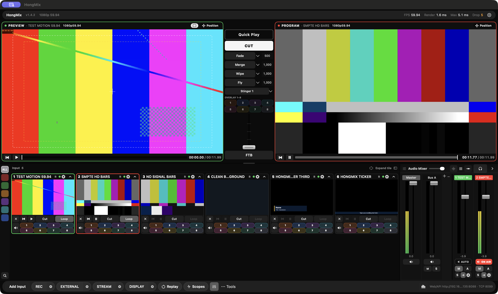
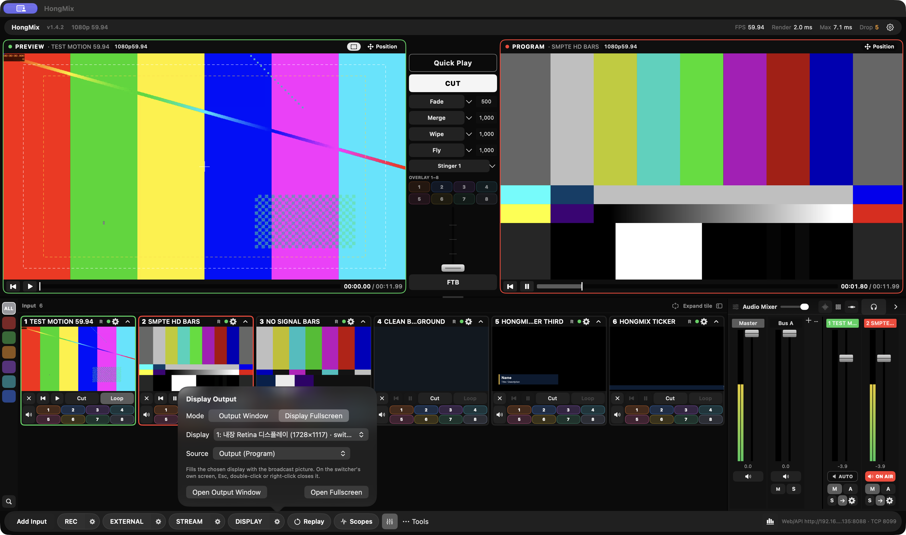
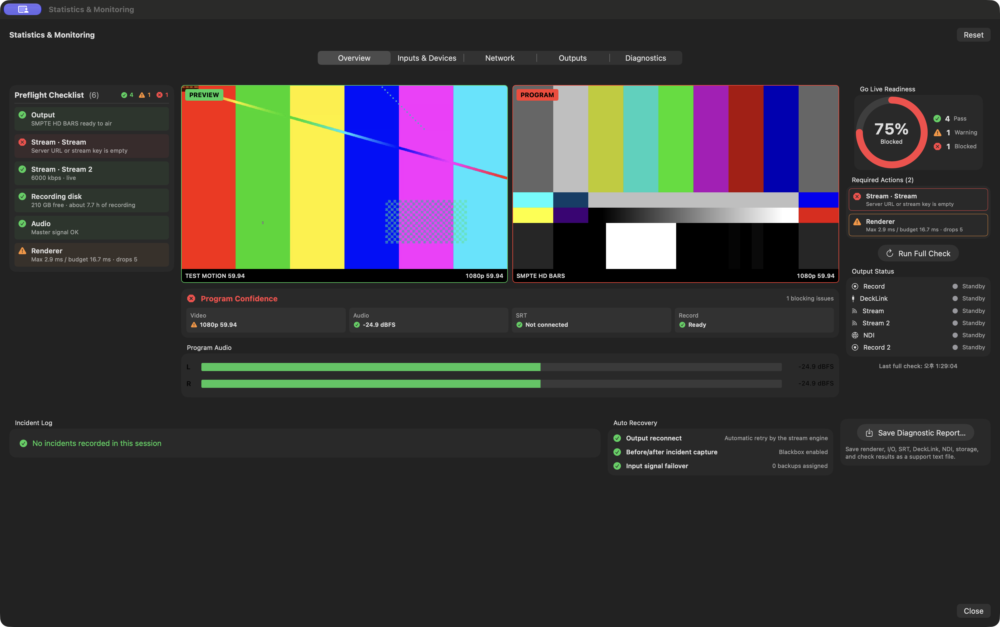
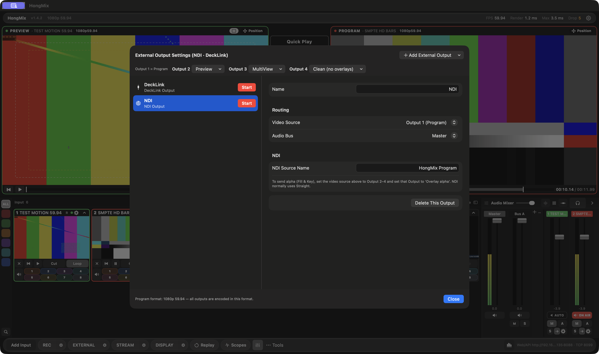
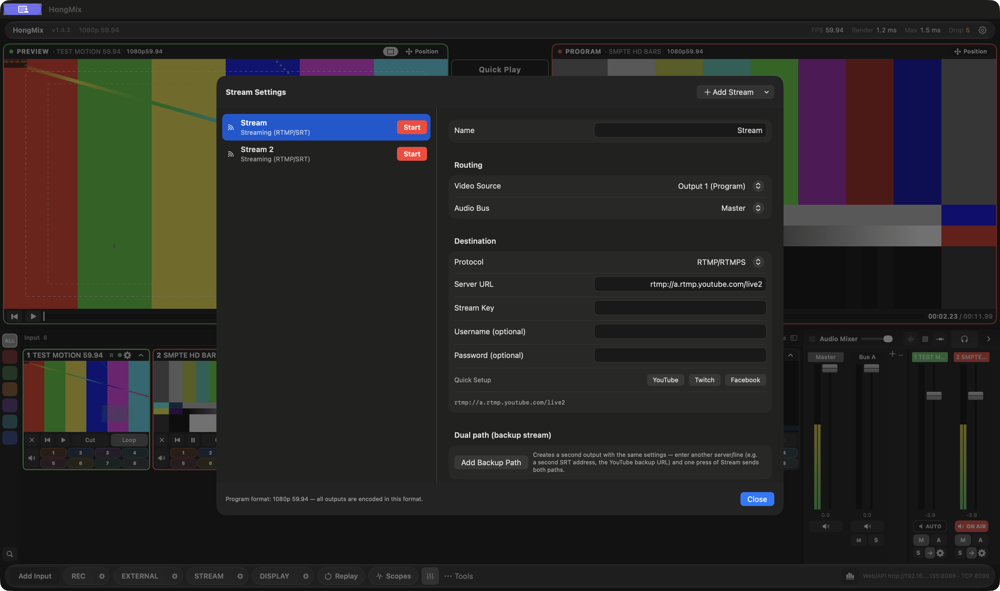

# GitHub release draft — HongMix 1.4.2

## Release title

`HongMix 1.4.2 — Display Output, Monochrome UI and Independent Monitoring`

## Tag

`v1.4.2`

## Release assets

- `HongMix-1.4.2.dmg`
- `HongMix-1.4.2.pkg`
- `SHA256.txt`

## Release body

HongMix 1.4.2 improves the macOS display-output workflow, separates output settings by task, and adds a restrained Monochrome operator skin.

### What's changed

- **Display output on macOS Spaces**
  - Output Window opens on the active desktop, including a full-screen switcher Space.
  - The green window button now fills the current display without creating another macOS full-screen Space.
  - Esc, double-click or right-click returns to the previous window size and position.
  - Closing Display no longer leaves a black full-screen desktop behind.
- **Focused output settings**
  - Record, External and Stream have separate settings windows.
  - External contains NDI, DeckLink and Output 2–4 routing.
  - Stream contains RTMP/SRT settings and dual-path backup controls.
- **Monochrome UI**
  - A black-and-white operator skin uses colour only for Preview, Program, ON AIR and warnings.
  - The original Default skin remains available in Settings.
  - Bottom-bar Display, Replay and Scopes controls are directly accessible.
- **Monitoring**
  - Statistics & Monitoring opens as an independent window that can move to another display or macOS desktop.
  - Preview, Program, program audio, preflight status, output status and recovery information update in the monitoring window.
- **Localization and testability**
  - New UI is available in English and Korean.
  - Added repeatable display-window regression hooks and `tests/window/test-display-output.sh`.

### Validation

- Version 1.4.2, build 61.
- Release build and core test completed successfully.
- Display regression: 16/16 steps passed with the switcher in both a normal window and macOS full screen.
- DMG checksum validation passed.
- Bundled app code-signature verification passed (ad-hoc signature).
- The packaged app has no development-machine library paths.

### Screenshots

All release screenshots use locally generated 1080p59.94 test patterns. They contain no people, third-party programme footage or stream keys.

### Known limitations

- Multi-display behaviour still needs physical testing with more than one connected monitor.
- Physical DeckLink input, output and Fill/Key validation is pending.
- The PKG and app use ad-hoc signing; they are not notarized with an Apple Developer ID.
- Long-duration on-air, reconnection and A/V drift testing should continue before production certification.
- Blackmagic SDK files are not included in this repository or installer.

