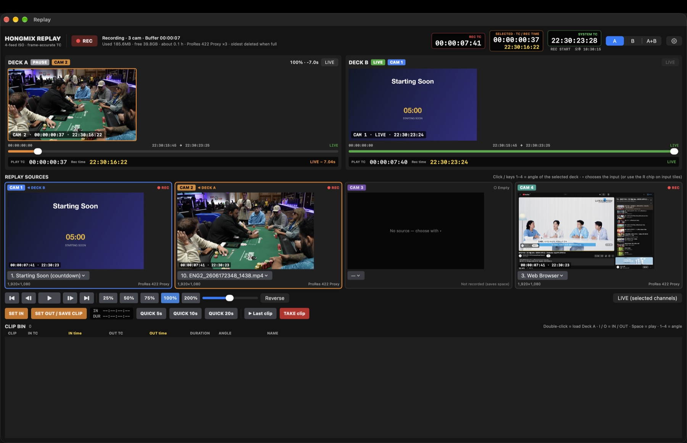

# HongMix 1.3.39 · Build 53

HongMix is a Mac live-production switcher for Preview/Program switching, media and live inputs, layered graphics, replay, audio mixing, and broadcast outputs. This release covers the work from 1.3.27 to 1.3.39: file-playback stutter, Instant Replay (4 sources, recording time, slow motion, per-camera audio, HEVC/ProRes recording), a vMix-style audio mixer, and a UI clipping pass.

> **Release status:** the app build is prepared. Measurements below come from a test harness and the files named; they are not a claim that every source has passed a long live-broadcast test. See **Verification and limits** before using this build on air.

## Screenshots / 캡처

Captured from the running HongMix 1.3.38/1.3.39 app on an Apple M1 Max (1080p59.94 program). The two measurement images were generated from the harness and encoder measurements described below.

| Screen | What it shows |
|---|---|
| [Main switcher](screenshots/1.3.39-main-switcher.jpg) | Input tiles with replay **R1–R4** chips, and the audio mixer with **ON AIR / AUTO / ON** buttons and input-level meters. |
| [Instant Replay · 4 sources](screenshots/1.3.39-replay-4cam.jpg) | Recording 3 of 4 CAM slots, Deck A paused on CAM 2 with TC + recording time, Deck B live on CAM 1, REPLAY SOURCES strip. |
| [Replay settings](screenshots/1.3.39-replay-settings.jpg) | Recording-format menu (HEVC Intra / H.264 / ProRes hardware), slow-motion options, storage. |
| [Audio mixer](screenshots/1.3.39-audio-mixer.jpg) | Off-air channels show grey input meters with AUTO; the on-air channel is ON AIR; a manually enabled channel is ON. |
| [Audio dropout fix · measured](screenshots/1.3.39-audio-fix-measured.jpg) | Before/after harness numbers for file audio underflows and late chunks. |
| [Replay quality · measured](screenshots/1.3.39-replay-quality-measured.jpg) | SSIM and size of each replay recording format on real footage. |

실행 중인 HongMix 1.3.38/1.3.39(Apple M1 Max, 1080p59.94 프로그램)에서 캡처했습니다. 측정 이미지 2장은 아래에 설명한 하네스·인코더 측정값으로 만들었습니다.

| 화면 | 확인할 수 있는 내용 |
|---|---|
| [메인 스위처](screenshots/1.3.39-main-switcher.jpg) | 입력 타일의 리플레이 **R1–R4** 칩, **ON AIR / AUTO / ON** 버튼과 입력 레벨 미터가 있는 오디오 믹서 |
| [인스턴트 리플레이 · 4소스](screenshots/1.3.39-replay-4cam.jpg) | CAM 4칸 중 3개 녹화, Deck A 는 CAM 2 일시정지(TC + 녹화 시각), Deck B 는 CAM 1 라이브, REPLAY SOURCES 줄 |
| [리플레이 설정](screenshots/1.3.39-replay-settings.jpg) | 녹화 형식 메뉴(HEVC Intra / H.264 / ProRes 하드웨어), 슬로모션 옵션, 저장 위치 |
| [오디오 믹서](screenshots/1.3.39-audio-mixer.jpg) | 출력 안 된 채널은 회색 입력 미터 + AUTO, 출력 중 채널은 ON AIR, 수동으로 켠 채널은 ON |
| [오디오 끊김 수정 · 측정](screenshots/1.3.39-audio-fix-measured.jpg) | 파일 오디오 언더런·늦은 청크 수정 전/후 하네스 수치 |
| [리플레이 화질 · 측정](screenshots/1.3.39-replay-quality-measured.jpg) | 실제 영상에서 리플레이 녹화 형식별 SSIM 과 용량 |

## What changed and what we did

### 1. Video files no longer stutter picture and sound together

**Problem:** loading camera MP4 files made picture and audio stutter at the same time. Measuring the test files showed why: ENG1 (1080p60) stores video packets up to **0.586 s** before the matching audio. The demuxer decoded video itself and stopped whenever its 12-frame (≈0.2 s) decoded queue was full, so it could not reach the audio stored behind that video. Audio arrived 0.3–0.4 s late, the mixer ran dry, and video was late at the same moments.

**Action:**
- Compressed video packets are read ahead into a 3 s / 256 MB queue (≈30 MB for 4K at 80 Mb/s), the ffplay/mpv approach.
- Video decodes on its own thread, so the demuxer never waits on decoded frames and interleaved audio keeps flowing.
- One shared media clock: the video presentation thread anchors it and audio follows. Two independent clocks used to drift apart by the keyframe-decode time after every seek.
- Pause freezes the audio "play clock" instead of discarding queued audio.
- Mark Out is handled like end of file, so the deeper read-ahead never plays past it. On loop, the last decoded frames are shown before seeking back.
- During a seek the decode thread yields the decoder: macOS mutexes are not fair, and an early version took about 1 s to show the first frame after a seek.

**Measured** (same FFmpeg, 60 fps mixer pull simulated, M1 Max): ENG1 60 s, mixer underflows **7 → 0** and late audio chunks **233 → 1**; pause/resume underflows **7 → 0**; seek-to-first-frame 76–98 ms (before 81–109 ms); playlist hand-off back at the old level.

**Screenshot:** [Audio dropout fix · measured](screenshots/1.3.39-audio-fix-measured.jpg).

### 2. Instant Replay: 4 sources (CAM 1–4), picked from the replay window or the input tile

**Problem:** sources could only be chosen in a hidden settings sheet; the decks stayed black without separate Replay A/B inputs; up to 8 feeds were recorded.

**Action:**
- 4 fixed CAM slots. Empty slots open no encoder, which saves encoder time and disk.
- The REPLAY SOURCES strip shows a live thumbnail, TC and clock, and a ▾ input picker for each slot. Click a slot, or press **1–4**, to switch the selected deck's angle.
- Input tiles get an **R1–R4** chip that shows and assigns the CAM.
- A slot's source can be added, swapped or removed **while recording**. Only that CAM's encoder starts or stops; the TC and other cameras keep going.
- The deck monitors always show their channel, even without Replay A/B inputs.

**Screenshot:** [Instant Replay · 4 sources](screenshots/1.3.39-replay-4cam.jpg), [Main switcher](screenshots/1.3.39-main-switcher.jpg) (R chips).

### 3. Replay shows the recording time (system clock) next to TC

**Problem:** TC alone is hard to use on a live show. The old clock readout was computed from the recording start time, so it went wrong after old footage was auto-deleted or recording was restarted.

**Action:** while recording, a tick→wall-clock anchor is stored every second. The recording time is shown:
- in the header (SELECTED · TC / REC TIME)
- in each deck's bottom bar and burn-in
- on the source thumbnails
- in the IN readout
- as IN/OUT time columns in the clip bin

**Screenshot:** [Instant Replay · 4 sources](screenshots/1.3.39-replay-4cam.jpg) (`Rec time 22:30:16:22` next to `PLAY TC`).

### 4. Replay audio follows the camera on screen

**Action:** while recording, each CAM also stores its input's own audio, taken from the mixer's per-input ISO buffer (pre-fader). Replay plays the audio of the angle on screen, so switching angle switches the audio. Settings › Replay audio can switch this to program audio. A CAM without audio plays program audio.

### 5. Slow motion: AI interpolation where the Mac allows it, GPU blending otherwise

**Problem:** slow replay repeated frames. Apple's ML frame-rate converter (`VTFrameRateConversion`) is not real time on every chip; on an M1 Max at 1080p it costs ≈45 ms for one in-between frame.

**Action:** each Mac measures itself once (cached per chip and macOS build).
- **Fast Macs:** real-time AI interpolation during playback (deck badge `AI RT`).
- **Other Macs:** when a clip is saved, ¼/½/¾ in-between frames render in the background. Three phases per call cost 20.5 ms per frame on M1 Max, and the render uses at most ~⅔ of the GPU. Progress shows as `AI 42%` → `AI ✓`. Slow playback of that clip then uses the AI frames (badge `AI`).
- **Before AI is ready, or on Macs without it:** GPU blending between frames (≈0.5 ms), badge `BLEND`.

### 6. Replay recording quality: HEVC Intra by default, hardware decode

**Problem:** replay looked soft. The old default, H.264 Intra 35 Mb/s, actually produced **25 Mb/s** with the real-time encoder and scored SSIM **0.968**.

**Action:**
- New default: **HEVC Intra, constant quality** (q65 ≈ 42 Mb/s, SSIM 0.986). That is sharper than ProRes Proxy at half the size.
- Other options: HEVC q72 / q80, H.264 Intra 100 / 60 (compatibility), and **ProRes 422 Proxy / LT on the hardware ProRes engine**. Macs without that engine (e.g. base M1) get a warning.
- Projects that used the old H.264 default move to HEVC automatically.
- Replay playback decodes on VideoToolbox (≈0.3 ms vs 2–4 ms per 1080p frame) and hands NV12 surfaces straight to the GPU.

**Screenshot:** [Replay quality · measured](screenshots/1.3.39-replay-quality-measured.jpg), [Replay settings](screenshots/1.3.39-replay-settings.jpg).

### 7. Audio mixer: vMix-style ON AIR / AUTO / ON / MUTE

**Problem:** with Follow (→) on every strip only the program input reached Master. The speaker button was only a mute, so pressing it on an off-air channel did nothing. Off-air meters stayed at zero, and the last strips were off-screen with no visible scrollbar.

**Action:** the strip button now shows the state:
- **ON AIR** — reaching Master via Follow.
- **AUTO** — Follow standby; click for manual **ON**.
- **ON** — manual, always to Master.
- **MUTE**

Meters always show the input level (after the fader), grey when the channel is not reaching Master. The mixer's horizontal scrollbar is always visible.

**Screenshot:** [Audio mixer](screenshots/1.3.39-audio-mixer.jpg).

### 8. UI clipping pass and English strings

**Action:**
- Every window and sheet was reviewed in English, where labels are longer.
- Fixed controls clipped or pushed off-screen:
  - Rundown item editor (labels cut on the left)
  - transition column
  - mixer header
  - replay header / decks / clip bin
  - Scopes toolbar
  - Output 2–4 bar
  - SRT statistics table
  - Scheduler, Data Sources, Layers, Triggers, Title gallery and Title editor
- 135 English translations were added to `en.json`; every Korean UI string in code now has one.

### 9. Earlier in this range (1.3.27–1.3.33)

- **Unified input tiles:** ✕ · restart · play/pause · Cut · Loop / audio · Overlay 1–8 (Quick Play removed).
- **Format labels** on Preview/Output.
- **60 ↔ 59.94 file conform:** a 60.00 fps file plays 0.1% slower in a 59.94 program, removing the dropped frame every ~17 s. Audio is resampled to match.
- **Software-decoded frames** (e.g. H.264 4:2:2 10-bit) are repacked to NV12 for GPU colour conversion.
- **Optimized Media** (ProRes copy) in the tile menu.
- **Headphone/monitor dropout fix** after short underruns.

## Verification and limits

- **Built:** release build passes with no new warnings. DMG/PKG built with the LGPL FFmpeg check.
- **Harness:** file playback (items 1) on ENG1 / ENG_3 (H.264 4:2:2 10-bit) / ENG_5 (4K59.94), including pause, seek, Mark In/Out loop, end of file, playlist hand-off and close.
- **Encode → store → decode round trip:** HEVC, H.264, ProRes Proxy/LT, with 0 dropped frames.
- **AI interpolation:** checked on real frames for correct colour and shape.
- **Not done:** no long on-air run. AI timings are from one M1 Max; other chips are measured on first use. The screenshots are UI illustrations, not stability proofs.

---

## 한국어

### 1. 동영상 파일의 영상·소리가 함께 버벅이던 문제
**원인:** 카메라 MP4(ENG1)는 영상 패킷이 해당 오디오보다 **최대 0.586초** 앞에 저장돼 있습니다. 디먹스 스레드가 영상까지 직접 디코드했는데, 디코드 큐(12프레임 ≈ 0.2초)가 차면 멈춰서 뒤에 있는 오디오를 읽지 못했습니다. 그래서 오디오가 0.3–0.4초 늦게 도착해 믹서가 비었고, 영상도 같은 순간에 늦었습니다.

**수정:**
- 압축 영상 패킷을 3초까지 미리 읽습니다(ffplay/mpv 방식).
- 영상은 전용 디코드 스레드에서 풉니다.
- 영상과 오디오가 하나의 시계를 씁니다(영상 기준, 오디오가 따라감).
- 일시정지하면 오디오 시계도 멈춥니다.
- Mark Out 을 파일 끝처럼 처리하고, 시크할 때는 디코더를 바로 넘겨줍니다.

**측정:** ENG1 60초 재생에서 믹서 언더런 **7 → 0**, 늦은 오디오 청크 **233 → 1**. 일시정지/재개 언더런 7 → 0.

### 2. 인스턴트 리플레이 소스 4개 (CAM 1–4)
- 덱 아래 소스 4칸에서 썸네일·TC·시각을 보고 ▾ 로 입력을 고릅니다. 칸 클릭 또는 1–4 키로 선택한 덱의 앵글을 바꿉니다.
- 입력 타일의 **R1–R4** 칩으로도 지정할 수 있습니다. 빈 칸은 녹화하지 않습니다.
- 녹화 중에도 소스를 바꿀 수 있습니다. 바꾼 CAM 만 새 소스로 이어지고, TC 와 다른 CAM 은 그대로입니다.
- 덱 화면은 Replay A/B 입력이 없어도 항상 보입니다.

### 3. 녹화 시각(시스템 시간) 표시
녹화 중 1초마다 tick→시각 기준점을 저장해서 계산합니다. 오래된 영상이 자동 삭제되거나 녹화를 다시 시작해도 정확합니다. 표시 위치: 헤더, 덱 하단 바와 화면 위 표시, 소스 썸네일, IN 표시, 클립 목록 IN/OUT 시각.

### 4. 화면에 나오는 CAM 의 소리로 재생
CAM 마다 그 입력의 소리(페이더 전)를 따로 녹화하고, 화면에 나오는 앵글의 소리로 재생합니다. 설정에서 프로그램 오디오로 바꿀 수 있습니다.

### 5. 슬로모션 보간
맥마다 처음 한 번 AI 처리 속도를 측정해서 방식을 고릅니다.
- **빠른 맥:** 재생 중 실시간 AI (`AI RT`)
- **그 밖의 맥:** 클립을 저장하면 ¼·½·¾ 중간 프레임을 백그라운드에서 만들어 둡니다 (`AI 42%` → `AI ✓`). M1 Max 1080p 기준 프레임당 20.5 ms 이고, GPU 는 3분의 2 이하만 씁니다.
- **AI 준비 전이나 AI 를 못 쓰는 맥:** GPU 블렌딩 (`BLEND`, 프레임당 약 0.5 ms)

### 6. 리플레이 화질: 기본 HEVC Intra + 하드웨어 디코드
- 예전 기본값 H.264 Intra 35 Mb/s 는 실제로 25 Mb/s 밖에 나오지 않았습니다(SSIM 0.968).
- 새 기본값 **HEVC Intra 고정 화질 q65** 는 약 42 Mb/s, SSIM 0.986 입니다. ProRes Proxy 보다 선명하고 용량은 절반입니다.
- 선택 옵션: HEVC q72 / q80, H.264 호환, **ProRes 422 Proxy / LT 하드웨어 녹화** (ProRes 엔진이 없는 맥은 경고 표시).
- 재생은 VideoToolbox 하드웨어로 디코드합니다.

### 7. 오디오 믹서 (vMix 방식)
- 채널 버튼이 상태를 보여 줍니다.
  - **ON AIR**: 출력 중이라 자동으로 나감
  - **AUTO**: 출력되면 자동으로 켜짐. 누르면 수동 ON
  - **ON**: 수동으로 켜서 항상 나감
  - **MUTE**: 음소거
- 미터는 항상 입력 레벨을 보여 주고, 마스터로 안 나가는 채널은 회색입니다.
- 가로 스크롤 바가 항상 보입니다.

### 8. UI 잘림 점검과 영어 번역
- 모든 창과 시트를 영어 기준으로 점검해서 잘리거나 화면 밖으로 밀리던 곳을 고쳤습니다(Rundown 편집 칸 등).
- 영어 번역 135개를 추가해, 코드의 한국어 UI 문자열이 모두 영어로 나옵니다.

### 9. 1.3.27–1.3.33
- 입력 타일 버튼 통일, Preview/Output 포맷 표시.
- 60↔59.94 파일 레이트 맞춤.
- 소프트웨어 디코드 프레임을 NV12 로 재포장해 GPU 가 색 변환.
- 최적화 미디어(ProRes 사본).
- 헤드폰/모니터 출력 끊김 수정.

### 검증과 한계
- 릴리스 빌드·DMG/PKG(LGPL FFmpeg 확인) 완료.
- 하네스 재생 테스트와 녹화 형식 왕복 테스트 통과.
- 장시간 실제 방송 테스트는 하지 않았습니다. AI 처리 시간은 M1 Max 기준이고, 다른 칩은 처음 사용할 때 측정합니다. 캡처는 UI 설명용입니다.
