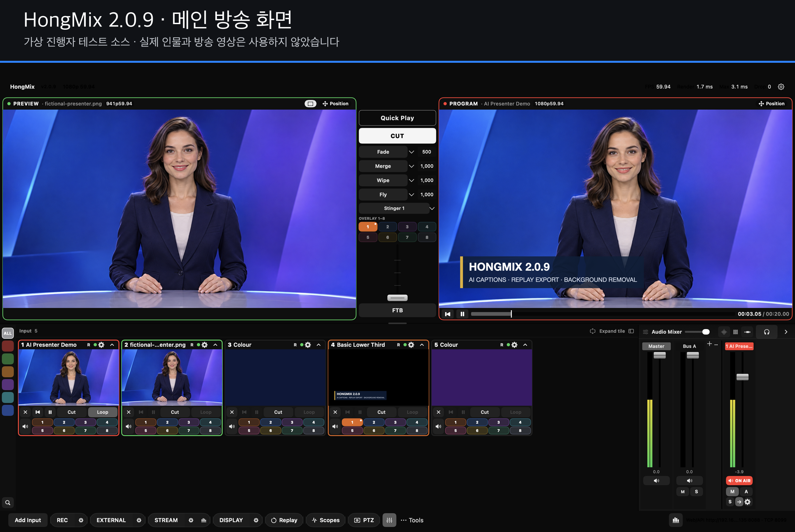
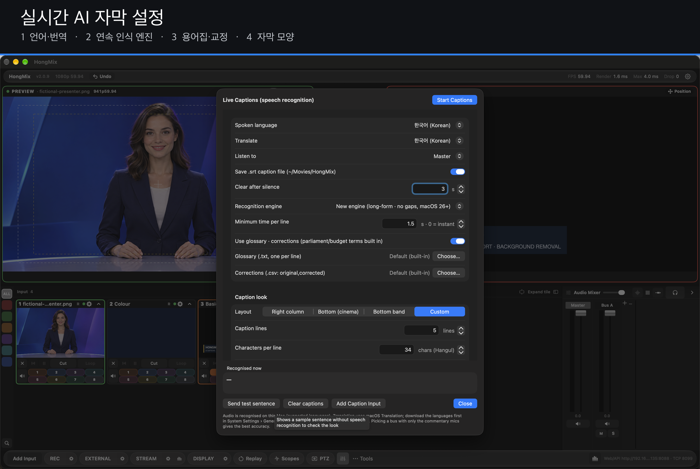
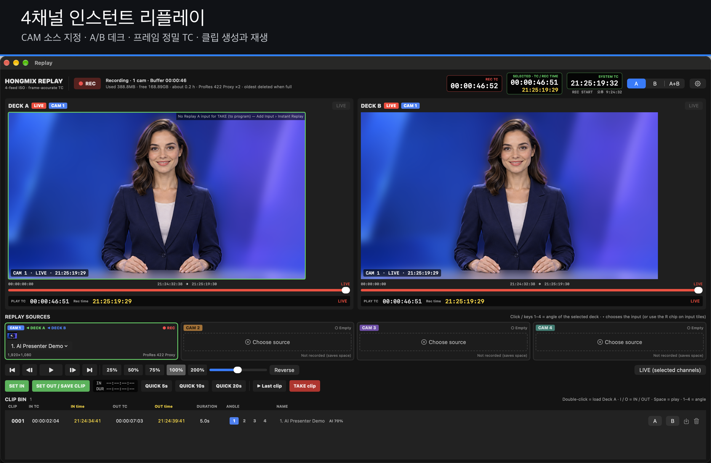
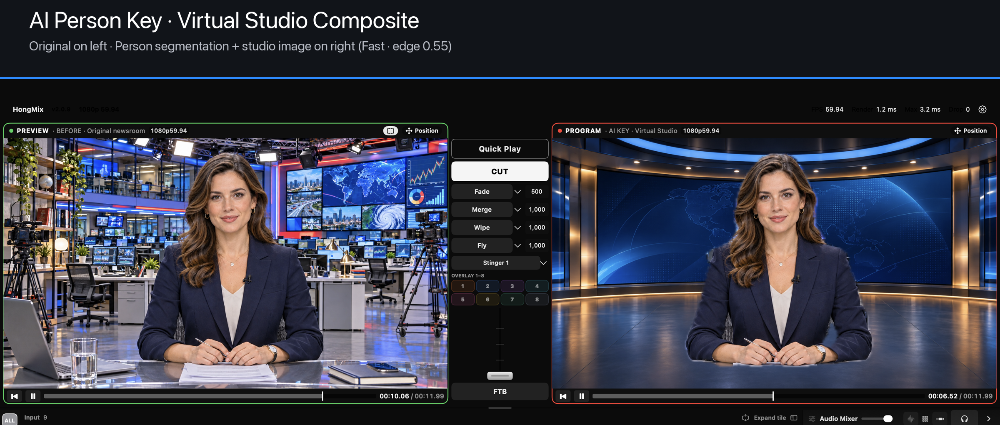
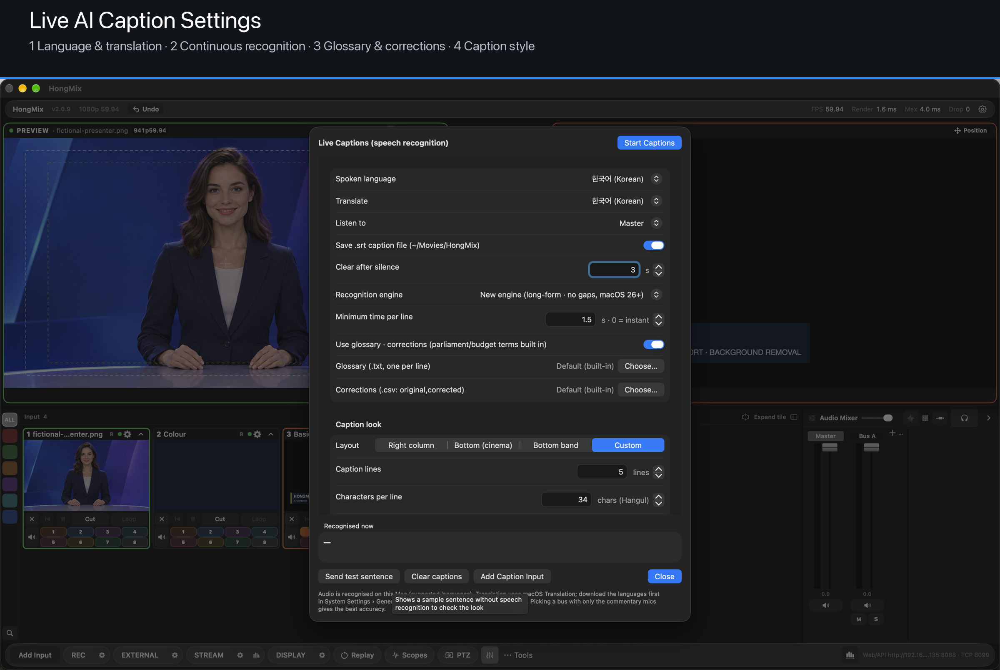
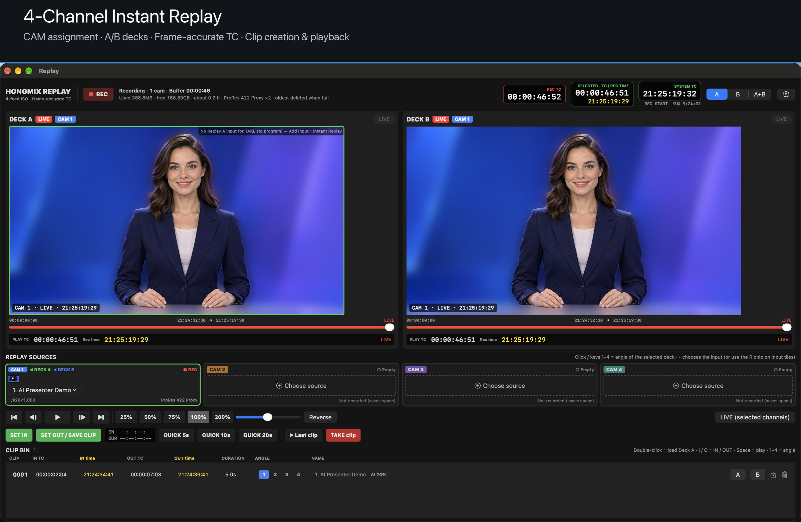
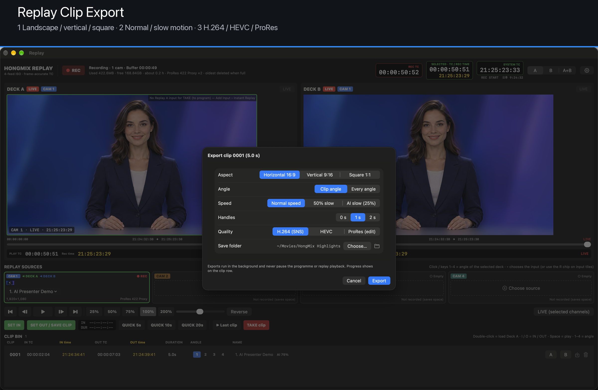

# HongMix 2.0.9

## 한국어

- **새 자막 엔진**(macOS 26 이상): 장시간 끊김 없는 맥 내장 음성 인식이라 문장이 잘리지 않습니다. 단어 단위로 약 1초 안에 표시하고, 국정감사·예산 용어집과 교정 목록이 들어 있습니다.
- **자막 모양**: 오른쪽형·하단 영화형·하단 띠 프리셋. 줄 수·글자 크기·자간·줄 간격·배경을 조정하고, 'AI 자막' 표시는 끄거나 위치를 바꿀 수 있습니다.
- **AI 배경 제거**: 그린스크린 없이 사람만 남깁니다(투명·흐리게·이미지).
- **리플레이 클립 내보내기**: 가로·세로(9:16)·정사각, 슬로 모션, H.264·HEVC·ProRes.
- 오래 켜 두면 자막이 멈추던 문제를 고쳤고, 설정 화면에서 글자·입력칸이 잘리던 곳을 정리했습니다.

M1 Max에서 확인했습니다. 실제 회의 음성 자막, 실제 카메라로 배경 제거, 두 번째 모니터는 아직 확인 전입니다.

전체 내용: [한국어 릴리스 노트](https://github.com/HongMix/HongMix/blob/main/docs/RELEASE-NOTES-2.0.9.ko.md)

### 화면 안내

---

## English

- **New caption engine** (macOS 26+): long-form on-device recognition without gaps — sentences are no longer lost. Word-by-word within about a second, with a built-in Korean parliamentary/budget glossary and corrections.
- **Caption look**: Right column / Bottom cinema / Bottom band presets; lines, size, letter spacing, line spacing, background, and an optional, movable "AI captions" label.
- **AI background removal**: keep people without a green screen (transparent / blur / image).
- **Replay clip export**: horizontal, vertical 9:16, square; slow motion; H.264 / HEVC / ProRes.
- Fixed captions freezing after long sessions, and clipped labels / number fields in settings.

Verified on M1 Max. Not yet verified: captions with real meeting audio, background removal with a live camera, a second monitor.

Full notes: [English release notes](https://github.com/HongMix/HongMix/blob/main/docs/RELEASE-NOTES-2.0.9.md)

### Screenshots

