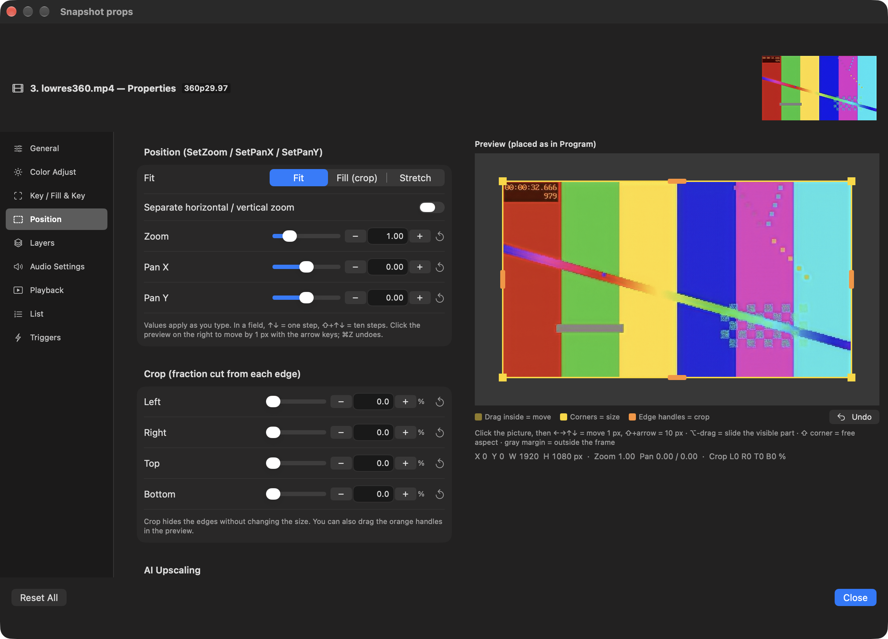
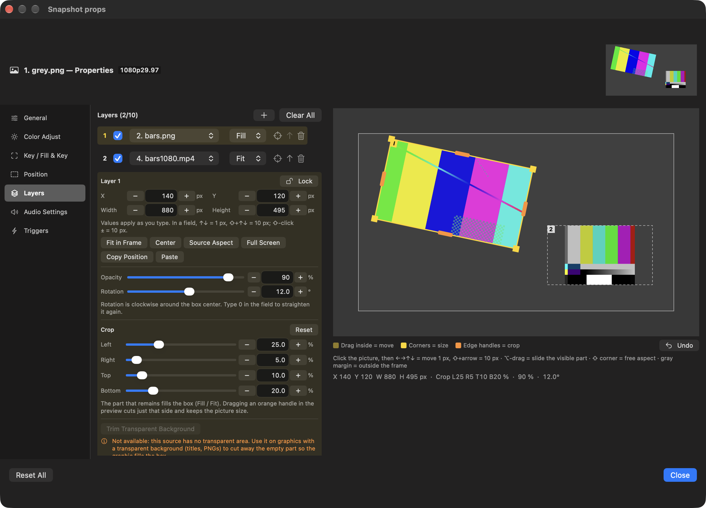

# HongMix 2.1.7 · build 117

## 한국어

- vMix처럼 숫자칸과 −/+로 위치·레이어를 정확하게 조정
- 화면 밖 상자 편집, 1px 화살표 이동, Command-Z 되돌리기
- 레이어 불투명도·회전·잠금·위치 복사/붙여넣기
- 레이어 자르기·투명 배경 잘라내기 수정과 이전 프로젝트 자동 변환
- 저해상도 송출 소스를 위한 선택형 AI 화질 올리기
- 레이어 합성 최적화와 안정성 문제 8개 수정
- 40분 시험: 프레임 빠짐 0, 재시작 0, 메모리 302~365MB로 일정

## English

- Exact Position and Layer values with number fields and −/+ controls
- Off-frame box editing, 1 px arrow-key nudge and Command-Z Undo
- Layer opacity, rotation, lock and Copy/Paste Position
- Fixed layer crop and transparent-background trimming with automatic legacy-project conversion
- Optional AI Upscaling for supported low-resolution on-air sources
- Faster layer composition and eight stability fixes
- 40-minute soak: 0 dropped frames, 0 restarts and flat 302–365 MB memory

Full notes: [English](https://github.com/HongMix/HongMix/blob/main/docs/RELEASE-NOTES-2.1.7.md) · [한국어](https://github.com/HongMix/HongMix/blob/main/docs/RELEASE-NOTES-2.1.7.ko.md)

## Screenshots

| Exact Position controls and AI Upscaling | Precise Layer controls |
|---|---|
|  |  |

## Verification notes

Core tests, translation checks, checksums, DMG verification and ad-hoc app signing passed. The 40-minute run was automated; physical mouse dragging, arrow-key nudge, number-button clicks, field typing and Command-Z still need wider hands-on verification. This build is not Apple-notarized yet.
