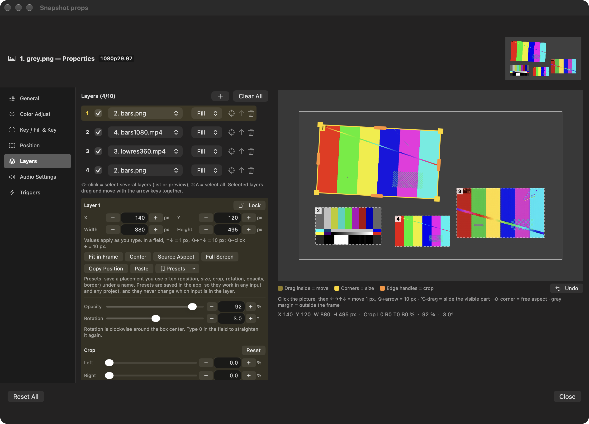
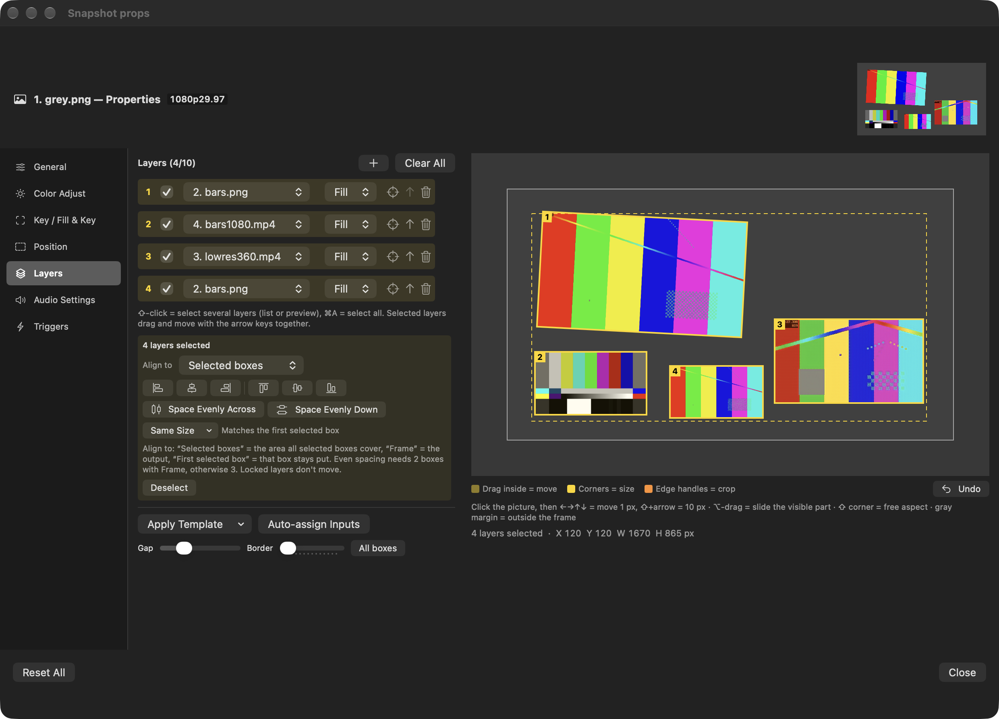

# HongMix 2.1.8 · build 119

## 한국어

- 어느 입력·프로젝트에도 적용하는 레이어 위치 프리셋
- Shift-클릭·Command-A로 여러 레이어 선택, 함께 이동·정렬·간격·크기 조정
- 다른 레이어 가장자리와 가운데에 스냅
- 회전한 레이어도 자르기 손잡이에 맞춰 상자 변 이동
- 2.1.7의 정밀 편집·AI 화질 올리기·레이어 성능 개선 포함
- 10분 자동 시험: 프레임 빠짐 0, 오류 0, 재시작 0, 메모리 344~450MB로 일정

## English

- Reusable layer placement presets across inputs and projects
- Shift-click or Command-A to select, move, align, distribute and resize several layers
- Snap boxes to other layers' edges and centers
- Cropping a rotated layer now moves that edge of the box
- Includes 2.1.7's precise editing, AI Upscaling and layer-performance improvements
- 10-minute automated soak: 0 dropped frames, 0 errors, 0 restarts and flat 344–450 MB memory

Full notes: [English](https://github.com/HongMix/HongMix/blob/main/docs/RELEASE-NOTES-2.1.8.md) · [한국어](https://github.com/HongMix/HongMix/blob/main/docs/RELEASE-NOTES-2.1.8.ko.md)

## Screenshots

| Layer presets | Multi-layer alignment |
|---|---|
|  |  |

## Verification notes

Core tests, translation checks, checksums, DMG verification and ad-hoc app signing passed. The 10-minute run was automated; physical Shift-click, group drag, snapping, rotated crop drag, Command-A, arrow keys and the preset-name dialog still need wider hands-on verification. This build is not Apple-notarized yet.
