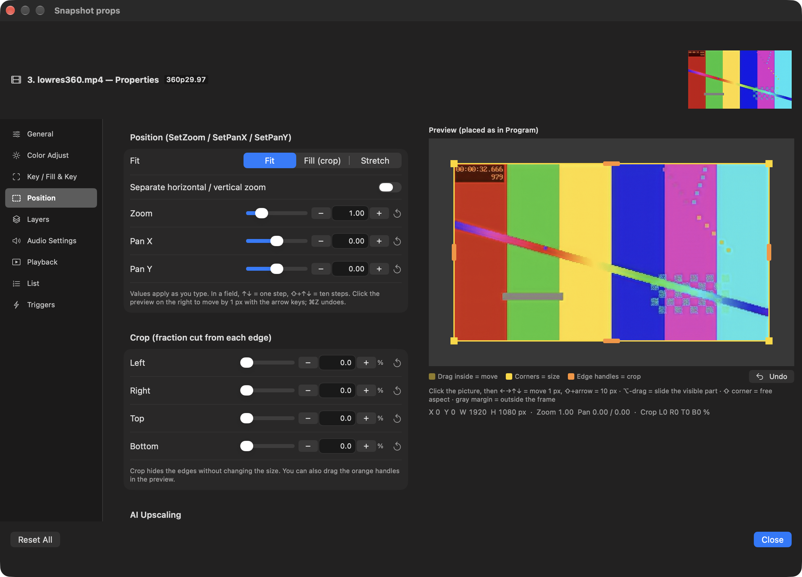
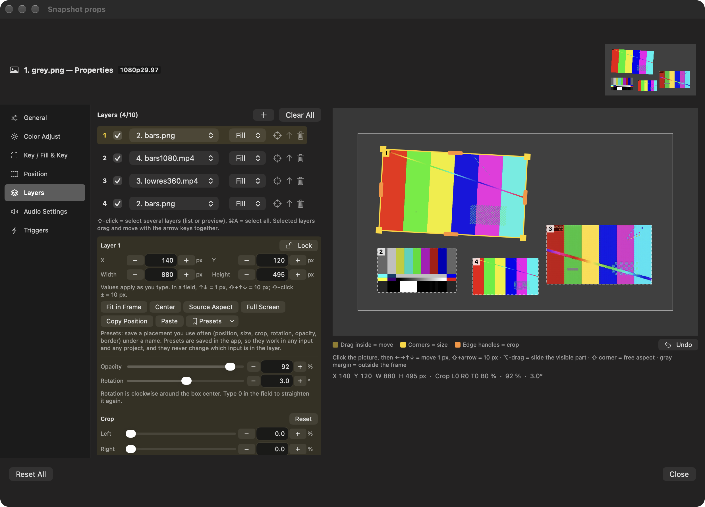
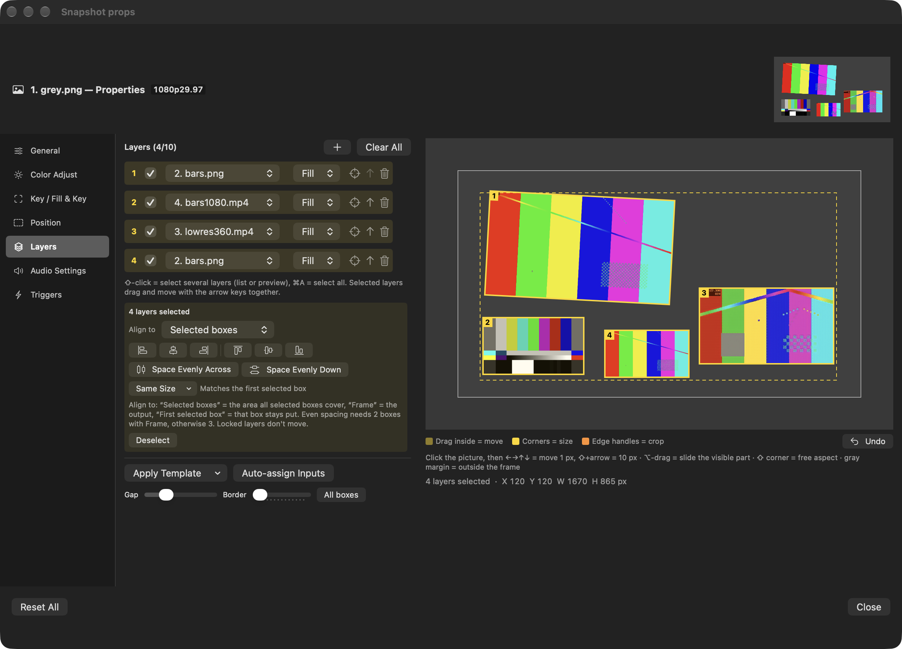

# HongMix 2.2.0 · build 121

## 한국어

- 방해 금지 단축어를 30초마다 실행하지 않도록 바꿔 메뉴 막대 아이콘 깜빡임 해결
- 2.1.7~2.1.8의 정밀 위치·레이어 편집, AI 화질 올리기, 프리셋과 다중 레이어 편집 포함
- AI 화질 올리기의 송출 대기 상태를 정확하게 표시
- 합성 테스트 파일 22개 호환성 확인
- 15분 시험과 빌드 121의 5분 재시험: 프레임 빠짐 0, 오류 0, 재시작 0

## English

- No more menu bar flicker from running the Do Not Disturb shortcut every 30 seconds
- Includes 2.1.7–2.1.8 precise Position/Layer editing, AI Upscaling, presets and multi-layer tools
- AI Upscaling now reports its off-air waiting state correctly
- Compatibility checked with 22 synthetic media files
- 15-minute soak plus a 5-minute build-121 rerun: 0 dropped frames, 0 errors and 0 restarts

Full notes: [English](https://github.com/HongMix/HongMix/blob/main/docs/RELEASE-NOTES-2.2.0.md) · [한국어](https://github.com/HongMix/HongMix/blob/main/docs/RELEASE-NOTES-2.2.0.ko.md)

## Screenshots

| Position editor | Layer presets |
|---|---|
|  |  |

## Verification notes

All 22 synthetic media files loaded and played. Core tests, translation checks, checksums, DMG verification and ad-hoc app signing passed. The 15-minute and 5-minute runs were automated. Physical mouse and keyboard interactions and visual confirmation of the menu bar icon still need hands-on verification. This build is not Apple-notarized yet.
