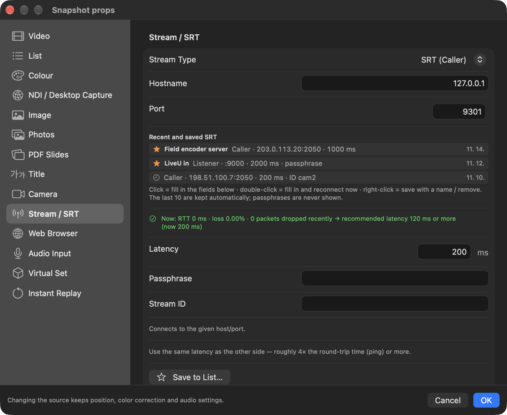

# HongMix 2.2.3 · build 128

> SRT를 수신하는 모든 사용자에게 권장하는 업데이트입니다. Recommended for everyone who receives SRT.

## 한국어

- SRT 수신이 몇 분마다 끊기던 버퍼 누적 문제 해결
- SRT 입력 더블클릭으로 연결 설정, 최근·저장한 연결 목록과 권장 Latency 제공
- 끊김 순간의 버퍼·Latency·RTT·손실·재전송·fps와 원인 판정을 블랙박스에 자동 기록
- 사고 폴더에 직전 30초 SRT 상태를 `srt.txt`로 저장
- SRT 전송률·손실·재전송 통계가 0 또는 잘못된 값으로 보이던 문제 수정

## English

- Fixed SRT inputs dropping out every few minutes as their receive buffer accumulated
- Double-click SRT inputs for connection settings, recent/saved connections and recommended latency
- The blackbox records buffer, latency, RTT, loss, retransmissions, fps and a verdict when a link breaks
- Each incident folder saves the preceding 30 seconds of SRT state in `srt.txt`
- Fixed SRT rate, loss and retransmission statistics sometimes showing zero or incorrect values

Full notes: [English](https://github.com/HongMix/HongMix/blob/main/docs/RELEASE-NOTES-2.2.3.md) · [한국어](https://github.com/HongMix/HongMix/blob/main/docs/RELEASE-NOTES-2.2.3.ko.md)

## Screenshot

## Verification notes

Real-link and local SRT tests kept the receive buffer stable with 0 drops after the pacing fix. Sender-stop and bandwidth-limit tests produced the expected disconnect and sender-drop verdicts. Core tests, translation checks, checksums, DMG verification and ad-hoc app signing passed. Two verdict paths requiring privileged network shaping were not deliberately triggered. This build is not Apple-notarized yet.
