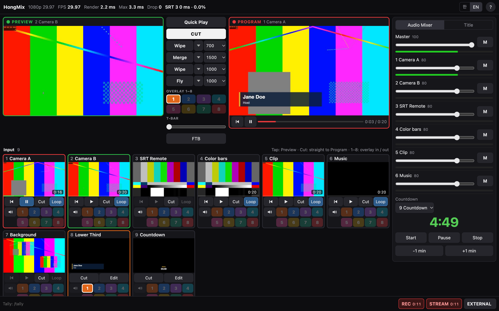
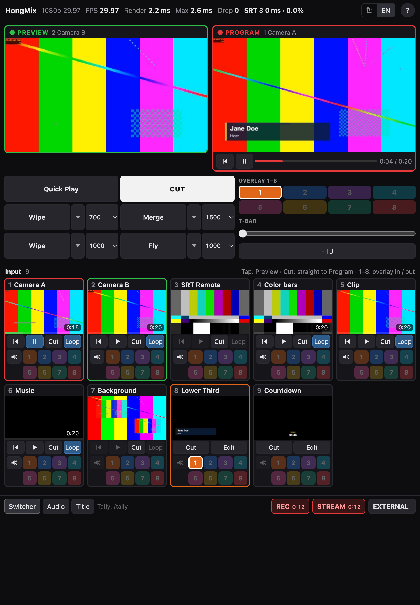
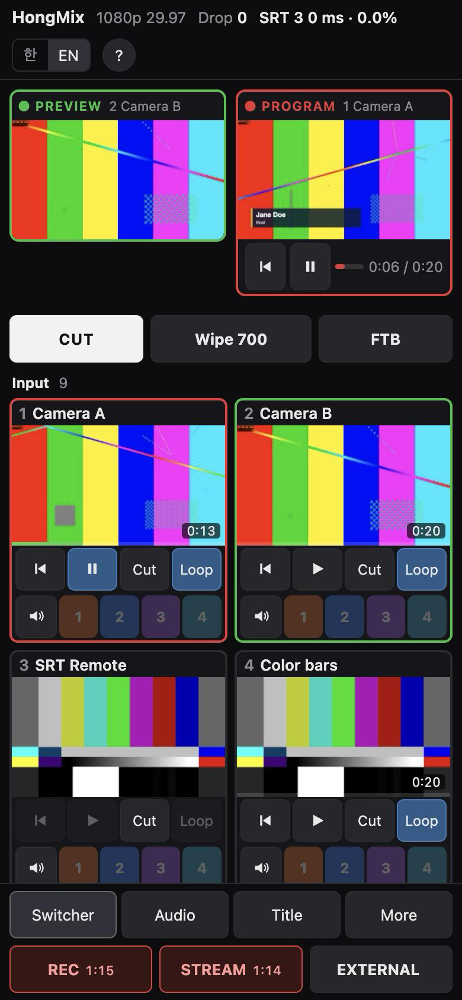
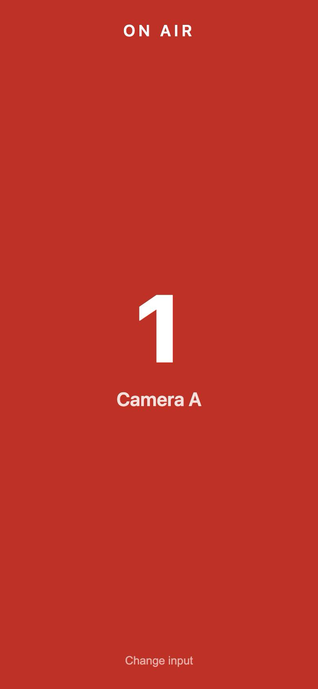

# HongMix 2.2.5 · build 134

> 웹 리모트가 노트북·아이패드·휴대폰용 브라우저 스위처로 바뀌었습니다. The web remote is now a responsive browser-based switcher.

## 한국어

- 앱과 같은 Preview·전환·Program·입력 타일·Audio Mixer 배치
- 입력마다 Cut·재생·오버레이 1–8, Program 재생·탐색 막대
- 노트북·아이패드·휴대폰에 맞춰 자동으로 바뀌는 화면
- 녹화·송출·External 확인창, 한국어/영어 전환, 사용법
- 비밀번호 없는 보기 전용 카메라 탈리와 화면 꺼짐 방지
- 캡처 28장이 포함된 한국어·영어 전체 사용 설명서

## English

- The app's Preview, transitions, Program, input tiles and Audio Mixer in a browser
- Cut, playback and overlays 1–8 on every tile; Program transport and seek bar
- Responsive layouts for laptops, iPads and phones
- Confirmation for Record, Stream and External; Korean/English switch and help
- View-only, password-free camera tally with screen wake lock
- Complete Korean and English manuals with 28 language-matched screenshots

Full notes: [English](https://github.com/HongMix/HongMix/blob/main/docs/RELEASE-NOTES-2.2.5.md) · [한국어](https://github.com/HongMix/HongMix/blob/main/docs/RELEASE-NOTES-2.2.5.ko.md)

Full manuals: [English](https://github.com/HongMix/HongMix/blob/main/docs/manual/HongMix-Manual.en.md) · [한국어](https://github.com/HongMix/HongMix/blob/main/docs/manual/HongMix-Manual.ko.md)

## Screenshots

## Verification

The virtual UI suite passed 196/196 checks across desktop, iPad and phone layouts. The real-app integration suite passed 47/47 with 0 dropped frames. Translation, core, checksum, DMG and ad-hoc signing checks passed. Physical phone and iPad testing is still pending. This build is not Apple-notarized yet.
