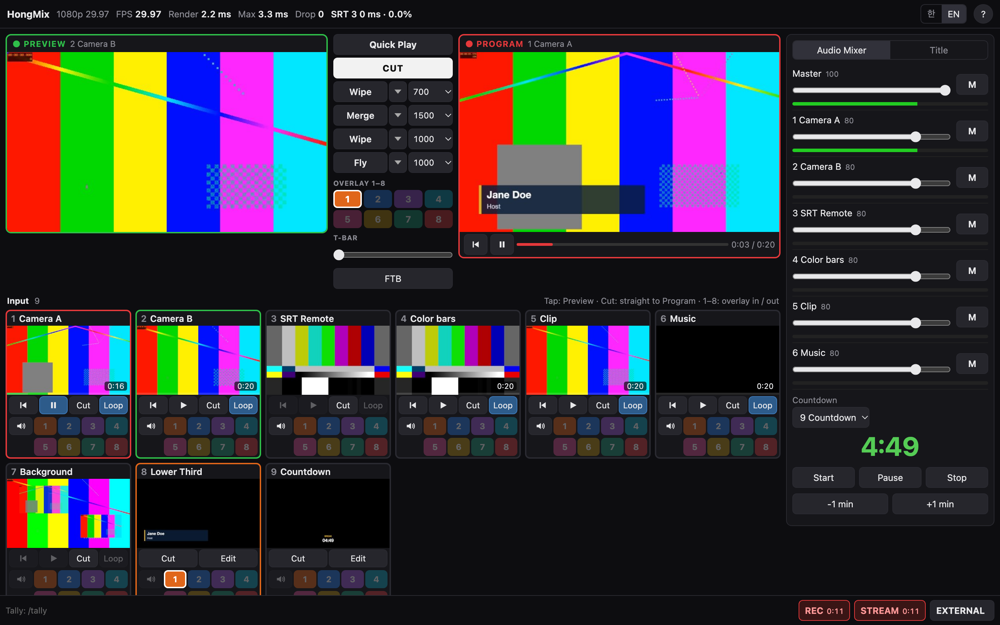
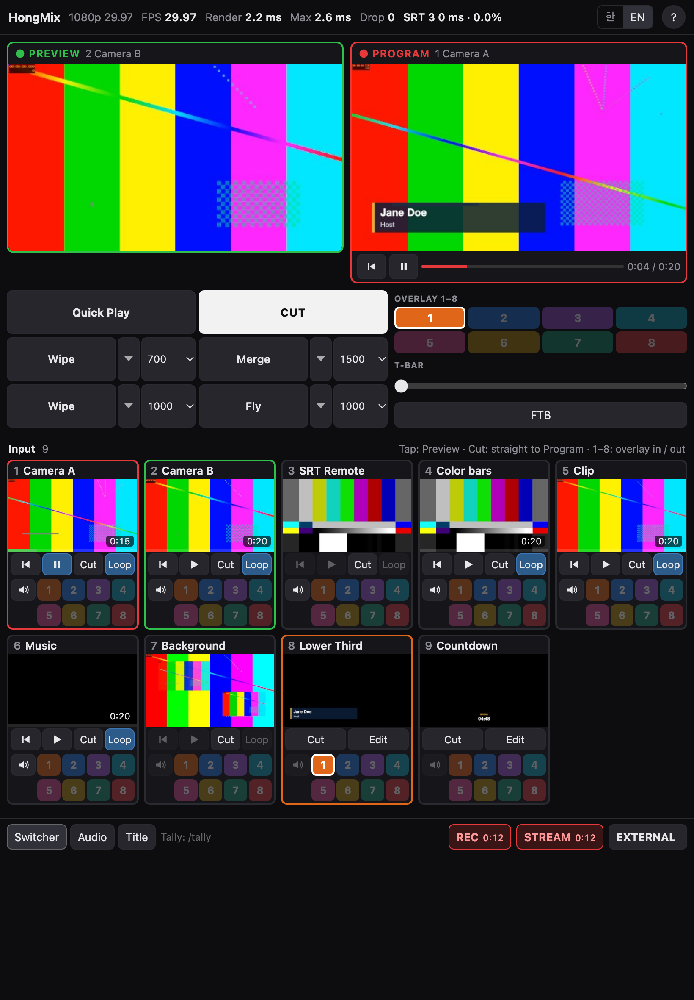
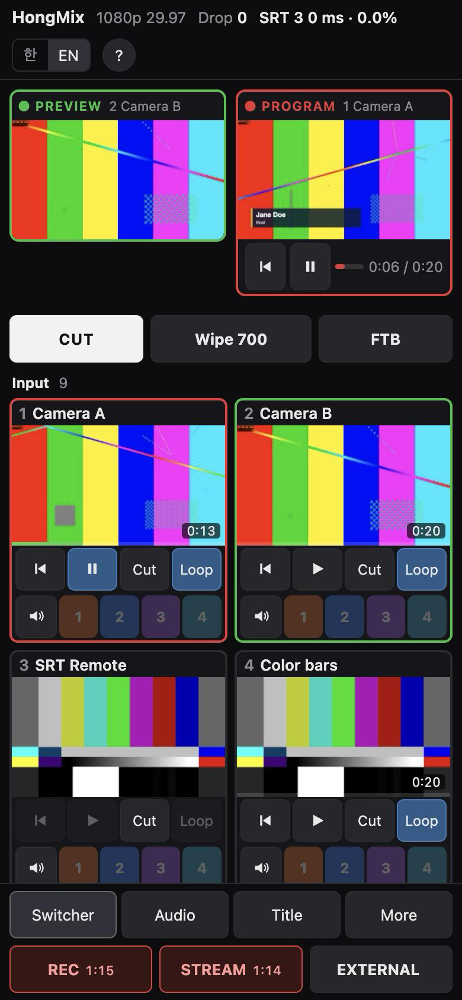
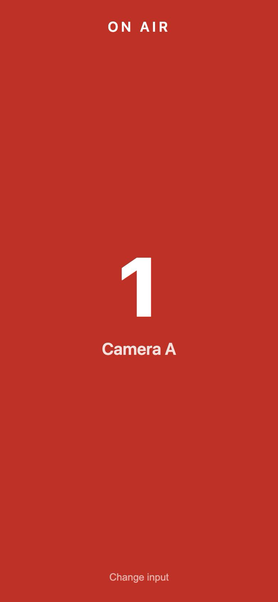

# HongMix 2.2.8 · build 141

> 웹 리모트의 Preview·Program이 실시간으로 움직이고, 불안정한 Wi-Fi에서 더 빠르게 복구합니다. Live Preview and Program are smoother, and the web remote recovers faster from unstable Wi-Fi.

## 한국어

- Preview·Program 실시간 화면과 부드럽게 15 fps / 보통 8 fps / 데이터 절약 2 fps 선택
- Wi-Fi가 끊기면 3초 안에 알리고 재연결, 사라진 휴대폰 연결은 약 8초 안에 정리
- 느린 회선에서 이전 탈리 상태가 잠깐 돌아오던 현상 수정
- 실시간 화면 최대 16개, 썸네일 별도 처리로 방송과 조작 명령의 부하 제한
- **이 맥에서만** 모드에 localhost와 휴대폰 접속 불가 안내 표시
- 휴대폰 접속 문제 해결 순서를 추가한 한국어·영어 그림 설명서

## English

- Live Preview and Program with Smooth 15 fps, Medium 8 fps and Data saver 2 fps modes
- Fast connection-loss notice and retry; vanished phone sessions are released in about eight seconds
- Fixed stale tally flashes on slow links
- Maximum 16 live pictures and isolated thumbnail work to protect live output and commands
- Clear localhost and phone warning in **This Mac only** mode
- Illustrated Korean and English manuals with phone connection troubleshooting

Full notes: [English](https://github.com/HongMix/HongMix/blob/main/docs/RELEASE-NOTES-2.2.8.md) · [한국어](https://github.com/HongMix/HongMix/blob/main/docs/RELEASE-NOTES-2.2.8.ko.md)

Full manuals: [English](https://github.com/HongMix/HongMix/blob/main/docs/manual/HongMix-Manual.en.md) · [한국어](https://github.com/HongMix/HongMix/blob/main/docs/manual/HongMix-Manual.ko.md)

## Screenshots

> These layout screenshots were captured for 2.2.5 and remain representative. The new 2.2.8 quality selector is not visible in them.

## Verification

The virtual UI suite passed 196/196 checks across desktop, iPad and phone layouts. The real-app integration suite passed 47/47 and the web hardening suite passed 10/10. A ten-minute load run completed 10,495 requests and 797 commands with 0 command failures and 0 dropped frames. Physical iPhone and iPad testing is still pending. The app is ad-hoc signed and not Apple-notarized yet.
