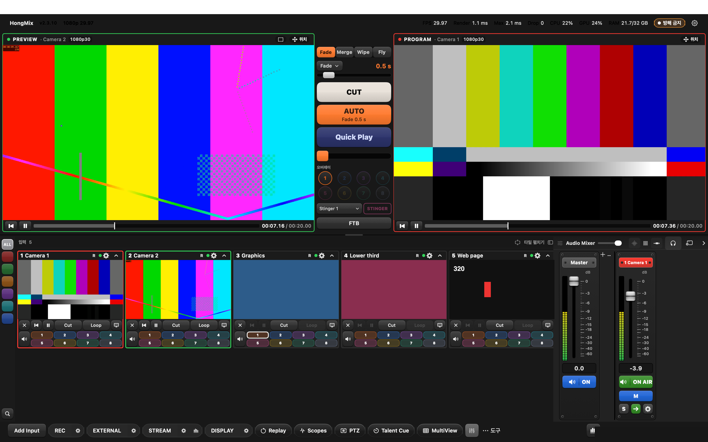

# HongMix 2.3.10 · build 187

**MultiView 이름표, 스코프 창, 하드웨어 룩 개선 등은 [@otiumvisuals](https://github.com/otiumvisuals) 님이 기여해 주셨고 렌더링 개선 아이디어는 Reddit의 Hawk_Super 님께 받았습니다. 감사합니다!**
**MultiView labels, Scopes windows, hardware-look refinements and more were contributed by [@otiumvisuals](https://github.com/otiumvisuals), and the render-thread ideas came from Hawk_Super on Reddit — thank you!**

## 한국어

- **브라우저 입력 영상 끊김 수정:** 메인 창이 보일 때 YouTube 등 브라우저 영상이 끊기던 문제 수정
- **시작할 때 짧은 소리 수정:** 로딩 중 스피커를 잠깐 열지 않도록 변경
- **MultiCorder ISO·MultiView 가볍게:** ISO를 GPU 한 번의 작업으로 처리하고 이름표를 GPU에 저장
- **MultiView 이름 옵션:** 칸별 이름, 화면 안·아래, 입력 이름 포함 또는 PREVIEW · PROGRAM
- **스코프 창 여러 개**, 다듬은 하드웨어 룩과 선택형 금속 배경
- 초록색 로딩 체크와 오버레이 기억 입력 테두리

## English

- **Smooth Browser-input video:** fixes YouTube and other video stuttering while the main window is visible
- **No click at launch:** Chromium no longer briefly opens the speakers while loading
- **Lighter MultiCorder ISO and MultiView:** one GPU pass for ISO frames and GPU-cached labels
- **MultiView name options:** per-cell names, on/below picture and two automatic-name styles
- **Multiple Scopes windows**, refined hardware look and optional brushed-metal background
- Green launch checks and a ring for inputs remembered by Overlay channels

> Projects using the new MultiView name options still open in older versions; the new settings are ignored.

Full notes: [English](https://github.com/HongMix/HongMix/blob/main/docs/RELEASE-NOTES-2.3.10.md) · [한국어](https://github.com/HongMix/HongMix/blob/main/docs/RELEASE-NOTES-2.3.10.ko.md)

Full manuals: [English](https://github.com/HongMix/HongMix/blob/main/docs/manual/HongMix-Manual.en.md) · [한국어](https://github.com/HongMix/HongMix/blob/main/docs/manual/HongMix-Manual.ko.md)

## Verification and limits

Translation, core and MultiView tests, DMG verification and deep ad-hoc signing passed. The operator's project measured zero drops. Build 187 uses the tested build 186 source but was not opened with the operator's project because its ad-hoc signature would prompt for folder access again. Multiple Scopes windows were not checked as real windows. The app is not Apple-notarized; the PKG is unsigned.
