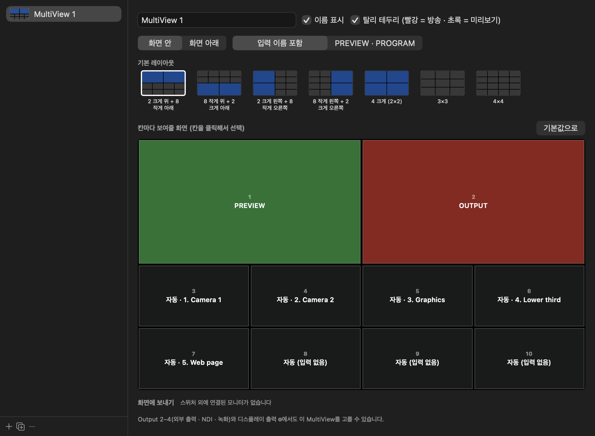
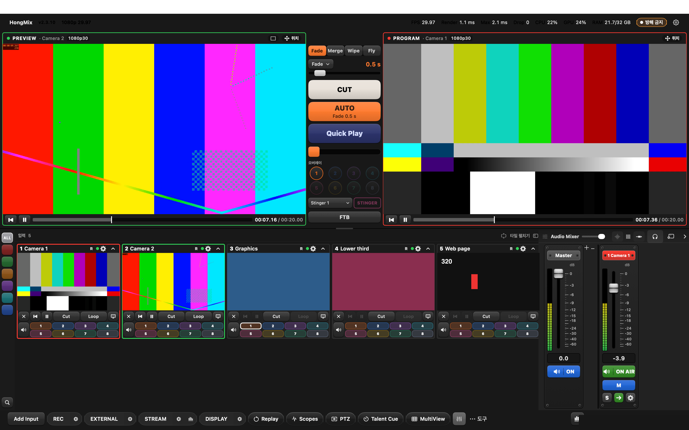

# HongMix 2.3.10 (빌드 187)

**MultiView 이름표, 스코프 창, 하드웨어 룩 개선 등은 [@otiumvisuals](https://github.com/otiumvisuals) 님이 기여해 주셨고 렌더 스레드 개선 아이디어는 Reddit의 Hawk_Super 님께 받았습니다. 감사합니다!**

HongMix 2.3.10은 건너뛴 2.3.9용 엔진 변경과 커뮤니티 PR #10~#14를 하나로 합쳤습니다.

## 부드러운 브라우저 입력과 조용한 실행

- 메인 HongMix 창이 보일 때 YouTube 등 브라우저 입력 영상이 끊기던 문제를 고쳤습니다. 측정한 페이지는 약 25fps에서 30fps로 올라갔고 24초 동안 24번이던 긴 간격이 0~1번으로 줄었습니다.
- Chromium 로딩 중 HongMix가 스피커를 잠깐 열지 않게 해 실행할 때 짧게 나던 소리를 없앴습니다. 웹페이지 소리는 계속 HongMix 믹서로 들어옵니다.

## 가벼워진 렌더링

- MultiCorder ISO 화면을 각각 기다리지 않고 GPU 한 번의 작업과 대기로 처리합니다. ISO 4개 시험에서 프레임당 1.67ms가 0.79ms로 줄었습니다.
- MultiView 이름표는 한 번 그려 GPU에 저장합니다. 4×4 MultiView가 프레임당 1.23ms에서 0.71ms로 줄었고 픽셀 차이는 2/255 이하였습니다.

## MultiView 이름과 배치

- 칸마다 이름을 직접 지정합니다.
- 이름표를 **화면 안** 또는 **화면 아래**에 놓습니다.
- 자동 이름은 **입력 이름 포함**(기본·기존 방식) 또는 **PREVIEW · PROGRAM**만 표시하도록 고릅니다.
- 새 이름 옵션을 쓴 프로젝트도 이전 버전에서 열리며 새 설정만 무시됩니다.

## 커뮤니티 화면 개선

- 스코프 창을 여러 개 열어 카메라마다 따로 볼 수 있습니다.
- 하드웨어 룩의 회색 톤과 모니터·타일 모서리를 다듬고 Talent Cue에 입체 조작계를 적용했습니다.
- **배경에 금속 질감**은 선택 기능이며 기본으로 꺼져 있습니다. 탈리 테두리는 100% 강도를 유지합니다.
- 모든 스킨에서 로딩 점검의 체크 표시가 초록색입니다.
- 오버레이 채널이 기억하는 입력은 해당 타일 키에 테두리가 표시됩니다.

## 검증과 제한

- 번역·핵심·MultiView 테스트를 통과했습니다. 운영자 프로젝트에서 드랍은 0이었고 HongMix GPU 사용량은 6.6%였으며 금속 질감을 켜도 측정 차이가 없었습니다.
- DMG 무결성과 심층 애드혹 서명을 확인했고 Chromium이 포함돼 있으며 빌드 187 DMG·PKG 체크섬이 배포 파일과 일치했습니다.
- 빌드 187은 시험한 빌드 186과 같은 소스지만 애드혹 서명 때문에 폴더 접근 권한을 다시 물을 수 있어 운영자 프로젝트로 직접 실행하지 않았습니다.
- 여러 스코프 창을 실제 창으로 열어 보지는 못했습니다.
- 메인 창이 처음 앞으로 올 때 약 1초 멈추는 이전 버전부터의 현상이 남아 있습니다.
- 공개 앱은 애드혹 서명이고 아직 Apple 공증 전이며 PKG는 무서명입니다.
