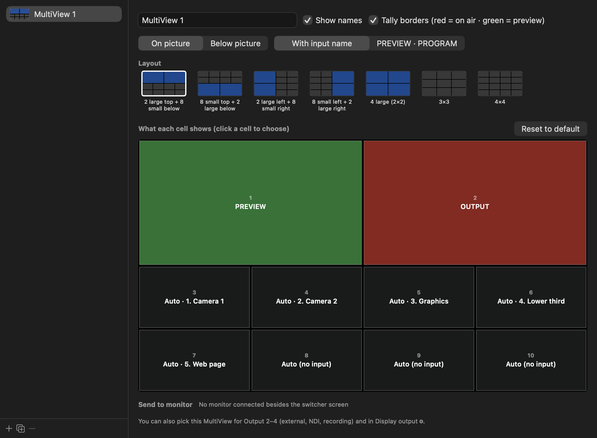
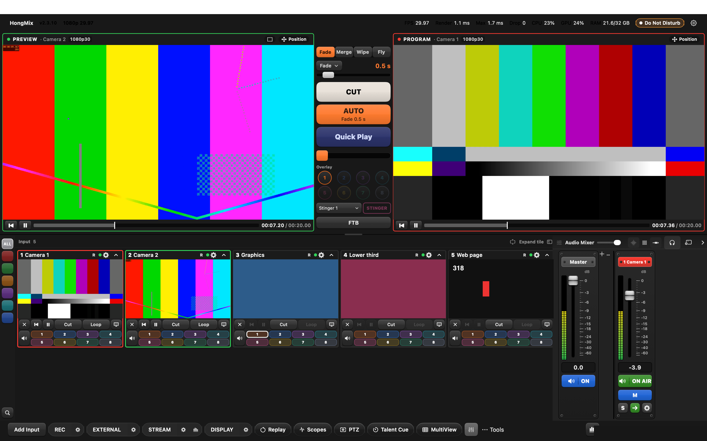

# HongMix 2.3.10 (build 187)

**MultiView labels, Scopes windows, hardware-look refinements and more were contributed by [@otiumvisuals](https://github.com/otiumvisuals), and the render-thread ideas came from Hawk_Super on Reddit — thank you!**

HongMix 2.3.10 combines the engine work prepared for the skipped 2.3.9 with community PRs #10–#14.

## Smoother Browser inputs and quieter launch

- YouTube and other video in a Browser input no longer stutters while the main HongMix window is visible. In the measured page, playback rose from about 25 to 30 fps and long gaps fell from 24 per 24 seconds to 0–1.
- HongMix no longer briefly opens the speakers while Chromium loads, removing the short click heard at launch. Page audio still goes to the HongMix mixer.

## Lighter rendering

- MultiCorder renders all ISO frames in one GPU pass with one wait instead of waiting once per ISO. Four ISO outputs fell from 1.67 to 0.79 ms per frame in the test.
- MultiView labels are drawn once and cached on the GPU. A 4×4 MultiView fell from 1.23 to 0.71 ms per frame, with pixel differences no greater than 2/255.

## MultiView names and layout

- Give every cell its own name.
- Place labels **On picture** or **Below picture**.
- Automatic names can show **With input name** (the default and previous behavior) or only **PREVIEW · PROGRAM**.
- Projects using these name options still open in older versions; the new settings are ignored.

## Community interface improvements

- Open more than one Scopes window, for example one per camera.
- The hardware look gains refined gray tones, squarer monitors and tiles, and hardware-style Talent Cue controls.
- **Brushed-metal background** is an optional setting and is off by default. Tally borders remain at full strength.
- Launch checks use green check marks in every skin.
- An Overlay key shows a ring when that channel remembers the input.

## Verification and limits

- Translation, core and MultiView tests passed. The operator's project recorded zero drops; HongMix GPU use was 6.6%, with no measured change when the metal texture was enabled.
- The DMG verified as valid, deep ad-hoc signing passed, Chromium is bundled, and the build 187 DMG/PKG checksums matched the release files.
- Build 187 uses the same source as tested build 186, but was not run with the operator's project because its ad-hoc signature would prompt for folder access again.
- Multiple Scopes windows were not checked as real windows.
- A roughly one-second pause when the main window first comes to the front remains from earlier versions.
- The public app is ad-hoc signed and is not Apple-notarized yet. The PKG is unsigned.
