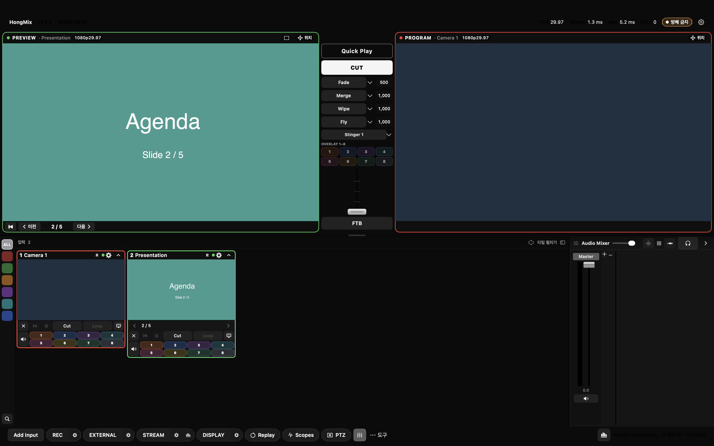

# HongMix 2.3.3 · build 157

> 스위처·웹 리모컨에서 슬라이드를 바로 넘기고 PowerPoint·Keynote 파일을 직접 사용합니다. Control slides on the switcher and web remote, and use PowerPoint or Keynote files directly.

## 한국어

- Preview·Program 아래에 **처음 · 이전 · n / N · 다음** 슬라이드 버튼
- 각 입력 타일의 **‹ n / N ›** 줄에서 송출 전 자료 준비
- 휴대폰·태블릿 웹 리모컨의 Program과 입력 타일에서 슬라이드 넘기기
- PDF 슬라이드 입력에 PPTX·PPT·Keynote 파일을 그대로 추가 — Office·Keynote 설치 불필요
- 원본을 다시 저장하면 현재 페이지를 유지한 채 재변환; 숨긴 슬라이드는 제외

## English

- **First · Previous · n / N · Next** controls below Preview and Program
- Prepare a deck before air with the **‹ n / N ›** strip on every slide input tile
- Turn slides from Program and input tiles in the phone and tablet web remote
- Add PPTX, PPT or Keynote files directly to PDF Slides — no Office or Keynote installation required
- Saving the source converts it again while keeping the current page; hidden slides are skipped

Full notes: [English](https://github.com/HongMix/HongMix/blob/main/docs/RELEASE-NOTES-2.3.3.md) · [한국어](https://github.com/HongMix/HongMix/blob/main/docs/RELEASE-NOTES-2.3.3.ko.md)

Full manuals: [English](https://github.com/HongMix/HongMix/blob/main/docs/manual/HongMix-Manual.en.md) · [한국어](https://github.com/HongMix/HongMix/blob/main/docs/manual/HongMix-Manual.ko.md)

## Verification

Real-app PPTX conversion and slide controls passed. Web remote tests passed on desktop (71/71), tablet (71/71) and phone (72/72). Core and translation checks passed; the DMG, checksums and ad-hoc app signature were verified for build 157. The app is not Apple-notarized yet.
