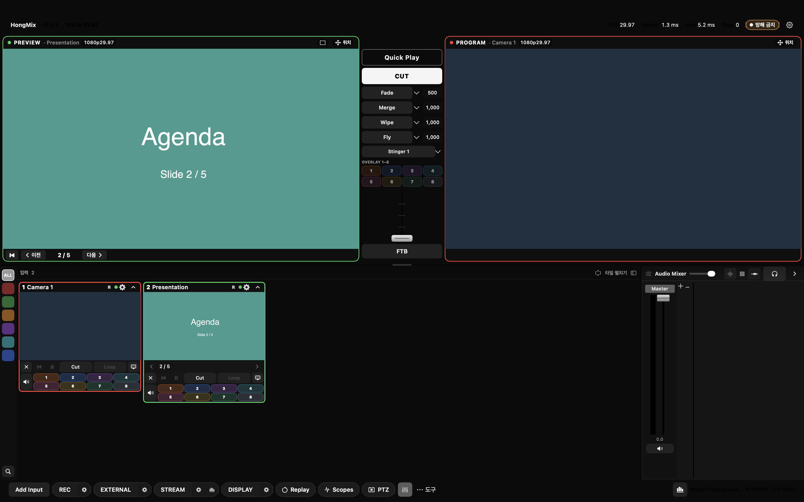
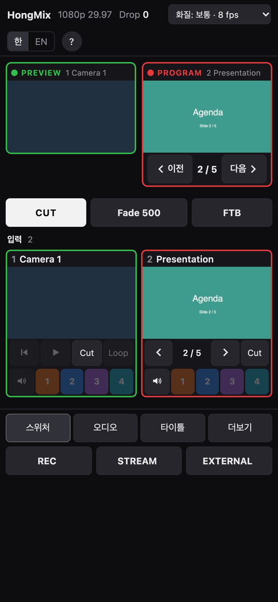
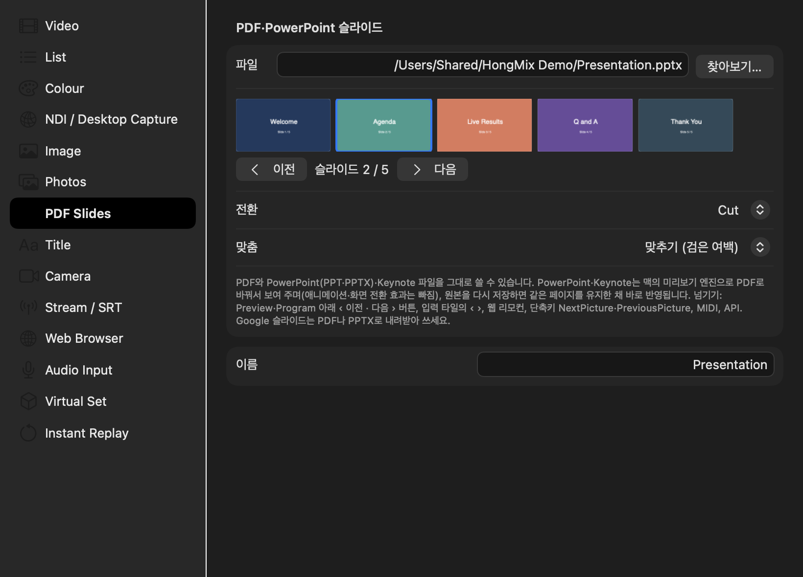

# HongMix 2.3.3 (빌드 157)

HongMix 2.3.3은 스위처와 웹 리모컨에 슬라이드 조작 버튼을 바로 표시하고, Office나 Keynote를 설치하지 않아도 PDF 슬라이드 입력에서 PowerPoint·Keynote 파일을 열 수 있습니다.

## 스위처의 슬라이드 버튼

- PDF·PowerPoint·사진 입력이 Preview나 Program에 있으면 모니터 아래에 **처음**, **이전**, 현재 장수, **다음** 버튼이 표시됩니다.
- 모든 슬라이드 입력 타일에 **‹ n / N ›** 조작 줄이 생겨 송출 전에 다음 자료를 미리 맞출 수 있습니다.
- 버튼은 **NextPicture** / **PreviousPicture** 단축키, MIDI, API와 같은 슬라이드 상태를 사용합니다.

## 웹 리모컨의 슬라이드 버튼

- 슬라이드 입력 타일에 이전·다음 버튼이 표시됩니다.
- 슬라이드 입력이 Program에 있으면 Program 모니터 아래에 큰 이전·다음 버튼이 나타납니다.
- 버튼 이름은 한/EN 전환을 따르며, 글자가 들어가지 않는 좁은 휴대폰에서는 양쪽 모두 화살표만 표시합니다.

## PowerPoint·Keynote 파일

- **PDF·PowerPoint 슬라이드** 입력에서 PDF, PPT, PPTX, PPS, PPSX, POT, POTX, Keynote, ODP 파일을 선택할 수 있습니다.
- 맥의 미리보기 엔진으로 발표 자료를 PDF로 변환하므로 PowerPoint·Keynote·LibreOffice를 설치할 필요가 없습니다.
- 원본 자료를 다시 저장하면 현재 페이지를 유지한 채 다시 변환합니다. 숨긴 슬라이드는 건너뛰며 애니메이션과 화면 전환 효과는 유지하지 않습니다.
- 미리보기 엔진이 자료를 열지 못하면 앱이 멈추거나 종료되지 않고 PDF로 내보내라는 안내를 표시합니다.

## 검증

- 합성 5장 PPTX는 약 2초 만에 변환됐습니다. 숨긴 슬라이드가 하나 있는 8장 자료는 7쪽으로 처리됐고, 원본을 다시 저장해도 선택한 페이지를 유지했습니다.
- 깨진 PPTX는 충돌 없이 명확한 오류를 표시했습니다.
- 실제 앱의 웹 리모컨에서 Program과 타일 버튼이 동작했습니다. 자동 테스트는 PC 71/71, 태블릿 71/71, 휴대폰 72/72를 통과했습니다.
- 번역 검사와 코어 테스트를 통과했고, DMG 무결성과 빌드 157 DMG·PKG의 체크섬을 확인했습니다.

## 알려진 제한

- 발표 자료는 정지된 PDF 페이지로 바뀌므로 애니메이션과 화면 전환 효과는 유지되지 않습니다.
- 공개 앱은 애드혹 서명이며 아직 Apple 공증 전입니다.
