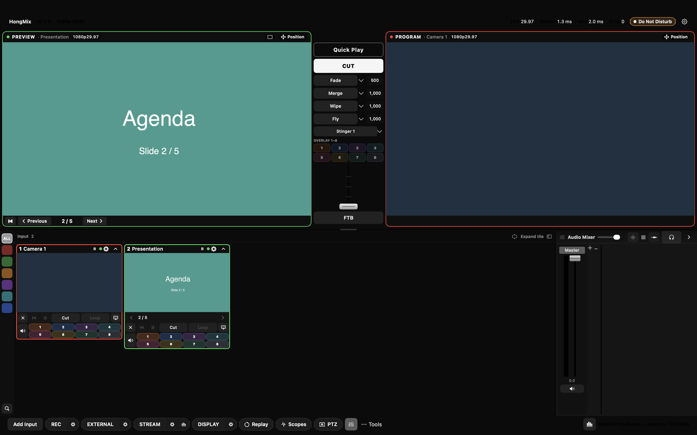
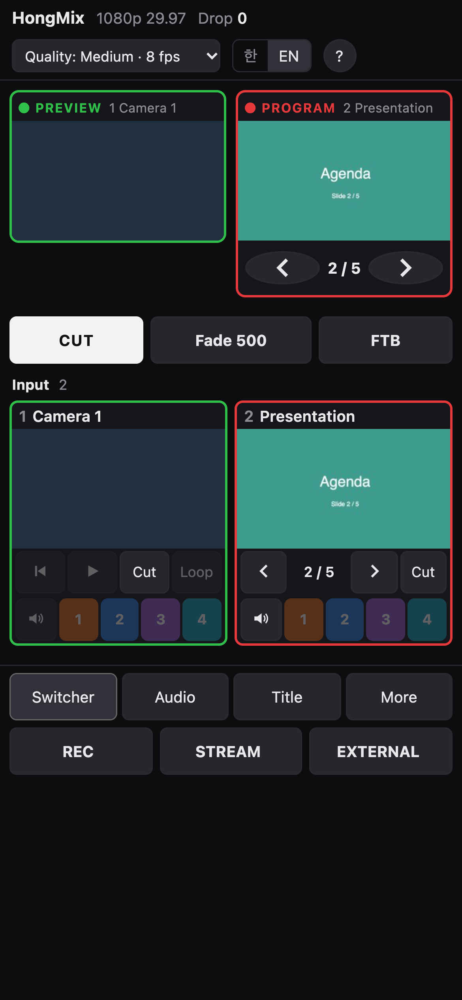
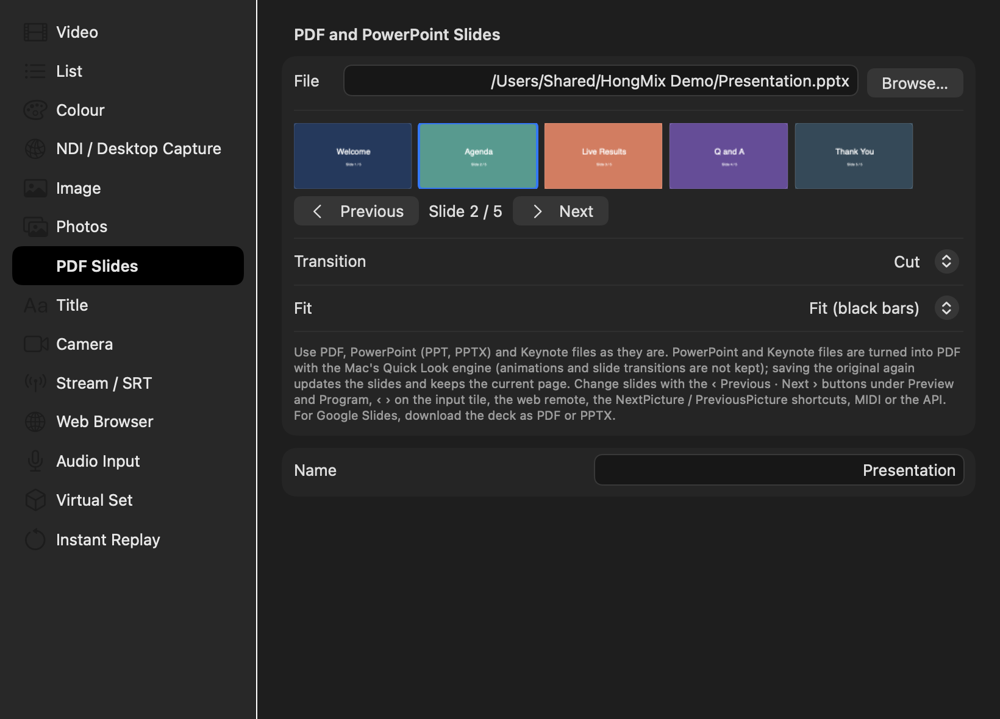

# HongMix 2.3.3 (build 157)

HongMix 2.3.3 puts slide controls directly on the switcher and web remote, and lets the PDF Slides input open PowerPoint and Keynote files without Office or Keynote installed.

## Slide controls on the switcher

- When a PDF, PowerPoint or Photos input is in Preview or Program, the bar below the monitor shows **First**, **Previous**, the current slide count and **Next**.
- Every slide input tile has a compact **‹ n / N ›** strip, so an operator can prepare a deck before putting it on air.
- The buttons share the same slide state as **NextPicture** / **PreviousPicture** shortcuts, MIDI and API commands.

## Slide controls in the web remote

- Slide tiles have previous and next buttons.
- When a slide input is on Program, the Program monitor has large previous and next controls.
- Labels follow the Korean / English switch. On narrow phones, both controls become arrow-only when the words do not fit.

## PowerPoint and Keynote files

- The **PDF and PowerPoint Slides** input accepts PDF, PPT, PPTX, PPS, PPSX, POT, POTX, Keynote and ODP files.
- HongMix uses the Mac's Quick Look engine to convert presentation files to PDF; PowerPoint, Keynote and LibreOffice are not required.
- Saving the source deck converts it again while keeping the current page. Hidden slides are skipped; animations and slide transitions are not preserved.
- If Quick Look cannot open a deck, HongMix displays a clear message asking for a PDF export instead of hanging or crashing.

## Verification

- A synthetic five-slide PPTX converted in about two seconds. An eight-slide deck with one hidden slide produced seven pages, and re-saving kept the selected page.
- A corrupt PPTX produced a clear error with no crash.
- Real-app Program and tile controls worked through the web remote. Automated remote tests passed: desktop 71/71, tablet 71/71 and phone 72/72.
- Translation and core tests passed, the DMG verified as valid, and the build 157 DMG and PKG checksums matched the release files.

## Known limitations

- Presentation animations and transitions are not retained because imported decks become still PDF pages.
- The public app is ad-hoc signed and is not Apple-notarized yet.
