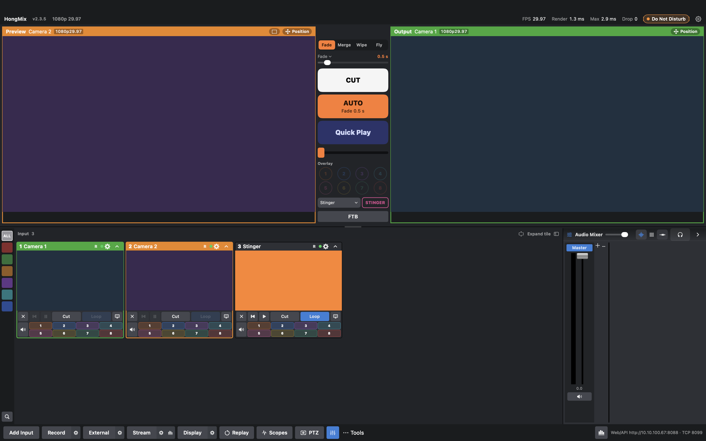

# HongMix 2.3.5 · build 165

> 최종 센터 패널, 정상 동작하는 스팅어, 끝까지 재생되는 영상과 읽기 쉬운 번역 자막. Final center panel, fixed stinger and clip endings, and readable translated captions.

## 한국어

- 트랜지션 탭·길이 슬라이더와 한 줄씩 크게 놓인 **CUT · AUTO · Quick Play**의 새 센터 패널
- Loop가 켜진 영상도 스팅어는 한 번만 재생되고 끝나면 정확히 빠짐
- 영상 마지막 약 0.5초가 잘리지 않고 마지막 프레임까지 재생
- 저장한 모니터가 없을 때 디스플레이 출력이 저절로 꺼지던 문제 수정
- 원문 아래 번역 자막 2줄, 각 번역 최소 3초 유지
- 영어 화면에 남던 한국어 상태·오류·라벨 수정

## English

- New center panel with transition tabs, a duration slider and large stacked **CUT · AUTO · Quick Play** buttons
- Stinger plays once even when its media input loops, then clears correctly
- Clips play through their last frame instead of losing the final half-second
- Fixes Display output turning itself off when the saved monitor is absent
- Two translated caption lines below the original, each held for at least three seconds
- Fixes remaining Korean status, errors and labels in the English interface

Full notes: [English](https://github.com/HongMix/HongMix/blob/main/docs/RELEASE-NOTES-2.3.5.md) · [한국어](https://github.com/HongMix/HongMix/blob/main/docs/RELEASE-NOTES-2.3.5.ko.md)

Full manuals: [English](https://github.com/HongMix/HongMix/blob/main/docs/manual/HongMix-Manual.en.md) · [한국어](https://github.com/HongMix/HongMix/blob/main/docs/manual/HongMix-Manual.ko.md)

## Verification

Real-app stinger, clip-ending, Display output and translated-caption checks passed. Core and translation checks passed; the DMG, checksums and ad-hoc app signature were verified for build 165. The app is not Apple-notarized yet.
