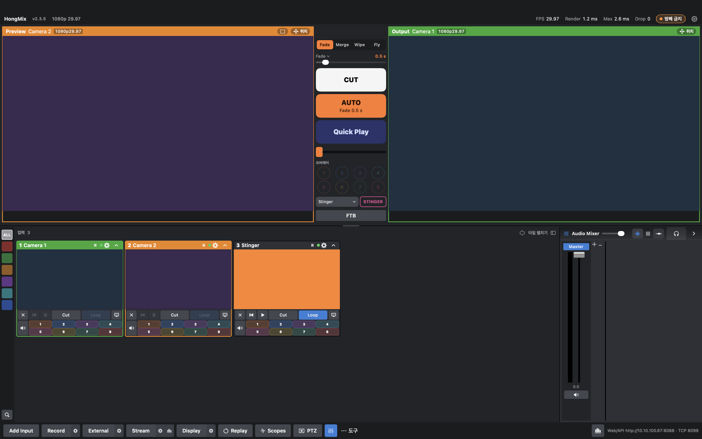
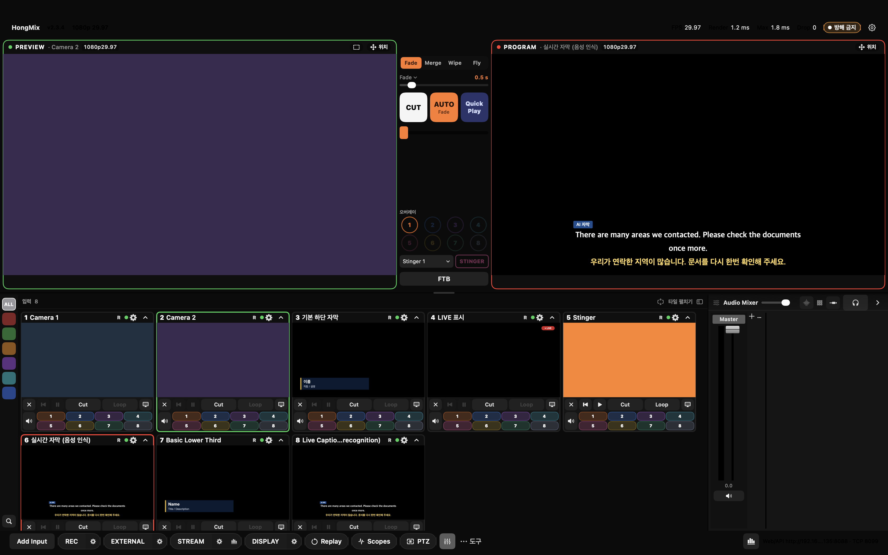

# HongMix 2.3.5 (빌드 165)

HongMix 2.3.5는 최종 센터 패널 C안을 적용하고 스팅어와 영상 마지막 구간 재생, 디스플레이 출력 유지, 번역 자막, 영어 화면을 개선했습니다. 2.3.4는 배포하지 않았으며 해당 변경을 모두 이번 버전에 포함했습니다.

## 새 센터 패널

- 트랜지션 탭에서 **AUTO**와 가로 T-바가 사용할 효과를 고릅니다. 탭을 우클릭하면 효과를 바꿀 수 있습니다.
- 선택한 효과와 0~5초 길이 아래에 **CUT**, **AUTO**, **Quick Play**를 한 줄씩 큰 버튼으로 놓았습니다.
- **AUTO**는 “Fade 0.5 s”처럼 선택한 효과와 시간을 가운데 정렬한 두 번째 줄에 표시합니다.
- 세 버튼이 남는 높이를 나눠 사용하므로 창이 작아져도 잘리지 않습니다.
- 가로 T-바, 원형 Overlay 1–8 버튼, 별도 스팅어 선택·실행 버튼과 FTB를 한 열에 배치했습니다.

## 스팅어와 영상 재생 수정

- 미디어 입력의 Loop가 켜져 있어도 스팅어는 한 번만 재생됩니다. 실행 중 Loop를 잠시 끄고, 끝나면 영상을 빼고 멈춘 뒤 원래 Loop 설정을 복구합니다.
- 설정한 컷 지점에서 Program이 바뀌고, 영상이 실제로 끝날 때 스팅어가 빠집니다.
- 영상이 끝나기 약 0.5초 전에 멈추지 않고 큐에 남은 마지막 프레임까지 보여 줍니다.
- 새 API 함수: `SetStinger` — 미디어 `Input`과 선택적인 밀리초 컷 지점 `Value`를 사용합니다.

## 디스플레이 출력 유지

- 저장한 모니터가 없어서 다른 화면에 출력을 띄운 경우, Dock·메뉴 막대·잠자기 복귀 등 화면 정보 알림 때문에 출력이 닫히지 않습니다.
- 창 모드 출력의 모니터를 분리해도 macOS가 남은 화면으로 창을 옮길 수 있으며 HongMix가 출력을 끄지 않습니다.

## 번역 자막 2줄

- 번역 자막은 기본적으로 원문 아래 두 줄을 사용하며 **번역 줄 수**를 1~4로 조절할 수 있습니다.
- 각 번역은 최소 3초, 또는 설정한 최소 줄 표시 시간이 더 길면 그 시간만큼 유지됩니다.
- **시험 문장 보내기**도 번역하므로 송출 전에 전체 배치를 확인할 수 있습니다.

## 영어 화면 수정

- 코어 입력 상태와 오류 메시지가 영어 화면에서 번역됩니다.
- 기본 실시간 자막 라벨과 타이틀 갤러리 필터가 선택한 언어를 따릅니다.
- TCP 8099 사용 불가 실행 점검이 한국어 문구에 의존하지 않습니다.

## 검증

- Loop가 켜진 2초 스팅어가 500ms 컷 지점에서 Program을 바꾸고 약 2.1초에 빠진 뒤 Loop 복구·일시 정지되는 동작을 두 번 연속 확인했습니다.
- 같은 영상이 약 1500ms에서 멈추지 않고 마지막 프레임인 1960ms까지 재생됐으며 일반 영상도 같은 검사를 통과했습니다.
- 저장 모니터가 없는 상태에서 창·전체 화면 Display 출력 각각 화면 변경 알림 5회를 견뎠습니다.
- 번역 검사와 코어 테스트를 통과했고, DMG 무결성과 빌드 165 DMG·PKG의 체크섬을 확인했습니다.

## 알려진 제한

- 공개 앱은 애드혹 서명이며 아직 Apple 공증 전입니다.
