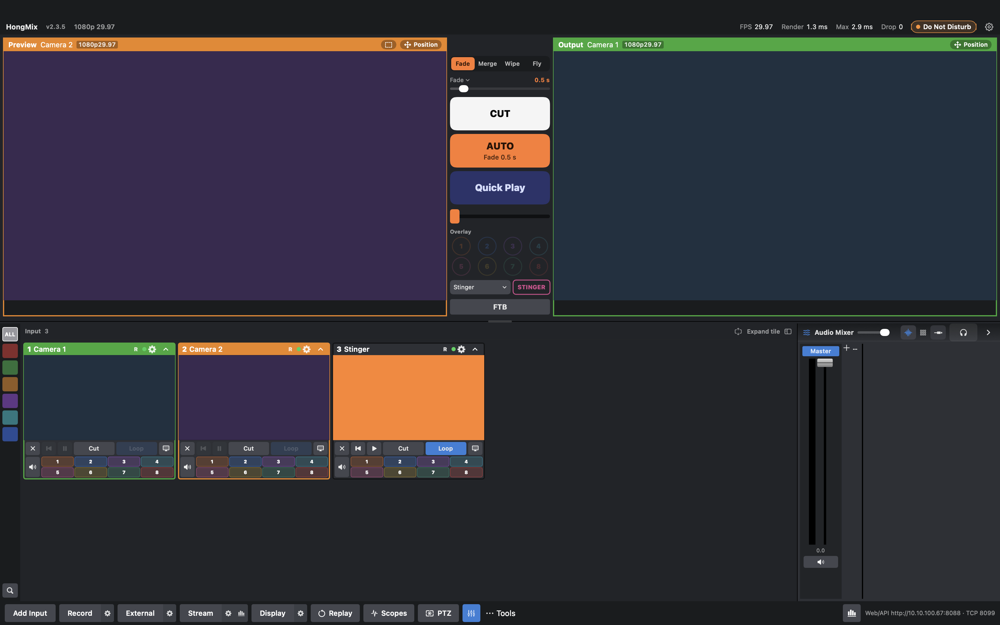
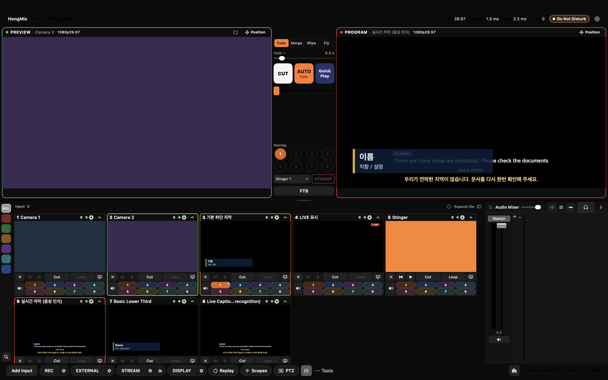

# HongMix 2.3.5 (build 165)

HongMix 2.3.5 introduces the final center-panel layout, fixes stinger playback and the last half-second of video clips, keeps Display output on air, improves translated captions, and removes remaining Korean text from the English interface. Version 2.3.4 was not published; all of its changes are included here.

## New center panel

- Transition tabs select the effect used by **AUTO** and the horizontal T-bar; right-click a tab to change its effect.
- The selected effect and its 0–5 second duration sit above three large full-width rows: **CUT**, **AUTO**, and **Quick Play**.
- **AUTO** shows the selected effect and time on a centered second line, for example “Fade 0.5 s”.
- The free height is shared by the three buttons so the panel still fits in a smaller window.
- A horizontal T-bar, round Overlay 1–8 keys, a separate stinger picker and button, and FTB complete the column.

## Stinger and clip playback fixes

- A stinger now plays once even when its media input has Loop enabled. HongMix temporarily disables Loop, clears and pauses the clip at the end, then restores the original Loop setting.
- The cut occurs at the configured cut point and the stinger clears when the clip actually finishes.
- Clips no longer stop about half a second early: HongMix waits until the final queued frame has been shown.
- New API function: `SetStinger` with a media `Input` and optional cut point in milliseconds as `Value`.

## Display output stays on air

- Display output no longer closes after a Dock, menu bar, wake or other screen-parameter notification when its saved monitor is absent and the output is using another screen.
- If a windowed output's monitor is unplugged, macOS can move the window to a remaining display without HongMix turning it off.

## Two-line translated captions

- Translated captions use two lines below the original by default, adjustable with **Translation lines** from 1–4.
- Each translation stays visible for at least three seconds, or the configured minimum line time if longer.
- **Send test sentence** also exercises translation, so the full layout can be checked before air.

## English interface fixes

- Core input status and error messages are translated in the English interface.
- The default live-caption label and title-gallery filters now follow the selected language.
- The launch check for an unavailable TCP 8099 port no longer depends on Korean text.

## Verification

- A two-second looping stinger switched Program at the 500 ms cut point, cleared at about 2.1 seconds, restored Loop and paused correctly, twice in a row.
- The same clip reached its final frame at 1960 ms instead of stopping near 1500 ms; ordinary clip playback passed the same check.
- Windowed and fullscreen Display output each stayed on through five simulated screen-change events with the saved monitor absent.
- Translation and core tests passed, the DMG verified as valid, and the build 165 DMG and PKG checksums matched the release files.

## Known limitations

- The public app is ad-hoc signed and is not Apple-notarized yet.
