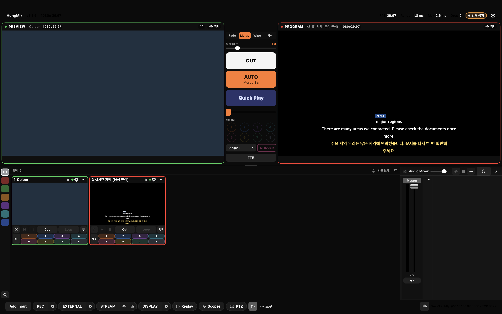
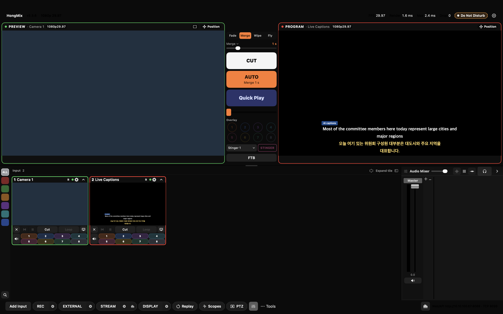

# HongMix 2.3.6 · build 168

> 번역 자막이 원문과 같이 바뀌고, 원문·번역 줄 수가 각각 제대로 나옵니다. Translated captions now change with their original, with independent original and translation line counts.

## 한국어

- 번역이 원문보다 먼저 나오지 않고 둘이 같이 바뀍니다.
- **자막 줄 수**는 원문, **번역 줄 수**는 번역에 각각 적용됩니다.
- 줄이 다 들어가지 않으면 자막 영역이 위로 늘어납니다.

## English

- The translation no longer appears before its original; both change together.
- **Caption lines** sets the original rows and **Translation lines** sets the translated rows.
- The caption area grows upward when the configured rows need more room.

Full notes: [English](https://github.com/HongMix/HongMix/blob/main/docs/RELEASE-NOTES-2.3.6.md) · [한국어](https://github.com/HongMix/HongMix/blob/main/docs/RELEASE-NOTES-2.3.6.ko.md)

Full manuals: [English](https://github.com/HongMix/HongMix/blob/main/docs/manual/HongMix-Manual.en.md) · [한국어](https://github.com/HongMix/HongMix/blob/main/docs/manual/HongMix-Manual.ko.md)

## Verification

Synthetic test sentences showed paired original and translated captions with two- and three-line original layouts. Core and translation checks passed; the DMG, checksums and ad-hoc app signature were verified for build 168. Continuous speech from a live microphone was not tested. The app is not Apple-notarized yet.
