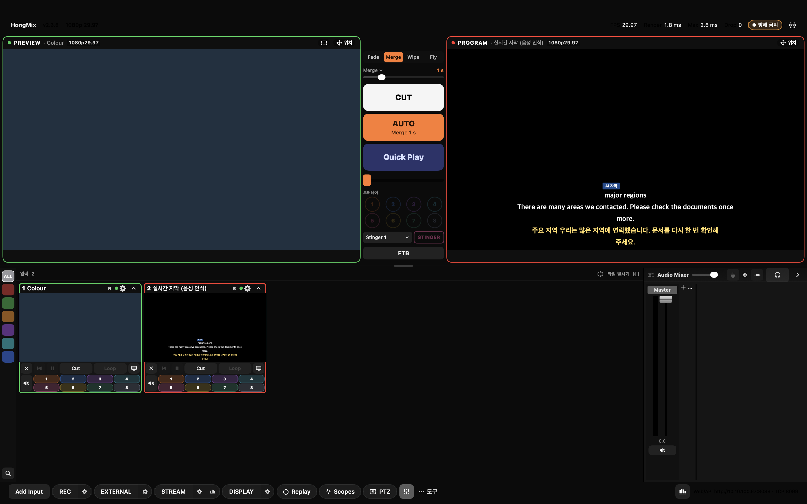

# HongMix 2.3.6 (빌드 168)

HongMix 2.3.6은 실시간 번역 자막이 원문보다 먼저 나오던 문제를 고치고, 원문과 번역 줄 수 설정이 각각 제대로 적용되게 했습니다.

## 원문과 번역이 같이 표시됨

- 번역이 해당 원문보다 먼저 나오지 않습니다. 최신 번역이 준비되면 원문과 번역을 같이 바꿉니다.
- 번역을 켜면 자막 변경 간격이 **한 줄 최소 시간**을 따르며, 최소 1.5초는 유지됩니다.
- 번역을 사용할 수 없거나 4초 넘게 걸리면 원문을 무기한 기다리게 하지 않고 원문만 표시합니다.
- **번역만 표시** 모드는 바뀌지 않았습니다.

## 자막 줄 수 설정 수정

- **자막 줄 수**는 원문 표시 줄 수를 정합니다.
- **번역 줄 수**는 원문 아래의 번역 표시 줄 수를 정합니다.
- 설정한 줄이 선택한 자막 영역에 다 들어가지 않으면 줄을 조용히 버리지 않고 영역을 위로 늘립니다.
- 박스와 밴드 배경도 자막 영역과 같이 늘어납니다.

## 검증

- 운영자의 영어→한국어 사용자 배치에서 합성 시험 문장을 넣으면 0.9~1.9초 후 원문과 번역이 같이 나왔습니다. macOS 번역기를 불러오는 첫 번째 번역은 2.9초 걸렸습니다.
- 화면 글자 인식으로 각 한국어 묶음이 바로 위 영어와 맞는지 확인했습니다.
- 원문 2줄+번역, 원문 3줄+번역 2줄을 앱에서 확인했고 후자는 자막 영역이 위로 늘어났습니다.
- 번역 검사와 코어 테스트를 통과했고, DMG 무결성과 빌드 168 DMG·PKG 체크섬을 확인했습니다.

## 알려진 제한

- 자막 동작은 합성 시험 문장으로 확인했으며 실제 마이크의 연속 발화로는 시험하지 못했습니다.
- 공개 앱은 애드혹 서명이며 아직 Apple 공증 전입니다.
