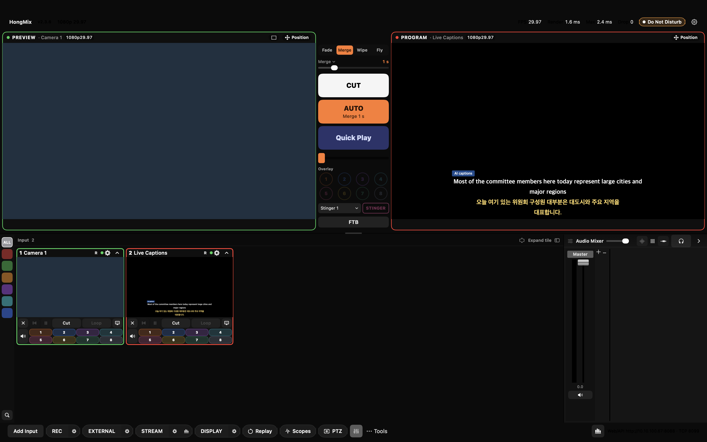

# HongMix 2.3.6 (build 168)

HongMix 2.3.6 fixes translated live-caption ordering and makes the configured original and translation line counts work independently.

## Original and translation now appear together

- A translation no longer appears before the original text it belongs to. HongMix waits for the newest translation, then changes the original and translation together.
- Caption changes respect **Minimum time per line**, with a minimum hold of 1.5 seconds while translation is enabled.
- If translation is unavailable or takes more than four seconds, the original appears on its own instead of being held indefinitely.
- **Translation only** mode is unchanged.

## Caption line settings fixed

- **Caption lines** now sets the number of original-language rows.
- **Translation lines** sets the number of translated rows below the original.
- If all configured rows do not fit in the chosen caption area, the area grows upward instead of silently dropping rows.
- Box and band backgrounds grow with the caption area.

## Verification

- With the operator's English-to-Korean custom layout, synthetic test sentences showed the original and translation together after 0.9–1.9 seconds; the first translation took 2.9 seconds while macOS loaded the translator.
- OCR confirmed that each Korean block matched the English immediately above it.
- Two original lines plus translation and three original lines plus two translated lines were checked in the app; the latter layout expanded upward.
- Translation and core tests passed, the DMG verified as valid, and the build 168 DMG and PKG checksums matched the release files.

## Known limitations

- The caption behaviour was checked with synthetic test sentences, not continuous speech from a live microphone.
- The public app is ad-hoc signed and is not Apple-notarized yet.
