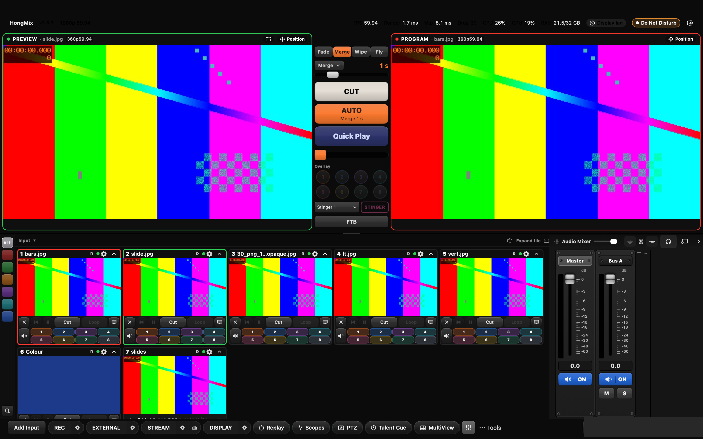

# HongMix 2.3.7 · build 171

**이번 버전의 MultiView, Talent Cue, 하드웨어 룩 등은 [@otiumvisuals](https://github.com/otiumvisuals) 님이 기여해 주셨습니다. 감사합니다!**
**MultiView, Talent Cue, the hardware look and more in this release were contributed by [@otiumvisuals](https://github.com/otiumvisuals) — thank you!**

## 한국어

- **MultiView 여러 개:** 레이아웃 7종, 칸별 화면, 이름·탤리, 모니터·출력으로 보내기
- **Talent Cue:** 발표자 타이머·메시지, 보호된 사회자 휴대폰 링크
- **하드웨어 룩:** 콘솔 형식 믹서와 입체 조작계(설정에서 끌 수 있음)
- **Backstage(선택):** 켜면 비정상 종료 후 HongMix 자동 재실행
- 출력 패널·출력 창 여러 개, 별도 Audio Mixer 창, CPU·GPU·RAM 표시
- 720p50·2160p25·2160p50, 네덜란드어 자막, 카테고리로 입력 끌어 넣기

## English

- **Multiple MultiViews:** 7 layouts, per-cell sources, labels and tally, with monitor/output routing
- **Talent Cue:** presenter timer and messages with a protected moderator phone link
- **Hardware look:** console-style mixer and raised controls (can be disabled in Settings)
- **Backstage (optional):** relaunches HongMix after an abnormal termination when enabled
- Reworked outputs and multiple output windows, separate Audio Mixer window, CPU / GPU / RAM load
- 720p50, 2160p25, 2160p50, Dutch captions and input drops onto category tabs

> Projects using new MultiView or Talent sources do not open in HongMix 2.3.6 or older.

Full notes: [English](https://github.com/HongMix/HongMix/blob/main/docs/RELEASE-NOTES-2.3.7.md) · [한국어](https://github.com/HongMix/HongMix/blob/main/docs/RELEASE-NOTES-2.3.7.ko.md)

Full manuals: [English](https://github.com/HongMix/HongMix/blob/main/docs/manual/HongMix-Manual.en.md) · [한국어](https://github.com/HongMix/HongMix/blob/main/docs/manual/HongMix-Manual.ko.md)

## Verification and limits

Core, translation, MultiView, Talent Cue, installed Backstage, Display regression, DMG and signing checks passed. MultiView was received over NDI at 1080p and about 58 fps. One AppKit launch crash occurred once and did not recur in six additional cycles. Physical second-monitor routing was not tested. The app is ad-hoc signed and not Apple-notarized; the PKG is unsigned.
