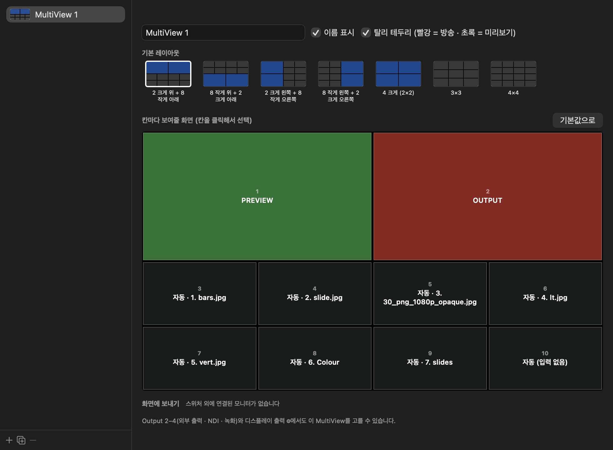
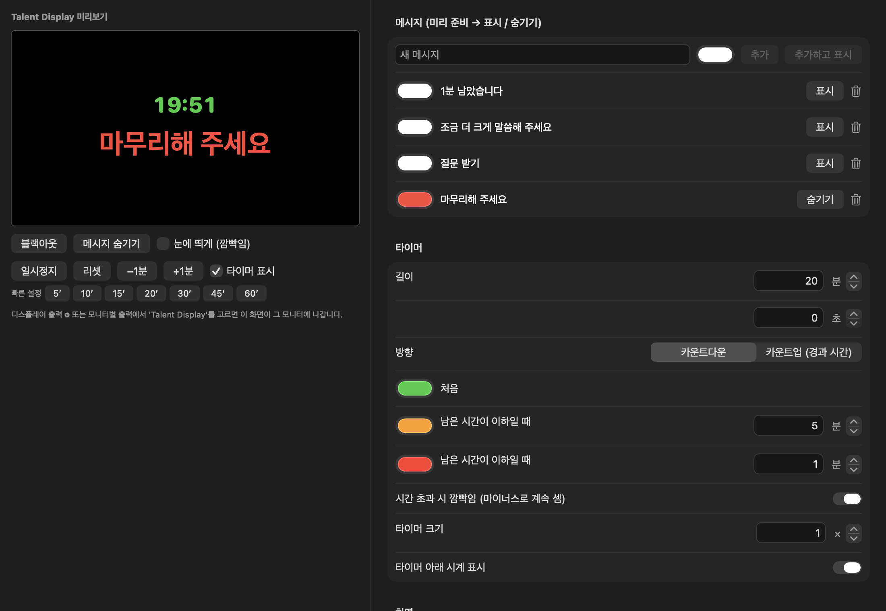
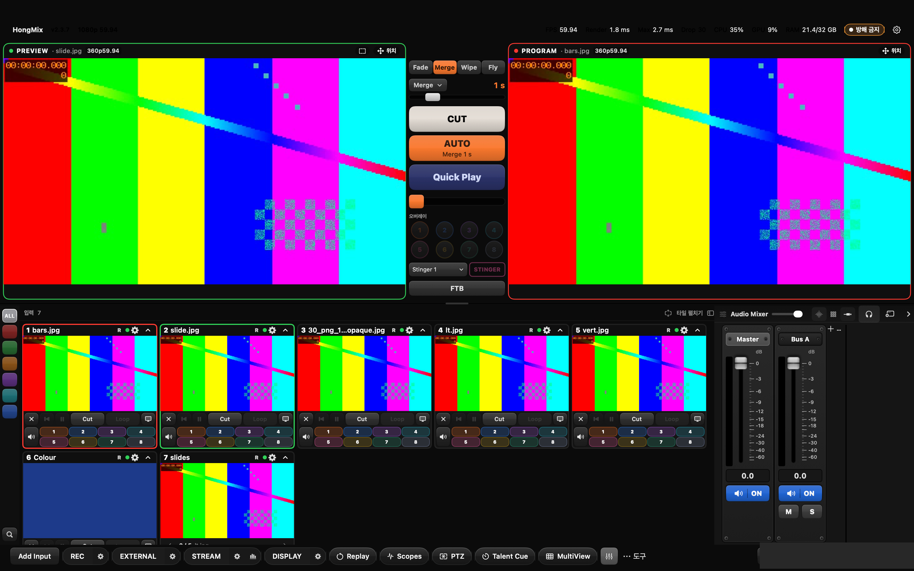

# HongMix 2.3.7 (빌드 171)

**이번 버전의 MultiView, Talent Cue, 하드웨어 룩 등은 [@otiumvisuals](https://github.com/otiumvisuals) 님이 기여해 주셨습니다. 감사합니다!**

HongMix 2.3.7은 여러 개의 편집 가능한 MultiView, 발표자 타이머·메시지, 선택적 충돌 안전망, 하드웨어 콘솔 화면과 새 출력 작업 방식을 추가했습니다.

## MultiView 여러 개

- MultiView를 여러 개 만들고 2+8, 8+2, 왼쪽 큰 화면, 오른쪽 큰 화면, 2×2, 3×3, 4×4의 레이아웃 7종을 고릅니다.
- 칸마다 소스를 고르고 이름과 Program/Preview 탤리 테두리를 표시합니다.
- MultiView를 모니터, Output 2~4, Display 출력, NDI/DeckLink, 출력 창으로 보냅니다.
- 부하가 커지면 Program보다 MultiView의 프레임레이트를 먼저 낮춥니다.

## Talent Cue

- 발표자 화면에 카운트다운·카운트업, 색상 구간, 준비한 메시지·직접 입력한 메시지, 깜빡임, 대기 화면, 블랙아웃을 표시합니다.
- 제작 안에 발표자 화면이 필요하면 **Talent Display** 입력을 추가합니다.
- 보호된 사회자 링크로 휴대폰에서 Talent Cue를 조작합니다. 별도 비밀 키를 쓰며 일반 API 권한은 주지 않습니다.

## 하드웨어 룩과 운영 작업 방식

- 하드웨어 룩은 콘솔 형식 믹서 채널, 입체 버튼과 알루미늄 질감을 추가합니다. 설정에서 끄면 이전 평면 화면을 쓰며 센터 열의 순서는 그대로입니다.
- 출력 패널은 모니터마다 한 줄을 쓰고, 이름을 붙인 출력 창 여러 개와 MultiView·Talent Display 라우팅을 지원합니다.
- Audio Mixer를 별도 창으로 옮길 수 있고 위쪽 바에 CPU·GPU·RAM 부하가 나옵니다.
- 720p50·2160p25·2160p50, 네덜란드어 실시간 자막, 카테고리 탭으로 입력 끌어 넣기, 고정 크기 입력 속성 창, 새 Replay 화면을 추가했습니다.

## 선택 기능 Backstage 안전망

- Backstage는 기본으로 꺼져 있으며 **설정 › 일반**에서 켭니다.
- 켜면 보조 앱이 Talent Display를 유지하고 HongMix가 충돌하거나 강제 종료된 뒤 2분 안에 최대 3회 다시 실행합니다.
- Backstage는 송출·녹화를 계속 유지하지 않습니다.
- 설치된 보조 앱이 내장 SSL/SRT 라이브러리를 찾도록 고쳤고 디버그 심볼을 제거했습니다.

## 검증

- 번역·코어·MultiView·Talent Cue 테스트를 통과했고 운영자의 입력 5개 프로젝트가 그대로 열렸습니다.
- 설치한 빌드 171의 Backstage가 강제 종료 약 1초 후 HongMix와 프로젝트를 복원했고, 정상 종료 후에는 다시 실행하지 않았습니다.
- MultiView를 NDI로 받아 1920×1080, 약 58fps와 올바른 이름·탤리 테두리를 확인했습니다.
- Talent Cue가 없거나 틀린 키와 다른 사이트의 명령·API 요청을 차단했습니다.
- Display 출력 회귀 검사, DMG와 앱·보조 앱 애드혹 서명, DMG·PKG 체크섬 검사를 통과했습니다.

## 호환성과 알려진 제한

- 새 MultiView·Talent 소스를 쓴 프로젝트는 HongMix 2.3.6 이하에서 열리지 않습니다.
- 8번 실행 중 한 번 AppKit 실행 충돌이 있었고 추가 6회 실행·종료에서는 재현되지 않았습니다.
- 보조 모니터가 없어 물리적 두 번째 모니터 라우팅과 Backstage의 Talent 창 유지는 실제 하드웨어로 시험하지 못했습니다.
- 공개 앱은 애드혹 서명이고 아직 Apple 공증 전이며 PKG는 무서명입니다.
