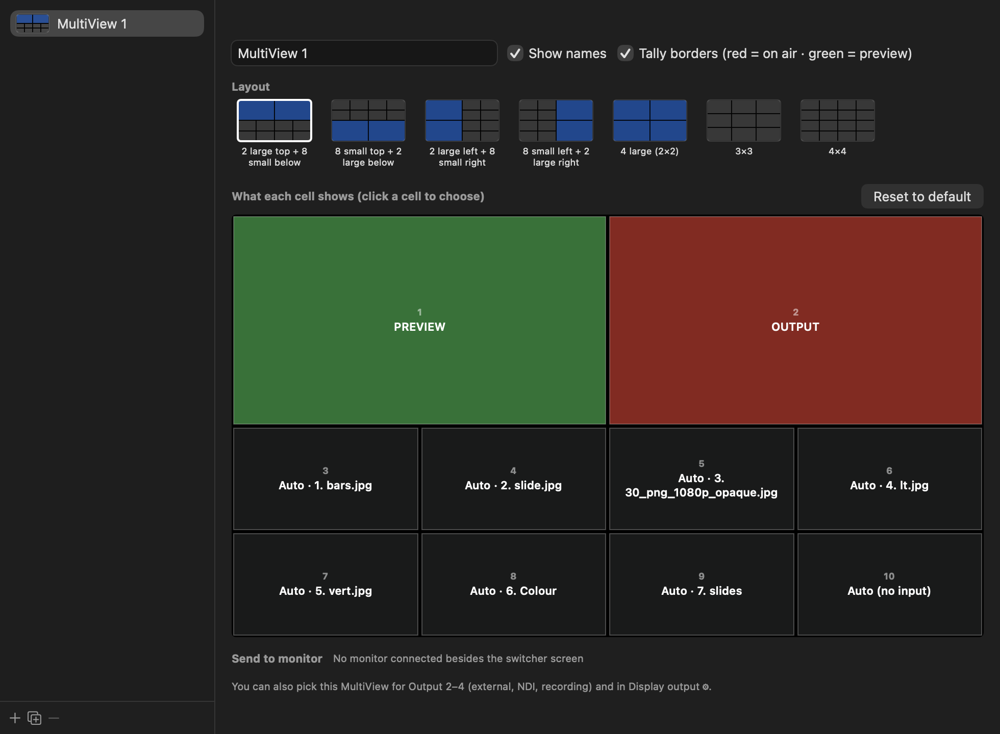
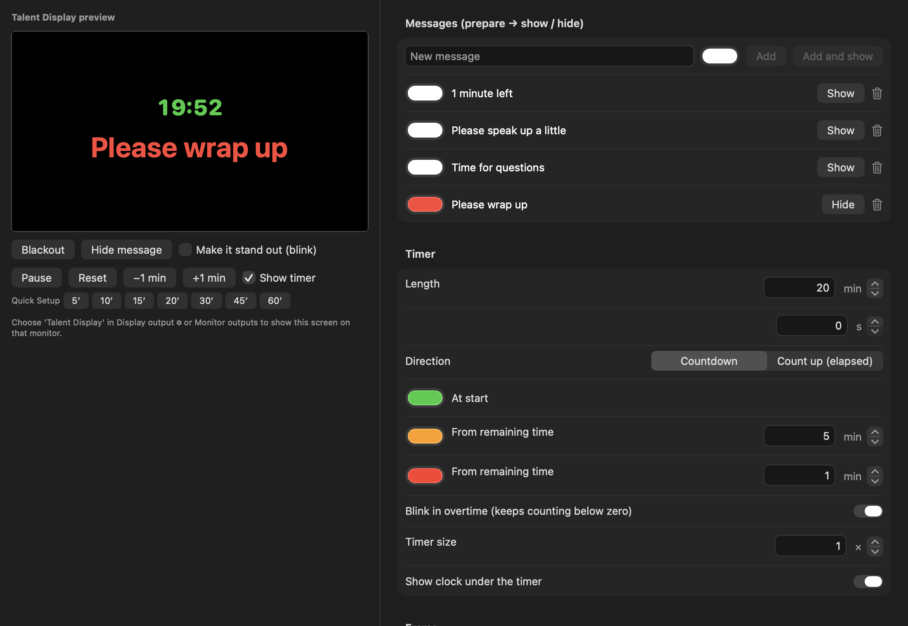
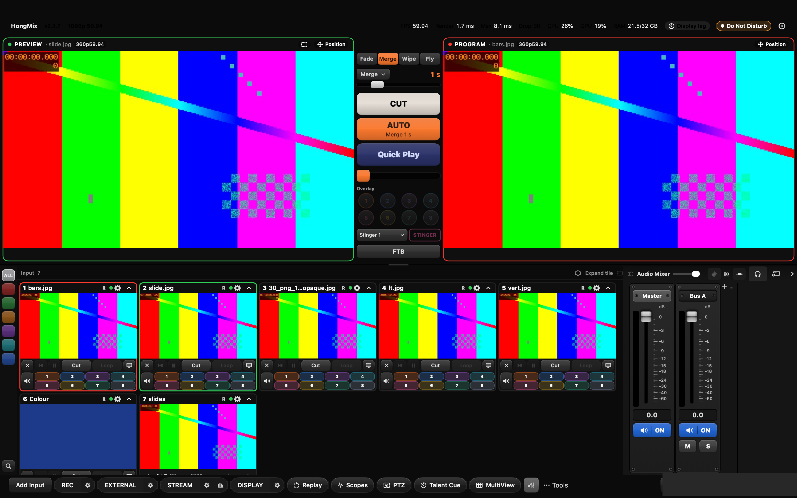

# HongMix 2.3.7 (build 171)

**MultiView, Talent Cue, the hardware look and more in this release were contributed by [@otiumvisuals](https://github.com/otiumvisuals) — thank you!**

HongMix 2.3.7 adds multiple configurable MultiViews, a presenter timer and messaging system, an optional crash safety net, a hardware-console appearance and a reworked output workflow.

## Multiple MultiViews

- Create several MultiViews and choose from seven layouts: 2+8, 8+2, large left, large right, 2×2, 3×3 and 4×4.
- Choose the source shown in every cell, with names and Program/Preview tally borders.
- Send a MultiView to a monitor, Output 2–4, Display output, NDI/DeckLink or an output window.
- Under heavy load, MultiView lowers its frame rate before Program does.

## Talent Cue

- Show a countdown or count-up clock, color phases, prepared or typed messages, blinking alerts, an idle screen or blackout on the presenter display.
- Add **Talent Display** as an input when it is needed inside the production.
- A protected moderator link lets a presenter coordinator control Talent Cue from a phone. It uses its own secret key and does not grant general API access.

## Hardware look and operator workflow

- The hardware look adds console-style mixer strips, raised keys and aluminum relief. Turn it off in Settings for the previous flat appearance; the center-column order remains unchanged.
- The outputs panel now has one row per monitor, several named output windows and routing for MultiView and Talent Display.
- Move the Audio Mixer into its own window. CPU, GPU and RAM load appear in the top bar.
- Added 720p50, 2160p25 and 2160p50 program formats, Dutch live captions, category-tab input drops, a fixed-size Input Properties window and updated Replay styling.

## Optional Backstage safety net

- Backstage is off by default and can be enabled in **Settings › General**.
- When enabled, its helper keeps Talent Display available and relaunches HongMix after a crash or Force Quit, up to three times in two minutes.
- Backstage does not keep streaming or recording alive.
- Packaging fixes let the installed helper find its bundled SSL/SRT libraries and remove its debug symbols.

## Verification

- Translation, core, MultiView and Talent Cue tests passed. The operator's five-input project opened intact.
- The installed build 171 Backstage helper relaunched HongMix about one second after a forced termination, restored the project, and stopped without relaunch after a normal Quit.
- MultiView was received over NDI at 1920×1080 and about 58 fps with correct labels and tally borders.
- Talent Cue rejected missing or incorrect keys and cross-site command/API requests.
- The Display-output regression check passed. The DMG and deep ad-hoc app/helper signatures verified, and the DMG/PKG checksums matched the release files.

## Compatibility and known limitations

- Projects saved with new MultiView or Talent sources do not open in HongMix 2.3.6 or older.
- One AppKit launch crash occurred in one of eight launches and did not recur in six additional launch/quit cycles.
- No second monitor was available, so physical second-monitor routing and Backstage preservation of its Talent window were not tested on real hardware.
- The public app is ad-hoc signed and is not Apple-notarized yet. The PKG is unsigned.
