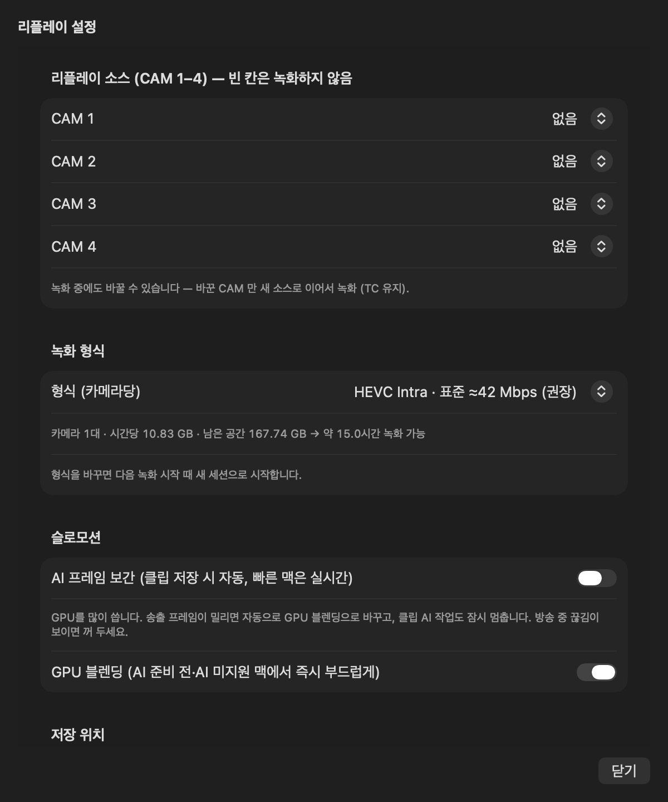
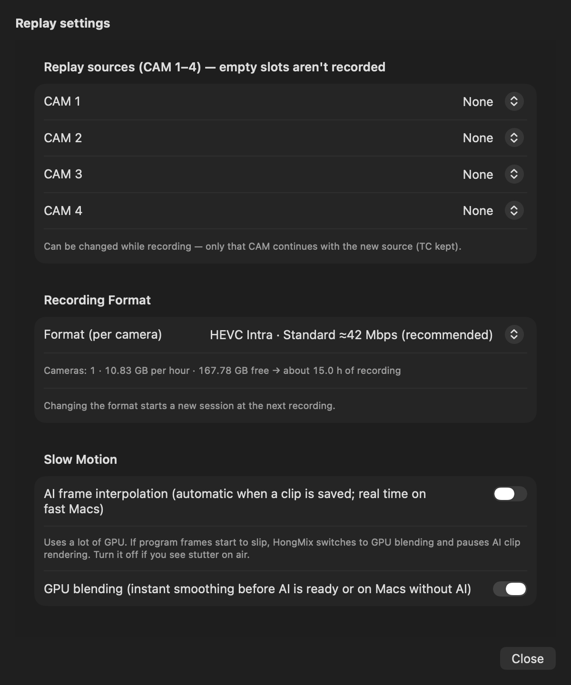

# HongMix 2.4.0 · build 198

## 한국어

- **리플레이가 송출을 끊지 않음:** AI 슬로모션이 켜져 있어도 리플레이 창과 슬로 재생 중 Program 프레임을 지킵니다. 송출이 바쁘면 GPU 블렌딩으로 자동 전환하고 백그라운드 AI 작업을 잠시 멈춥니다.
- **AI 슬로모션 기본 꺼짐:** GPU 부담이 커서 새 프로젝트는 꺼진 상태로 시작하며 설정에 안내를 추가했습니다.
- **창이 더 빨리 열림:** Replay·Talent Cue·MultiView·Scopes·오디오 믹서·디스플레이 출력 창의 불필요한 전체 화면 갱신을 줄였습니다.
- **가벼워진 리플레이 창:** 디스크 확인과 화면 갱신 범위를 줄였습니다.
- API에 `OpenWindow`와 `CloseWindow`를 추가했습니다.

## English

- **Instant Replay no longer disturbs Program:** with AI slow motion on, Program keeps every frame while the Replay window is open and during slow motion. When Program gets busy, HongMix switches to GPU blending and pauses background AI work.
- **AI slow motion off by default:** it is heavy on the GPU, so new projects start with it off and Replay settings explain the trade-off.
- **Faster windows:** Replay, Talent Cue, MultiView, Scopes, Audio Mixer and display-output windows avoid unnecessary full-interface refreshes.
- **Lighter Replay window:** disk checks and redraws are reduced.
- The API adds `OpenWindow` and `CloseWindow`.

Full notes: [English](https://github.com/HongMix/HongMix/blob/main/docs/RELEASE-NOTES-2.4.0.md) · [한국어](https://github.com/HongMix/HongMix/blob/main/docs/RELEASE-NOTES-2.4.0.ko.md)

Full manuals: [English](https://github.com/HongMix/HongMix/blob/main/docs/manual/HongMix-Manual.en.md) · [한국어](https://github.com/HongMix/HongMix/blob/main/docs/manual/HongMix-Manual.ko.md)

## Verification and limits

The operator's project recorded zero Program drops in Replay-window, slow-motion and all-window tests with AI enabled. Ten overlapping AI-load stress launches completed with zero crashes. Translation, core and MultiView tests, DMG verification and deep ad-hoc signing passed. The app is not Apple-notarized and the PKG is unsigned. Engine-wide UI updates, main-window activation and delayed AI loading can still cause short UI pauses; none caused Program drops in the measured runs.
