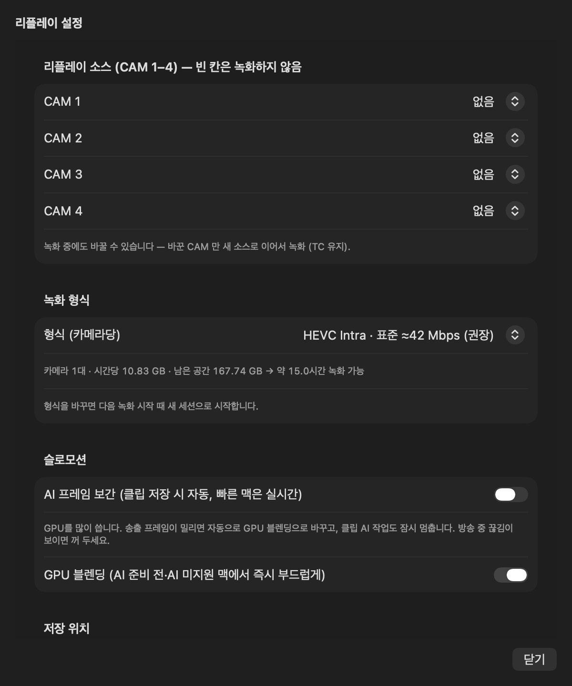

# HongMix 2.4.0 (빌드 198)

HongMix 2.4.0은 인스턴트 리플레이가 Program 송출을 끊지 않도록 보호하고 보조 창이 더 빨리 열리게 합니다.

## 리플레이가 송출을 끊지 않음

- AI 슬로모션을 켜도 리플레이 창과 슬로모션 재생 중 Program 프레임이 끊기지 않습니다.
- Program이 바빠지면 30초 동안 GPU 블렌딩으로 바꾸고, 여유가 생길 때까지 백그라운드 AI 렌더링을 멈춥니다.
- 여러 리플레이 카메라 프레임을 GPU 작업 한 번으로 함께 처리합니다.
- AI 슬로모션은 GPU 부담이 커서 새 프로젝트에서 기본으로 꺼집니다. 기존 프로젝트의 저장값은 유지되며, 리플레이 설정에 사용 안내를 추가했습니다.

## 더 빠르고 가벼운 창

- Replay·Talent Cue·MultiView·Scopes·오디오 믹서 창을 실행 뒤 보이지 않게 미리 준비해 처음 열 때도 더 빠릅니다.
- 오디오 믹서와 디스플레이 출력 상태가 바뀔 때 더 이상 스위처 엔진을 보는 모든 화면을 새로 계산하지 않습니다.
- 리플레이 창은 화면을 그릴 때마다 디스크를 확인하지 않고 백그라운드에서 3초마다 확인합니다. 빠르게 바뀌는 덱 위치와 상태도 필요한 부분만 갱신합니다.

## 안정성과 원격 제어

- 시험 중 발견한 Metal 초기화 충돌을 피하려고, AI 모델은 HongMix 실행 20초 뒤에 불러옵니다.
- API에 도구 창을 여닫는 `OpenWindow`와 `CloseWindow`를 추가했습니다.
- 카메라 한 대일 때의 영어 표시를 “Cameras: 1”로 바로잡았습니다.

## 검증과 남은 한계

- 운영자 프로젝트에서 AI 슬로모션을 켜고 리플레이 창·슬로모션·모든 창 열기를 시험했으며 Program 드랍은 모두 0, 리플레이는 60fps였습니다.
- 녹화 시작·창 열기·지연된 AI 로딩을 겹친 실행 시험 10회에서 충돌은 0회였습니다.
- 번역·핵심·MultiView 검사를 통과했습니다. 빌드 198 DMG는 유효성 및 임시 서명 검사를 통과했고 Chromium이 포함돼 있습니다.
- 빌드 198은 시험한 소스에서 패키징하고 내용을 검사했습니다. 공개 앱은 임시 서명이며 Apple 공증 전이고, PKG에는 설치 패키지 서명이 없습니다.
- 마스터 음소거처럼 엔진 값을 바꾸면 화면이 약 0.2초 멈출 수 있고, 메인 창을 앞으로 가져올 때 약 0.3초, 실행 약 20초 뒤 AI 모델을 불러올 때 한 번 약 0.4초 멈출 수 있습니다. 측정 중 이 화면 멈춤으로 인한 Program 드랍은 없었습니다.
