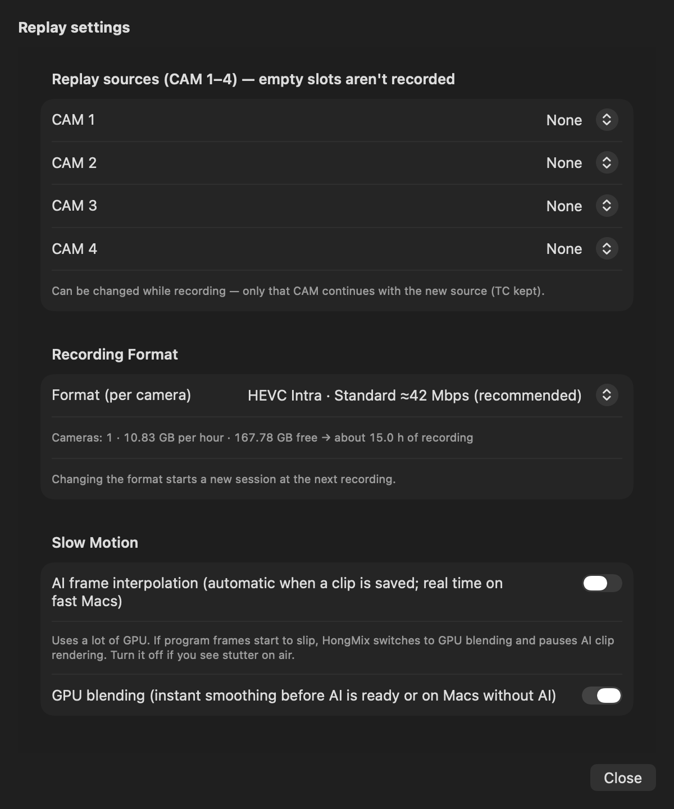

# HongMix 2.4.0 (build 198)

HongMix 2.4.0 keeps Instant Replay from disturbing Program and makes secondary windows open faster.

## Instant Replay no longer disturbs Program

- With AI slow motion on, Program keeps every frame while the Replay window is open and during slow-motion playback.
- When Program gets busy, HongMix switches to GPU blending for 30 seconds and pauses background AI rendering until there is room again.
- Replay camera frames are rendered together in one GPU pass.
- AI slow motion is off by default in new projects because it is heavy on the GPU. Existing projects keep their saved setting, and Replay settings now explain the trade-off.

## Faster, lighter windows

- Replay, Talent Cue, MultiView, Scopes and Audio Mixer windows are prepared invisibly after launch, so their first opening is faster.
- Audio Mixer and display-output state no longer refresh every view that watches the switcher engine.
- The Replay window checks free disk space in the background every three seconds instead of on every redraw. Fast-changing deck and status values redraw only their own sections.

## Stability and control

- AI model loading waits until HongMix has been running for 20 seconds, avoiding a Metal initialization race found during testing.
- The API adds `OpenWindow` and `CloseWindow` for tool-window control.
- The English single-camera status now reads “Cameras: 1”.

## Verification and known limits

- With the operator's project and AI slow motion enabled, Replay-window, slow-motion and all-window tests recorded zero Program drops; replay ran at 60 fps.
- Ten stress launches that overlapped replay recording, window opening and delayed AI loading completed with zero crashes.
- Translation, core and MultiView tests passed. The build 198 DMG verified as valid, deep ad-hoc signing passed and Chromium is bundled.
- Build 198 was inspected and packaged from the tested source. The public app is ad-hoc signed and not Apple-notarized; the PKG is unsigned.
- A published engine-property change such as Master mute can still pause the UI for about 0.2 seconds, bringing the main window to the front still takes about 0.3 seconds, and delayed AI model loading may cause one roughly 0.4-second UI pause around 20 seconds after launch. These measured UI pauses produced no Program drops.
