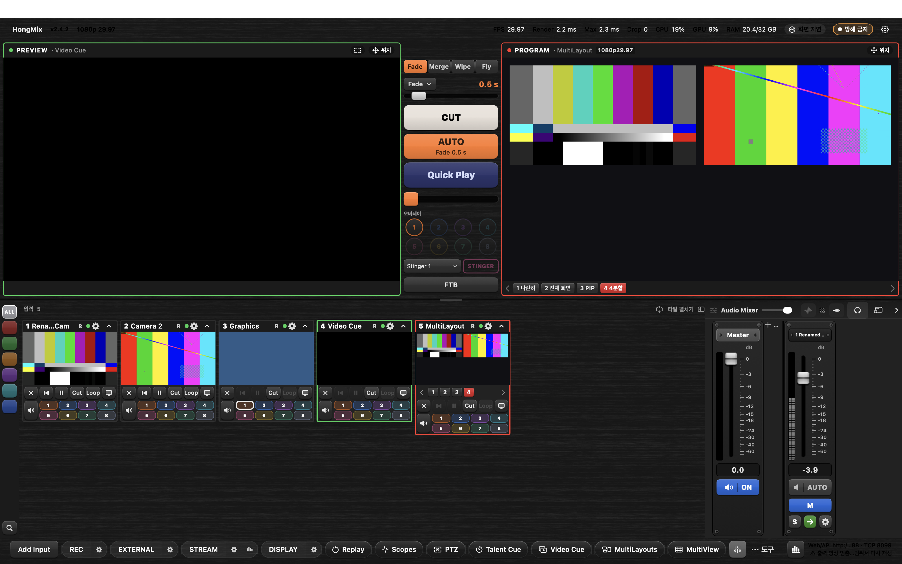
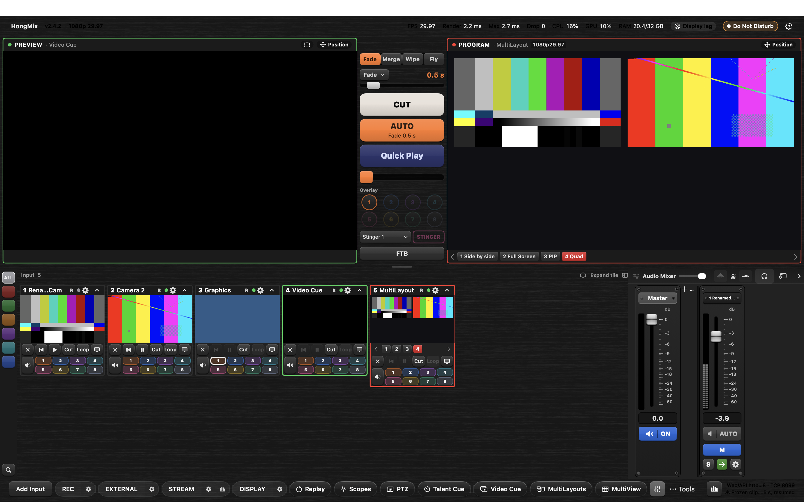

# HongMix 2.4.3 · build 207

**Video Cue, MultiLayouts and the Input Settings preview were contributed by [@otiumvisuals](https://github.com/otiumvisuals) — thank you!**

2.4.2 was skipped; all of its changes are included in 2.4.3.

## 한국어

- **스위처가 멈칫하지 않음:** 마스터 음소거·컷·페이드·오버레이·Preview 변경 때 모든 화면을 다시 그리지 않습니다.
- **입력 설정 수정:** 미리보기의 보이지 않는 영역이 ↺와 슬라이더를 가리던 문제를 고쳤고 숫자 칸도 현재 값을 바로 보여 줍니다.
- **MultiLayouts 끌어 놓기:** 입력이 마우스 아래 상자에 들어갑니다.
- **타일 버튼은 마우스를 올렸을 때만:** 입력 목록을 차분하게 만드는 새 옵션이며 기본은 꺼짐입니다.
- **새 기능:** Video Cue, 8상자 MultiLayouts, 입력 설정 실시간 미리보기.

## English

- **The switcher no longer hitches:** master mute, cuts, fades, overlays and Preview changes no longer redraw the whole interface.
- **Input Settings fixed:** invisible preview content no longer blocks reset buttons and sliders; number fields show current values immediately.
- **MultiLayouts drag-and-drop:** an input goes into the box under the pointer.
- **Tile buttons on hover only:** a new calmer-input-grid option, off by default.
- **New:** Video Cue, eight-box MultiLayouts and live previews in Input Settings.

> Projects containing a Video Cue or MultiLayout input require HongMix 2.4.3 or newer and do not open in 2.4.1 or older.

Full notes: [English](https://github.com/HongMix/HongMix/blob/main/docs/RELEASE-NOTES-2.4.3.md) · [한국어](https://github.com/HongMix/HongMix/blob/main/docs/RELEASE-NOTES-2.4.3.ko.md)

Full manuals: [English](https://github.com/HongMix/HongMix/blob/main/docs/manual/HongMix-Manual.en.md) · [한국어](https://github.com/HongMix/HongMix/blob/main/docs/manual/HongMix-Manual.ko.md)

## Verification and limits

Translation, MultiView, MultiLayout and Video Cue tests, DMG verification and deep ad-hoc signing passed. Regression checks recorded zero Program drops, no launch click and no crashes. MultiLayout box hit testing passed, but actual list-to-box dragging could not be synthesized and needs direct confirmation. Replay recording was not started. The app is not Apple-notarized and the PKG is unsigned.
