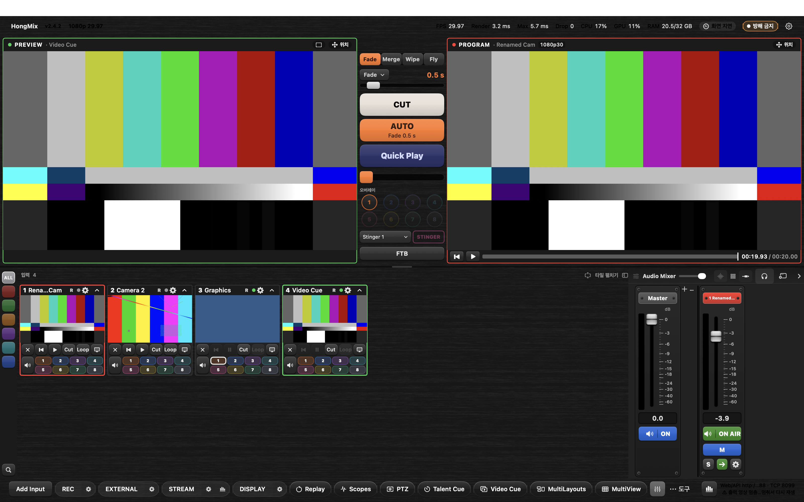
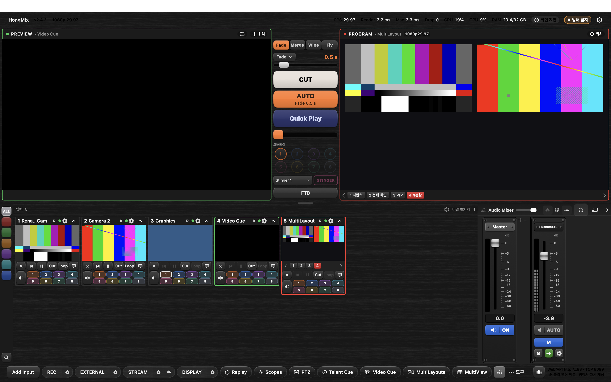
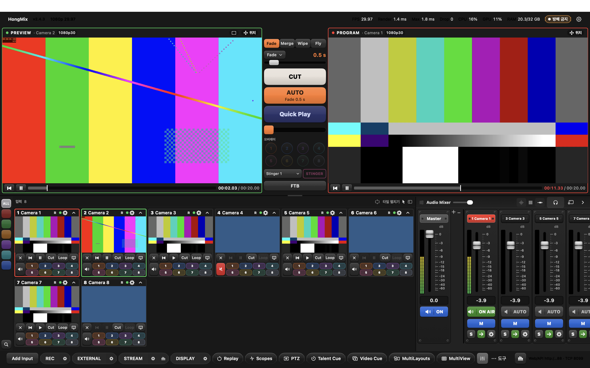
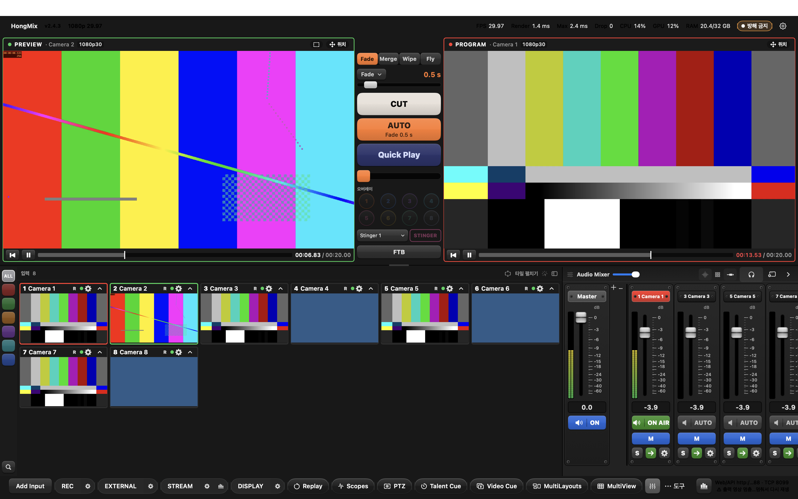

# HongMix 2.4.3 (빌드 207)

**Video Cue, MultiLayouts, 입력 설정 미리보기는 [@otiumvisuals](https://github.com/otiumvisuals) 님이 기여해 주셨습니다. 감사합니다!**

2.4.2는 배포하지 않았습니다. 그 버전의 성능 개선과 기여 기능에 2.4.3 추가 수정을 합쳐 배포합니다.

## 스위처가 멈칫하지 않음

Swift Observation으로 바꿔 화면마다 자기가 보여 주는 값이 바뀔 때만 다시 그립니다. 운영자 프로젝트 측정에서 마스터 음소거는 약 150ms에서 3~18ms, 페이드는 약 28ms, 슬라이더 드래그는 약 30ms로 줄었습니다. Program 드랍은 0이었고 모니터는 59~60fps를 유지했습니다.

## Video Cue

큐 목록을 만들고 **GO**, **STOP**, **PANIC**으로 재생합니다. 페이드, 모니터 출력, 배경과 테스트 화면을 지원하며 소리는 다른 입력처럼 Program을 따릅니다.

## MultiLayouts

최대 8상자 레이아웃과 장면을 만들고 날아오기·커지기·페이드 효과와 둥근 모서리를 사용합니다. 입력을 끌어 놓으면 마우스 아래 상자에 들어갑니다. **방송에 나갈 때 애니메이션**은 기본으로 꺼져 있어 CUT은 즉시 됩니다.

## 입력 설정과 차분한 타일

- 색 보정·Key·재생·목록 옆에 실시간 미리보기가 나옵니다.
- 옮기거나 확대한 미리보기가 영역 밖으로 나가도 ↺와 슬라이더가 정상적으로 눌립니다. 초점이 있는 숫자 칸도 현재 값을 바로 보여 줍니다.
- 선택형 **타일 버튼은 마우스를 올렸을 때만** 모드는 평소 그림과 이름만 보여 줍니다. 음소거와 반복은 작은 표시로 남습니다. 기본은 꺼짐입니다.

| 버튼 항상 표시 | 마우스를 올릴 때 표시 |
|---|---|
|  |  |

## API와 호환성

- Video Cue·MultiLayout 함수와 `ShowInputProperties`를 추가했습니다.
- Video Cue나 MultiLayout 입력이 들어 있는 프로젝트는 HongMix 2.4.3 이상이 필요하며 2.4.1 이하에서는 열리지 않습니다.

## 검증과 한계

- 번역·MultiView·MultiLayout·Video Cue 검사를 통과했습니다. 빌드 207 DMG는 유효성 및 깊은 임시 서명 검사를 통과했고 Chromium이 포함돼 있습니다.
- 회귀 시험에서 Program 드랍 0, 시작 소리 0회, 충돌 0회였습니다. 같은 프로젝트 조건에서 GPU 사용량은 배포하지 않은 2.4.2와 같았습니다.
- MultiLayout 상자 판정은 4분할·겹친 상자·숨긴 상자를 단위 시험으로 확인했습니다. 이 Mac에서는 실제 목록→상자 드래그를 흉내 낼 수 없어 직접 확인이 필요합니다.
- 이번 시험에서는 리플레이 녹화를 시작하지 않았습니다.
- 타일 마우스 오버 옵션은 기본으로 꺼져 있습니다. 공개 앱은 임시 서명이며 Apple 공증 전이고 PKG에는 설치 패키지 서명이 없습니다.
