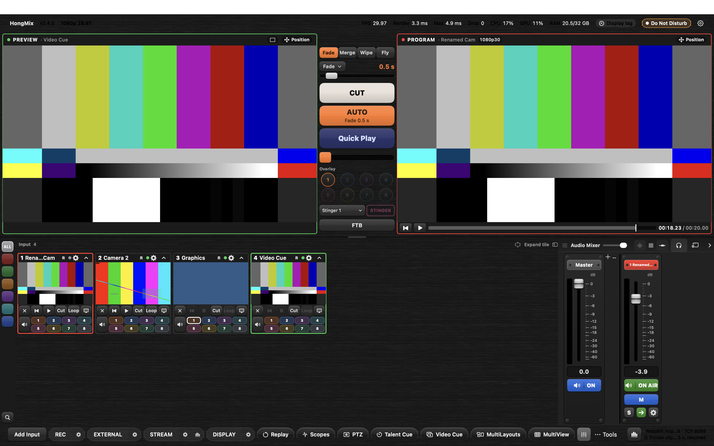
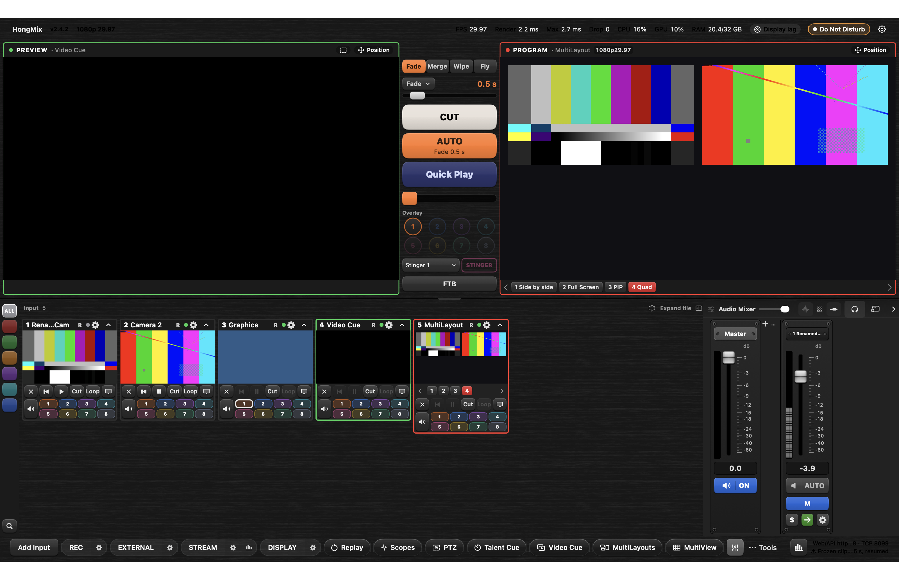
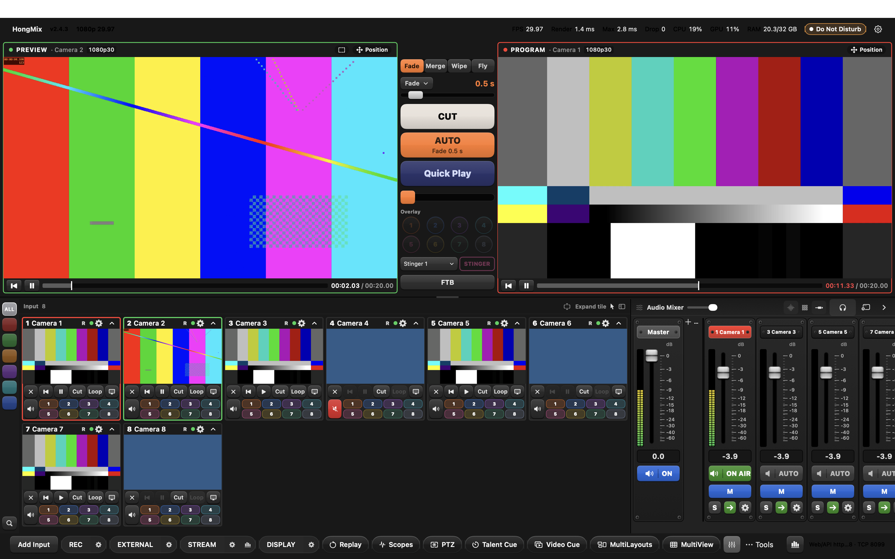
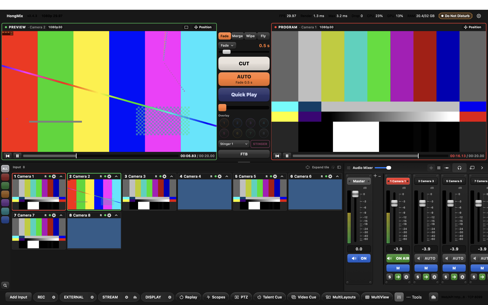

# HongMix 2.4.3 (build 207)

**Video Cue, MultiLayouts and the Input Settings preview were contributed by [@otiumvisuals](https://github.com/otiumvisuals) — thank you!**

Version 2.4.2 was never released. Its performance work and community features are included here with the additional 2.4.3 fixes.

## The switcher no longer hitches

HongMix now uses Swift Observation so each part redraws only when a value it displays changes. Master mute fell from about 150 ms to 3–18 ms, fades to about 28 ms and slider dragging to about 30 ms in the measured operator project. Program dropped zero frames and the monitors stayed at 59–60 fps.

## Video Cue

Create a cue list and run it with **GO**, **STOP** and **PANIC**. Video Cue supports fades, monitor outputs, a background and a test card; its audio follows Program like any other input.

## MultiLayouts

Build layouts with up to eight boxes, save scenes and change them with fly-in, grow or fade effects and rounded corners. Drag an input onto the box under the pointer. **Animate when going on air** is off by default so CUT stays instant.

## Input Settings and calmer tiles

- A live preview now sits beside Color Adjust, Key, Playback and List.
- Reset and slider clicks work when a moved or zoomed preview extends outside its canvas. Focused number fields also show the current value immediately.
- Optional **Tile buttons on hover only** mode shows picture and name until the pointer enters a tile. Mute and loop remain as small badges. The option is off by default.

| Controls always visible | Controls on hover |
|---|---|
|  |  |

## API and compatibility

- Added Video Cue and MultiLayout functions plus `ShowInputProperties`.
- Projects containing a Video Cue or MultiLayout input require HongMix 2.4.3 or newer and do not open in 2.4.1 or older.

## Verification and limits

- Translation, MultiView, MultiLayout and Video Cue tests passed. The build 207 DMG verified as valid, deep ad-hoc signing passed and Chromium is bundled.
- Regression checks recorded zero Program drops, no launch click and no crashes. GPU use matched the unreleased 2.4.2 build under the same project conditions.
- MultiLayout hit testing is unit-tested for four boxes, overlapping boxes and hidden boxes. Actual Finder/list-to-box dragging could not be synthesized on the test Mac, so please verify that interaction directly.
- Replay recording was not started in this round.
- Tile-buttons-on-hover is off by default. The public app is ad-hoc signed and not Apple-notarized; the PKG is unsigned.
