# HongMix 2.3.2 User Manual

HongMix is a live production switcher for Apple Silicon Macs. Its layout, keyboard shortcuts and remote API follow vMix, so vMix operators, Bitfocus Companion and Stream Deck setups feel at home.

> Korean version: [HongMix-Manual.ko.md](HongMix-Manual.ko.md)

## Contents

1. [Install](#1-install)
2. [Screen tour](#2-screen-tour)
3. [Adding inputs](#3-adding-inputs)
4. [Switching](#4-switching)
5. [Overlays 1–8](#5-overlays-18)
6. [Input settings](#6-input-settings)
7. [Audio Mixer](#7-audio-mixer)
8. [Titles](#8-titles)
9. [Outputs](#9-outputs)
10. [Replay and live captions](#10-replay-and-live-captions)
11. [Broadcast safety](#11-broadcast-safety)
12. [Web remote and tally](#12-web-remote-and-tally)
13. [Companion, Stream Deck and API](#13-companion-stream-deck-and-api)
14. [General settings](#14-general-settings)
15. [Troubleshooting and FAQ](#15-troubleshooting-and-faq)
16. [System requirements and credits](#16-system-requirements-and-credits)

---

## 1. Install

Everything HongMix needs (FFmpeg, SRT, the NDI runtime and the Chromium web engine) is inside the app. There is nothing else to install.

### Option A: PKG installer (recommended)

1. Double-click **HongMix-2.3.2.pkg**.
2. If macOS says the file is from an **unidentified developer**, right-click the file and choose **Open**, then **Open** again. (Alternatively: **System Settings › Privacy & Security**, then **Open Anyway**.)
3. Click **Continue**, then **Install**. HongMix is installed in **Applications**.

### Option B: DMG

1. Open **HongMix-2.3.2.dmg**.
2. Drag **HongMix** into the **Applications** folder.

### First launch

HongMix is not notarized by Apple yet, so macOS asks once.

1. In **Applications**, right-click **HongMix** and choose **Open**.
2. Click **Open** in the warning. Later launches open normally.

### Permissions

macOS asks for these the first time a feature needs them. If you clicked **Don't Allow** by mistake, change it in **System Settings › Privacy & Security**.

| Permission | Needed for |
|---|---|
| Camera | Camera and capture-card inputs |
| Microphone | Microphone and audio inputs, capture-card audio |
| Screen & System Audio Recording | Desktop and window capture inputs only |
| Local Network | Finding NDI sources and SRT devices, the web remote |
| Speech Recognition | Live captions (only when you start them) |

---

## 2. Screen tour

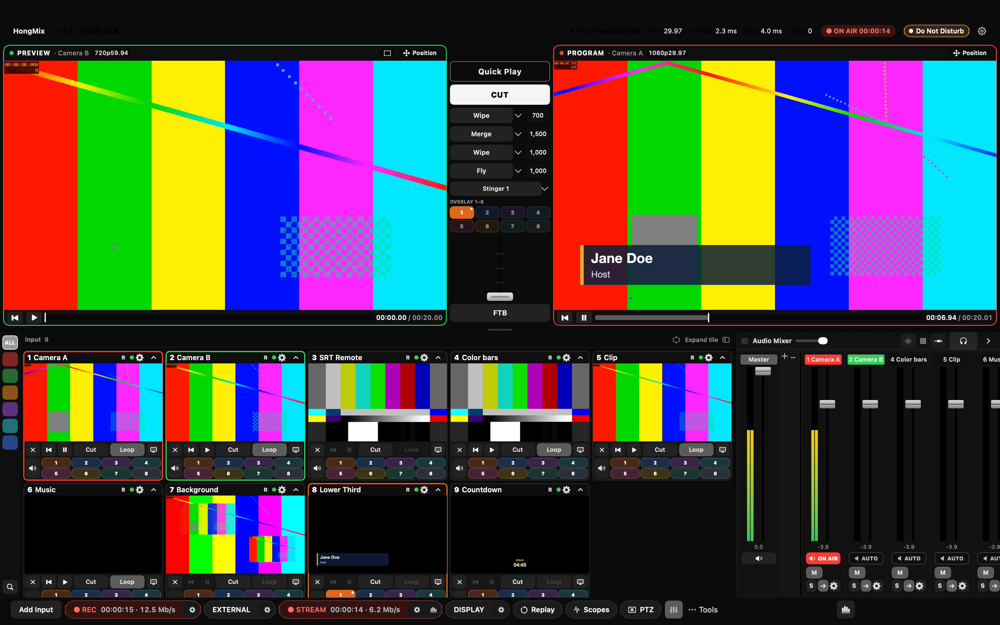

The main window follows the vMix layout.

| Area | What it does |
|---|---|
| **PREVIEW** (left monitor) | What goes on air next. Prepare the next shot here. |
| **PROGRAM** (right monitor) | What is on air now, the picture that is streamed, recorded and sent out. |
| **Transition column** (between the monitors) | **Quick Play**, **CUT**, four transition buttons, **OVERLAY 1–8**, Stinger buttons, **T-bar** and **FTB**. |
| **Input tiles** (below) | One tile per input. Click a tile to put it in Preview. |
| **Audio Mixer** (right) | Master, buses and one strip per input with audio. |
| **Bottom bar** | **Add Input**, **REC**, **EXTERNAL**, **STREAM**, **DISPLAY**, **Replay**, **Scopes**, **PTZ**, the Audio Mixer toggle, **Tools**, and Statistics. |
| **Top status** | **FPS**, **Render**, **Max**, **Drop**, the **Do Not Disturb** button, and live/recording indicators. |

Notes:
- The default skin is **Black & White**: PROGRAM is red, PREVIEW is green, and color is used only where it means something. The classic look (**Default**: Output green, Preview orange, buttons labeled Record / External / Stream / Display) can be chosen in **Settings › General › Appearance › Skin**.
- **Render** is the time needed to draw one frame. It is fine while it stays below the frame time (about 16.7 ms at 59.94p). **Drop** counts dropped output frames.
- Under each monitor, video inputs show a playback bar: restart, play/pause, position bar (click or drag to seek) and time. Right-click the bar for **Mark In** / **Mark Out**. Click the time to switch between elapsed and remaining; it turns red in the last 10 seconds.

### Input tile controls

| Control | Action |
|---|---|
| Click the picture | Put the input in Preview |
| Double-click | Open the input's settings (for a stream input: its connection settings) |
| Right-click the title | Fold / unfold the tile; more options in the menu |
| Drag | Reorder |
| **×** | Ask before closing the input (press **Undo** at the top to restore it). Choose **Don't ask again**, or turn the question back on in **Settings › General › Safety**. |
| ⏮ / ▶ ❚❚ | Restart, play / pause (media inputs) |
| **Cut** | Send this input straight to Program |
| **Loop** | Loop playback on/off |
| Monitor icon | Show the input in its own window |
| Speaker | Mute / unmute the input |
| **1–8** | Put the input on overlay 1–8, or take it off |

### Bottom bar **Tools** menu

**MultiCorder** start/stop and settings, **All Outputs…**, **Overlay Settings…**, **Rundown / Cue Sheet**, **Scheduler…**, **Captions…**, **Pre-flight Check…**, **Status Board / Black Box…**, **Save Snapshot**.

---

## 3. Adding inputs

Open the Add Input window with **Add Input** in the bottom bar or **⌘I**. Choose a category on the left, fill in the options on the right, and click **OK**. Category names are shown in English in both languages.

### Camera or capture card

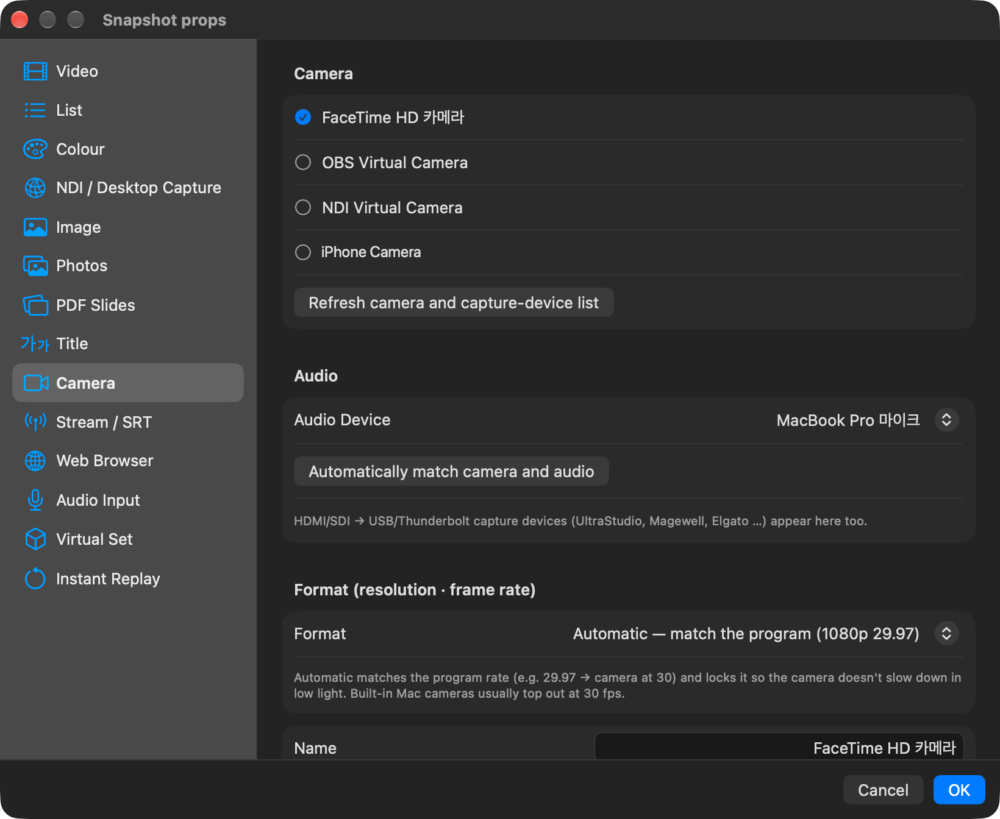

1. Click **Add Input** and choose **Camera**.
2. Pick the device. Built-in cameras and HDMI/SDI → USB/Thunderbolt capture devices (UltraStudio, Magewell, Elgato …) are listed. If a device is missing, click the refresh button.
3. Choose **Format (resolution · frame rate)**. **Auto** matches the program frame rate; or pick an exact mode the device offers.
4. Choose the **Audio Device**, or leave **Automatically match camera and audio** on.
5. Click **OK**. If macOS asks for camera or microphone access, click **Allow**.

If you see "Camera permission denied", allow HongMix in **System Settings › Privacy & Security › Camera**.

### Video, image and audio files

The quickest way is to drag files from the Finder:

1. Drag one or more video files, images, a photo folder or a PDF onto the input area. Each becomes a new input.
2. Hold **Option** while dropping several videos to make one **List** input that plays them in order.
3. Hold **Command** and drop a file on an existing tile to replace its file (you are asked to confirm).

Or use Add Input:

- **Video**: one file per input. Options: **Loop**, Auto Play, Auto Pause, Auto Restart, hardware decoding (VideoToolbox).
- **List**: select several files; they play from top to bottom in one input. Manage them later in the input's **List** tab (add, remove, reorder, shuffle, double-click to play an item, loop the list).
- **Image**: PNG (with transparency), JPG and others. Transparent PNGs work well as logos on overlays.
- **Photos**, **PDF Slides**: export PowerPoint, Keynote or Google Slides to PDF first. Assign **NextPicture** / **PreviousPicture** in **Settings › Shortcuts**; leave **Input** empty to control the slides on Program (or Preview if Program has none).

Supported formats include MP4, MOV (including ProRes 4444 with alpha), MXF, TS, MKV, AVI, MP3 and WAV. A file extension alone does not guarantee that every codec inside it is supported. New video inputs start with **Loop** off (change the default in **Settings › General › Playback › Loop new video inputs**).

### SRT, RTMP and other stream inputs

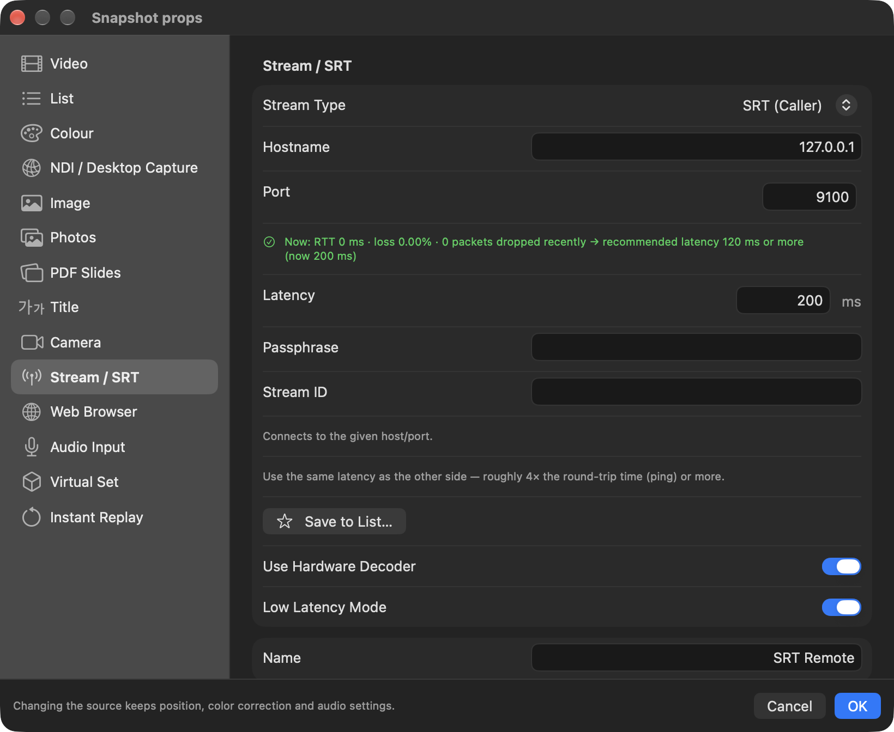

1. Click **Add Input** and choose **Stream / SRT**.
2. Choose the type: **SRT (Caller)**, **SRT (Listener)**, **SRT (Rendezvous)**, **RTMP (Server)** to receive a push, **RTMP / HLS / HTTP (URL)**, RTSP over UDP/TCP, or Transport Stream over UDP/TCP.
3. For SRT, fill in host, port, **Latency**, and if used the passphrase and Stream ID. Example: a field encoder connects as caller to `srt://192.0.2.10:9000`, so HongMix is the listener on port 9000.
4. Click **OK**.

**Recent and saved SRT**: the top of the SRT settings lists the last SRT connections you used. Click an entry to fill in the fields. Click **Save to List…** (or right-click an entry) to keep a connection under a name.

**Latency advice**: use the same latency as the other side, roughly 4× the round-trip time (ping) or more. While the input is connected, the settings show RTT, loss, recently dropped packets and a recommended latency. Click **Use Recommended** to apply it.

**Edit later**: double-click a stream input's tile to open its connection settings directly (address, port, mode, latency, passphrase).

### NDI

1. Click **Add Input** and choose **NDI / Desktop Capture**.
2. NDI sources on the network are found automatically. Click refresh if needed, or type a name manually (for example `MACHINE (Source)`).
3. Optionally turn on **Low Bandwidth**.
4. Sources on another subnet: add their IPs in **Settings › Network › Extra NDI discovery IPs**.

### Desktop and window capture

1. Click **Add Input** and choose **NDI / Desktop Capture**, then **Desktop Capture**.
2. Pick a display or a window. Options: **Capture audio** (a window captures only that app's sound; a display captures all Mac sound except HongMix), **Show cursor**, frame rate.
3. The first time, allow **Screen & System Audio Recording** in System Settings.

### Web browser

1. Click **Add Input** and choose **Web Browser**, then enter the address.
2. The built-in Chromium engine is used. Turn on **Transparent background** for pages without a background color to get alpha.
3. You can click and type into the page directly on a monitor. Press **Esc** or click elsewhere to return to the switcher shortcuts.

### Title

Click **Add Input** and choose **Title** to see all templates with a live preview (see [chapter 8](#8-titles)).

### Color

Click **Add Input** and choose **Colour**: SMPTE color bars, black, white, **Transparent**, or a custom color with opacity. A transparent color input is the usual base for split screens built with Layers.

### Audio only

Click **Add Input** and choose **Audio Input**, then select the device (microphone, audio interface).

### Virtual input

A virtual input shows the same picture as another input without decoding it again. Its position, crop and layers are its own; playback and sound follow the original.

1. Right-click the input tile.
2. Choose **Create Virtual Input**.

### Other categories

**Virtual Set** (presenter in a set with a foreground image) and **Instant Replay** are also in Add Input.

### Signal loss and backup

For live inputs (SRT, NDI, camera), open the input's settings, **General** tab, **Signal Loss / Failover**: choose the picture to show when the signal is lost and a **Backup input**. If the input drops while on air, HongMix switches to the backup and returns when the signal comes back.

---

## 4. Switching

The basic idea: prepare in **PREVIEW**, then send to **PROGRAM**.

### Basic steps

1. Click an input tile. It appears in PREVIEW.
2. Click **CUT** (or press **Space**) for an instant switch, or a transition button for an effect.
3. The old Program input moves to Preview, so pressing CUT again switches back.

### Transition column

| Control | Action |
|---|---|
| **Quick Play** | Runs transition 1 (a 0.5 s fade by default). Shortcut **Return**. |
| **CUT** | Instant switch from Preview to Program. |
| Transition buttons 1–4 | Button = run. **▾** = choose the effect (Fade, Merge, Wipe, Slide, Fly, CrossZoom, Zoom …). Number = duration in ms. |
| **OVERLAY 1–8** | Toggle each overlay channel (see [chapter 5](#5-overlays-18)). |
| Stinger | A transition with an animation on top (for example a ProRes 4444 MOV with alpha). Click to run; use its **▾** menu to choose the media input and the cut point. |
| **T-bar** | Drag for a manual transition with the first effect. The transition completes when you reach the end. |
| **FTB** | Fade To Black (audio fades too). Press again to come back. |

### Keyboard shortcuts

| Key | Action |
|---|---|
| Space | Cut |
| Return | Quick Play |
| 1 – 9 | Input 1–9 to Preview |
| ⌘1 – ⌘9 | Input 1–9 straight to Program (Cut) |
| ⌥1 – ⌥4 | Transition buttons 1–4 |
| ⇧⌘B | FTB |
| ⌘I | Add Input |
| ⌘N / ⌘O / ⌘S | New / Open / Save project (autosaves every 5 s) |
| ⌘W | Close the current tool window or sheet (never the switcher or the Display output) |

Change any shortcut in **Settings › Shortcuts** (a vMix default set is included).

---

## 5. Overlays 1–8

Overlays put an input on top of Program, for example a lower third, a logo or a picture-in-picture. There are eight overlay channels.

### Put an input on an overlay

1. On the input's tile, click a number **1–8**.
2. The input fades onto Program on that channel. A lit number means that channel is on air with this input.
3. Click the same number again to take it off.

### OVERLAY 1–8 in the transition column

Each button puts the input you last assigned to that channel back on, or takes it off. Assign an input first with the tile buttons.

### Overlay settings

**Tools › Overlay Settings…** sets the effect, duration and picture-in-picture position for each channel, and the Stinger settings.

---

## 6. Input settings

Double-click an input tile (or use the ⚙ menu, **Properties…**) to open its settings. Tabs: **General**, **Color Adjust**, **Key / Fill & Key**, **Position**, **Layers**, **Audio Settings**, and depending on the input **Playback**, **List**, **Triggers** and **PTZ**. A live preview matched to Program stays fixed on the right while the controls scroll on the left.

### Position

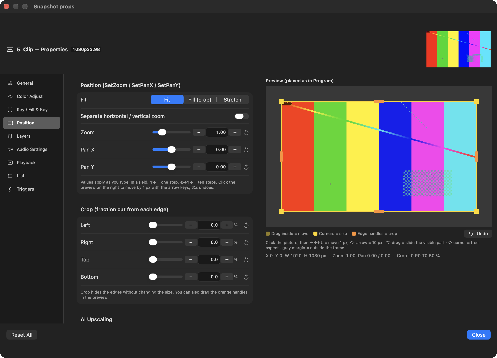

Edit position directly on the picture:

- Drag inside the box to move it. Drag the yellow corners to resize.
- Drag the orange edge handles to crop. **Option**-drag slides the visible part inside the crop.
- The gray margin around the frame keeps boxes and handles reachable even when they are outside the frame.

Enter exact values:

1. Type a number in any field; it applies as you type. Values are in output pixels.
2. Use **−** / **+** next to the field, or the arrow keys: **↑↓** = one step, **⇧+↑↓** = ten steps.
3. Set **Opacity** and **Rotation** the same way.

Other controls: **Fit** (keep the whole source), **Fill** (cover the frame, cropping the edges), **Stretch** (fill without keeping the aspect ratio), separate X/Y zoom for wide LED walls, **Center**, **Fit to Screen**, and **Reset Position**.

**AI Upscaling**: enlarges low-resolution sources with Apple's real-time super-resolution model on Apple Silicon with macOS 26 or later. It waits ("Starts when the input is on air or in Preview") until the input is in Program, Preview or an on-air layer, so it does not use the GPU for inputs that are not shown.

### Layers (split screens and picture-in-picture)

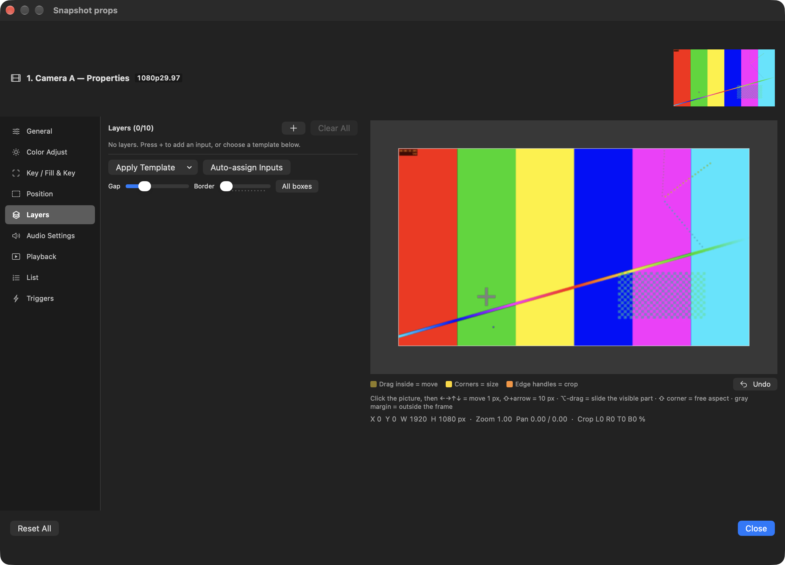

Build a 4-split screen:

1. Click **Add Input**, choose **Colour**, then **Transparent** (or a background color).
2. Open that input's settings and choose the **Layers** tab.
3. Click **Apply Template** and choose a layout: 2-split, 3-split, 4-split (2×2), 9-split (3×3), 16-split, 1+3, 1+5, PIP and more.
4. Choose an input for each box, or click **Auto-assign Inputs** to fill empty boxes with inputs 1, 2, 3 … in order.
5. Set **Fit** / **Fill**, **Gap** and **Border**.
6. Fine-tune by dragging boxes in the preview, then send this input to Program or an overlay.

Editing layers:

- **Select several**: **⇧**-click layers or press **⌘A**. Then align (left, right, top, bottom edges, horizontal or vertical centers), **Space Evenly Across** / **Space Evenly Down**, or **Same Size** (width only, height only, or both), aligned to the frame, the selected boxes or the first selected box.
- **Snap**: moving layers snap to the frame and to the edges and centers of other visible layers.
- **Crop**: switch to Crop mode, or use the edge handles and per-edge sliders. Cropping a rotated layer moves that edge of its box like an unrotated layer.
- **Fit in Frame**, **Center**, **Source Aspect**, **Full Screen**, **Copy Position** / **Paste**, **Lock**, **Opacity**, **Rotation**.
- **Trim Transparent Background**: removes empty transparent margins around title and PNG layers, so Fill uses the visible graphic. Sources it cannot work on show the reason inline.
- **Presets**: click **Save Current Placement as Preset…** to store position, size, crop, rotation, opacity, border and Fit/Fill (not the source input). Apply a preset to any layer in any project.
- **Undo** (⌘Z) undoes the last change.

### Color Adjust

Brightness, contrast, saturation and similar adjustments, plus **LUT** (3D `.cube` file, strength 0–100 %) to convert Log cameras (S-Log3, V-Log, C-Log …) to Rec.709 or apply a look. Processing runs on the GPU.

### Key

**Key / Fill & Key**: chroma key, alpha handling, and **AI background removal**, which keeps people without a green screen. Choose a transparent, blurred or image background and Fast, Balanced or Accurate quality. Fast is recommended for 59.94p. Always test with the real camera and lighting before air.

### Triggers

Run functions automatically when the input goes to or leaves Program, goes to or leaves an overlay, finishes playing, or when a countdown reaches 0. Example: when the opener ends, Fade to Camera 1. Choose "This input" to target the input itself, add a delay in ms, and press ▶ to test.

### PTZ

For live inputs, the **PTZ** tab sets the camera's IP and presets. The **PTZ** button in the bottom bar opens a control window: **1–9** select a camera, **W/A/S/D** pan/tilt, **Q/E** zoom, **Z/X** focus, **F** autofocus, plus the preset keys shown in the window. Movement stops when you release a key or the window loses focus.

### Categories

Assign an input to a color category from its ⚙ menu (**Category**). The color tabs left of the input tiles filter by category; right-click a tab to rename it; the magnifier searches by name or number.

---

## 7. Audio Mixer

Show or hide the mixer with the slider button in the bottom bar.

### What is shown

- **Master** and the buses in use are always shown. Click **+ Bus** to add buses A–G.
- Media inputs show their strip as soon as an audio track is detected. Inputs without audio stay hidden. Live inputs appear when audio arrives.
- The waveform button beside the mixer title shows/hides the level meters. The arrow folds/unfolds all input strips. Per input: **Audio Settings › Visible in Mixer**.

### Per channel

| Control | Action |
|---|---|
| Fader | Volume |
| Mute | Audio off/on (also the speaker button on the tile) |
| **M**, **A**, **B** … | Send to Master and buses |
| **Solo** (headphones) | Listen to this channel alone in the headphones |
| **→** (**Audio Auto**) | Audio on only while the video is in Program |
| ⚙ | Audio settings: EQ, compressor, gate, delay, channel mode, auto ducking |

The grid icon opens the **Audio Bus Manager** (every input × every bus on one screen). Set the headphone volume and click **Monitor** to listen on the Mac's default output; with Solo on you hear the Solo signal.

**Auto ducking** (input ⚙ › Audio Settings): on the presenter mic, enable "lower the others when this input speaks"; on music, enable "lower this input". Defaults: amount −15 dB, threshold −38 dB, release 0.9 s.

---

## 8. Titles

### Add a title

1. Click **Add Input** and choose **Title**.
2. Pick a template from the gallery (lower thirds, full screen, LIVE/social/logo, countdown, clock, scoreboard, tickers and more). Your own designs are marked with ★.
3. Click **OK**, then put the title on an overlay with the tile's **1–8** buttons.

### Edit text and design

1. Open the input's ⚙ menu and choose **Edit Title…**.
2. Type the text in the fields. Drag text and boxes in the large preview to move or resize them.
3. Change color, gradient, shadow, outline, font and the in/out animation (fade, slide, wipe, pop).
4. Add or remove fields as needed.

### Presets

Save the current text as a preset (**Save current text as a preset**) and step through presets during the show, for example one preset per guest.

### Share designs

**Save as My Template…** adds your design to the Add Input gallery. **Export to File…** shares it with other Macs.

### Countdown

Countdown titles start counting as soon as they go to Program or an overlay (a finished countdown starts over). Turn this off in the title editor: Countdown, **Start automatically when put on Output/an overlay**. Start, pause and stop are also available from the web remote.

API example: `SetText Input=3 SelectedName=Headline.Text Value=Hello`

---

## 9. Outputs

Each output button in the bottom bar has two parts: the main part starts/stops it, and the gear opens its settings.

### Recording (REC)

1. Click the gear on **REC** to open **Recording Settings**.
2. Choose the folder, container (MP4, MOV or MPEG-TS), codec (H.264, HEVC or ProRes 422) and bitrate. ProRes uses MOV.
3. Optional: a new file every N minutes, **Backup recording (second disk)**, continue on another disk when the first is full, multitrack audio (buses as extra tracks).
4. Click **REC** to start. The top bar shows the estimated recording time left.

### Streaming (STREAM)

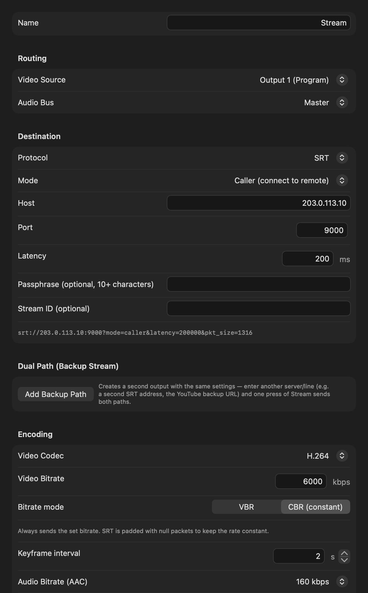

1. Click the gear on **STREAM**.
2. Add a destination: RTMP (YouTube, Twitch …: server URL and stream key), SRT (Caller or Listener), or a custom URL.
3. Under encoding, set the video codec (H.264 or HEVC), **Video Bitrate** and **Bitrate mode**:
   - **VBR**: never exceeds the bitrate; simple pictures use less.
   - **CBR (constant)**: always sends the set bitrate. For SRT, padding keeps the rate constant. If the encoder cannot do CBR, HongMix streams as capped VBR and tells you.
4. Optional: **Dual Path (Backup Stream)** sends the same program to a second server; **Broadcast delay** (5 s – 6 h) with a **DUMP** button to drop the delayed part in an emergency.
5. Click **STREAM**. If something looks wrong, the Pre-flight Check opens first and you can choose to start anyway.

While connecting, reconnecting or in error, **STREAM** blinks orange; it turns red once connected. The **Stream monitor** next to it shows bitrate, drops, SRT RTT/loss and reconnects.

A **Return feed** (Add Output › Return feed) sends the program back to the field as an SRT listener (port 9998). It runs independently of STREAM.

### EXTERNAL (NDI and DeckLink)

1. Click the gear on **EXTERNAL** to open **External Output Settings (NDI · DeckLink)**.
2. Click **Add External Output** and choose NDI (program over the network) or DeckLink (SDI/HDMI on a Blackmagic card). **Fill & Key** is available for overlays.
3. Click **EXTERNAL** to start.

### DISPLAY (full screen and monitors)


1. Click the gear on **DISPLAY** to open the display output settings.
2. Under **Monitor outputs**, choose what each connected display shows (Program, Preview, multiview …) or **Off**. **Identify monitors** shows a large number on every display for 3 seconds.
3. Optional: **Always on this display**, or use the **Output Window** to move it to another display or desktop and make it full screen with the green button.
4. Click **DISPLAY** to turn the display outputs on or off.

To close a full-screen output: **Esc**, double-click or right-click. If a display is unplugged, its output closes and reopens automatically when the display comes back.

### MultiCorder (ISO recording)

1. Open **Tools › MultiCorder Settings…** and choose the inputs to record (or turn on **Record this input with MultiCorder** for an input).
2. Choose **Tools › Start MultiCorder**. Each input is recorded to its own file.

### Other tools

- **Tools › Scheduler…**: run any function (start streaming, record, cut …) at set times or days.
- **Tools › Rundown / Cue Sheet**: the show's running order with actions per item; **NEXT** runs the next item.
- **Tools › Save Snapshot**: saves the current Program as PNG.
- **Scopes** (bottom bar): waveform, RGB parade, vectorscope and histogram in their own window.

---

## 10. Replay and live captions

### Instant Replay

1. Click **Replay** in the bottom bar and open the replay settings.
2. Choose up to four replay sources (CAM 1–4), the recording format and the storage location.
3. Start recording. Mark moments, and play them back at normal speed or in slow motion.
4. Export: press ⬇ on a clip (Command-click to select several). Choose 16:9, 9:16 or 1:1, one or all angles, normal / 50 % / AI slow motion, 0–2 s handles and H.264, HEVC or ProRes. Exports run in the background.

### Live captions

1. Choose **Tools › Captions…**.
2. Choose the audio source (Master or a bus A–G) and the **Spoken language**. Optionally add a translation line.
3. Click **Add Caption Input** and put the new **Live Captions** input on an overlay.
4. Click **Start Captions**. Allow **Speech Recognition** the first time.

Recognition runs on the Mac. Choose a caption style (right column, cinema, band or custom) and a minimum line time. An `.srt` file is saved to `~/Movies/HongMix`. On macOS 26 or later, a newer on-device engine is used.

---

## 11. Broadcast safety

### Pre-show Check

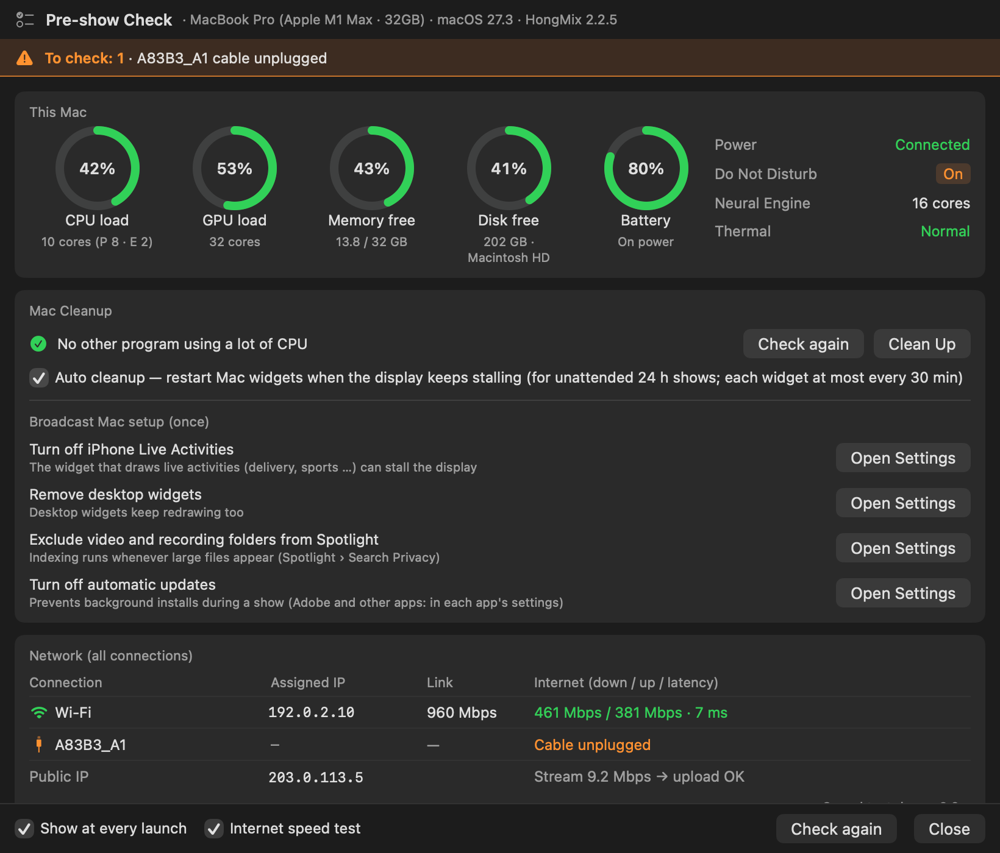

The Pre-show Check opens at launch (turn it off in **Settings › General › On-Air Safety › Show the pre-show check at launch**). It shows:

- **This Mac**: CPU and GPU load, free memory and disk, battery and power adapter, thermal state, Do Not Disturb.
- **Network (all connections)**: each connection, assigned IP, link speed, and optionally an internet speed test (down / up / latency) and public IP.

The speed test and public IP use Cloudflare's speed test servers; hotspots are skipped to save data. Turn the test off with **Test internet speed in the pre-show check**. Click **Check again** to refresh.

The separate **Pre-flight Check** (**Tools › Pre-flight Check…**) checks the show itself: output signal, live inputs, backups, SRT quality, destinations, recording disk, audio (silence, clipping), renderer and FTB, in green / yellow / red.

### Do Not Disturb

Calls, messages and notifications can steal the keyboard, mouse or Companion control during a show.

1. In **Settings › General › On-Air Safety**, turn on **Turn on Do Not Disturb when HongMix opens** and **Turn off Do Not Disturb when HongMix quits**.
2. The first time, click **Approve…** to install the Do Not Disturb shortcut.
3. The **Do Not Disturb** button in the top bar shows the state and switches it.

HongMix checks the state at launch, when you use the button, and when you switch back to HongMix (not periodically).

### Signal-loss failover

Set a **Backup input** for each live input (input settings › **General** › **Signal Loss / Failover**, see [chapter 3](#signal-loss-and-backup)). The Pre-flight Check warns about live inputs without a backup.

### Incident log (black box)

While streaming or recording, HongMix records signal loss, frame drops, silence, SRT loss and output errors, with Program pictures from about 10 seconds before and after.

- Location: `~/Movies/HongMix/Incidents` (the summary is `incidents.txt`).
- Open **Tools › Status Board / Black Box…** to see SRT link lights, 2-minute RTT/loss/rate graphs, recommended latency and the incident list. Click **Save Report…** for a text report.
- For SRT incidents, each incident folder has `srt.txt` with the link's last 30 seconds (buffer, latency, RTT, loss, drops, retransmissions, Mbps, fps) and a **verdict**:

| Verdict | Meaning |
|---|---|
| Disconnected | The sender or the network closed the connection |
| No data arriving | The sender stopped or the path is blocked |
| HongMix reading too slowly | A HongMix-side problem; please report it |
| Network problem | Latency too short for this RTT / loss: raise the latency |
| Dropped by the sender | Packets missing without retransmission (sender bandwidth limit or overload) |
| Network loss | Retransmission could not recover everything: check the line; a higher latency helps |
| Network loss, being recovered | Loss recovered by retransmission, no visible effect |

---

## 12. Web remote and tally

New in 2.2.5–2.2.6: the web remote is the switcher moved into a browser, with the same layout and labels as the app. It works on a laptop, an iPad or a phone on the same network.

### Turn on remote control

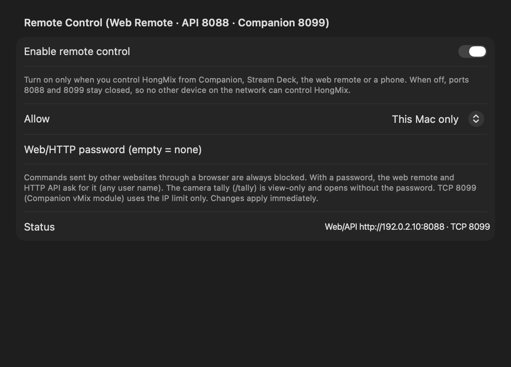

Remote control is **off by default**. While it is off, ports 8088 and 8099 stay closed.

1. Open **Settings** (⌘,) and choose **Network**.
2. Under **Remote Control (Web Remote · API 8088 · Companion 8099)**, turn on **Enable remote control**.
3. Under **Allow**, choose **Devices on the network (Companion · Stream Deck · phones)**, or **This Mac only**.
4. Optional: **Only these IPs** (comma-separated, empty = all) and **Web/HTTP password** (empty = none). With a password, the browser asks for it; any user name works.

Changes apply immediately. Commands sent by other websites through a browser are always blocked.

### Open the web remote

1. Find the Mac's IP address (the **Remote control addresses** in Settings, or the Pre-show Check).
2. On the other device, open `http://<Mac IP>:8088/`, for example `http://192.0.2.10:8088/`.

### Desktop layout (1100 px and wider: laptop, desktop, iPad landscape)

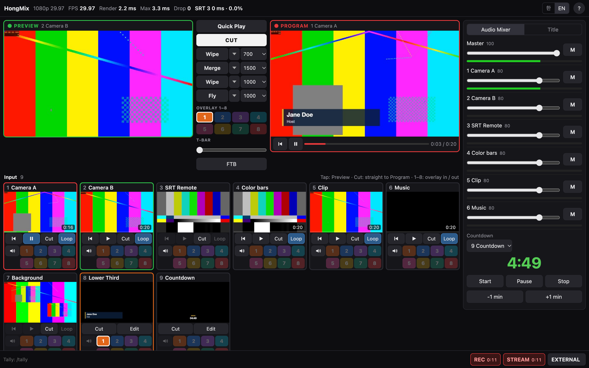

The page looks like the app:

- **PREVIEW** · center column · **PROGRAM**. The center column has **Quick Play**, **CUT**, four transition buttons with effect **▾** and duration (ms), the **OVERLAY 1–8** bank, **T-BAR** and **FTB**.
- **PROGRAM** has a playback bar for media on air: tap the bar to seek.
- **Input tiles** with ⏮, ▶/❚❚, **Cut**, **Loop**, a speaker (mute) button and overlay buttons **1–8**.
- **Audio Mixer / Titles** panel on the right.
- **REC**, **STREAM** and **EXTERNAL** at the bottom.
- Top status: **FPS**, **Render**, **Max**, **Drop**, and one item per SRT input (RTT, loss, dropped packets).
- **한 / EN** switches the language (remembered per device). **?** opens the help.
- The **Quality** menu (top) sets how smoothly PREVIEW and PROGRAM move and how much network they use (remembered per device):
  - **Smooth** — 15 frames per second, about 1–5 Mbps per picture. For a few devices on the same Wi-Fi.
  - **Medium** (default) — 8 frames per second, about 0.6–1.5 Mbps.
  - **Data saver** — 2 frames per second, about 0.2 Mbps. For weak Wi-Fi or mobile data.
  - When the pictures aren't on screen (Audio or Title tab on a phone, another app in front), the page stops the video to save network and HongMix work. Many devices watching the same picture cost HongMix one encoder, not one per device.

### Using it

| Action | Result |
|---|---|
| Tap a tile | The input goes to PREVIEW |
| **Cut** on a tile | The input goes straight to PROGRAM |
| **1–8** on a tile | Puts the input on that overlay; tap again to take it off. A lit number is on air. |
| **OVERLAY 1–8** (center) | Puts the input last used on that overlay back on, or takes it off |
| **CUT** | Switches PREVIEW to PROGRAM |
| Transition button | Runs the effect and duration chosen beside it |
| **T-BAR** | Drag to the end to complete the transition |
| ⏮ / ▶❚❚ / **Loop** / speaker | Restart, play/pause, loop, mute |
| **REC** / **STREAM** / **EXTERNAL** | Always ask for confirmation before starting or stopping |

**Audio Mixer**: volume slider, mute and level meter for Master and each input with audio. Countdown titles can be started, paused and stopped here.

**Titles**: choose a title input and edit its text boxes. Typing does not go on air. Tap **Apply** to send the changes, or **Revert** to discard them. You can also step through presets and play IN / OUT.

### iPad portrait and small windows (700–1099 px)

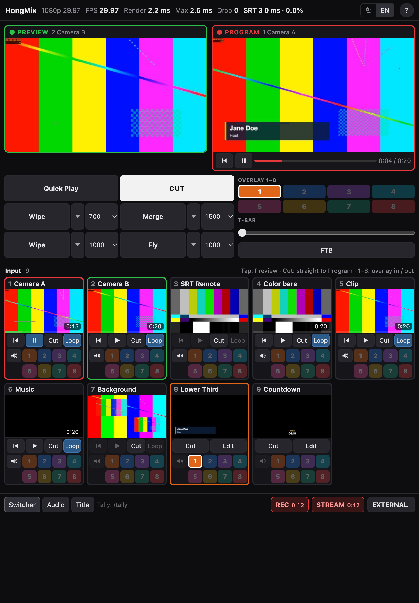

PREVIEW | PROGRAM side by side, a transition strip, then the input tiles. Audio Mixer and Titles open from the bottom tabs.

### Phone (narrower than 700 px)

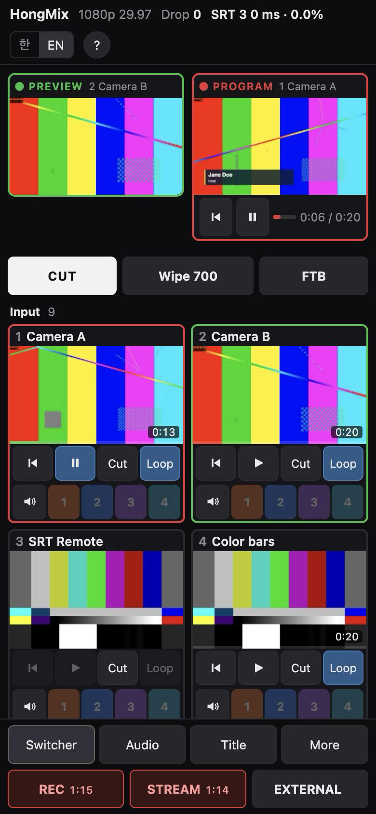

Small PREVIEW | PROGRAM monitors, a **CUT** · transition · **FTB** strip, and input tiles in two columns. Bottom tabs: **Switcher**, **Audio**, **Title**, **More** (overlay bank, four transitions, T-Bar). Buttons are finger-sized on touch screens.

### Camera tally


1. On the camera operator's phone, open `http://<Mac IP>:8088/tally`.
2. Choose the camera's input.
3. The screen turns red with **ON AIR** when the input is on Program, and green with **PREVIEW** when it is in Preview. Tap **Change input** to pick another.

The tally is view-only: it cannot switch anything, so it opens without the HTTP password (the IP rules still apply). It keeps the phone screen on; if asked, tap once to keep the screen on.

---

## 13. Companion, Stream Deck and API

HongMix speaks the vMix API, so existing controllers work as they are. Turn on remote control first ([chapter 12](#turn-on-remote-control)).

| Interface | Address |
|---|---|
| HTTP Web API | `http://<Mac IP>:8088/api/?Function=Cut` |
| TCP API | port **8099** (`FUNCTION Cut`) |
| Web remote | `http://<Mac IP>:8088/` |
| Tally | `http://<Mac IP>:8088/tally` |

### Bitfocus Companion / Stream Deck

1. In Companion, add the **vMix** module.
2. Enter the Mac's IP (for example `192.0.2.10`) and port **8088**. Companion also uses TCP 8099 for feedback.
3. Use vMix actions as usual (Cut, Fade, overlays, SetText, StartStreaming …).

Note: TCP 8099 uses only the IP limit, not the HTTP password.

### Examples

```
http://192.0.2.10:8088/api/?Function=PreviewInput&Input=2
http://192.0.2.10:8088/api/?Function=Fade&Duration=1000
http://192.0.2.10:8088/api/?Function=OverlayInput1In&Input=5
http://192.0.2.10:8088/api/?Function=SetText&Input=3&SelectedName=Headline.Text&Value=Hello
http://192.0.2.10:8088/api/?Function=LayerPreset&Input=4&Value=1,Interview
```

HongMix-specific functions include `SetFitMode`, `SetZoomX` / `SetZoomY`, `LayerLayout`, `SetLayer`, `LayerPreset` / `LayerPresetSave`, `SetLUT`, `SetDelay` / `DelayDump`, `RundownNext` and the ducking functions. Calling `/api/` without a function returns the vMix-style XML state, including `<inputSrtStats>` per SRT input.

Full list: [docs/FUNCTIONS.md](../FUNCTIONS.md).

**MIDI**: **Settings › MIDI** offers learn mode, controller templates and LED tally. Test every assigned control before air.

---

## 14. General settings

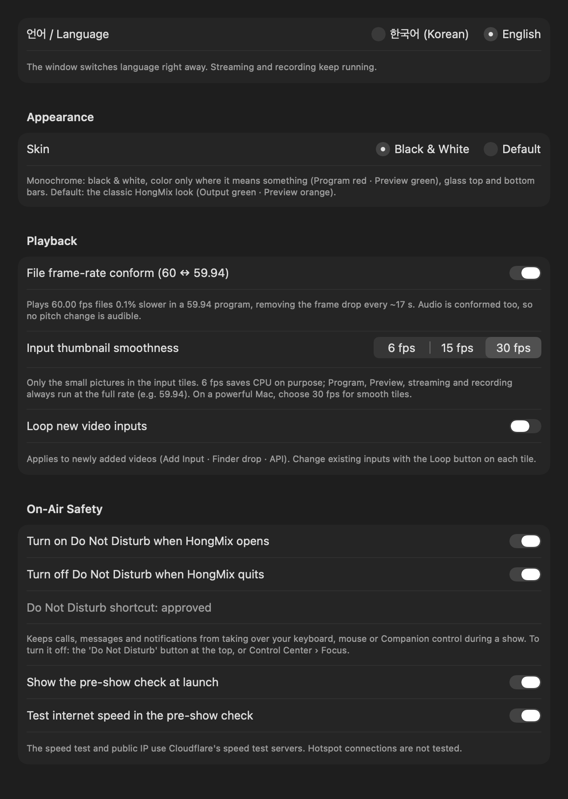

Open **Settings** with **⌘,**. Tabs: **Video**, **Network**, **General**, **About**, **Shortcuts**, **MIDI**.

### General

| Setting | Description |
|---|---|
| **언어 / Language** | 한국어 or English. The window switches right away; streaming and recording keep running. |
| **Appearance › Skin** | **Black & White** (default) or **Default** (classic HongMix look). |
| **Playback › File frame-rate conform (60 ↔ 59.94)** | Plays 60.00 fps files 0.1 % slower in a 59.94 program, removing a frame drop about every 17 s. Audio is conformed too. |
| **Playback › Input thumbnail smoothness** | 6, 15 or 30 fps for the small tile pictures only. Program, Preview, streaming and recording always run at the full rate. |
| **Playback › Loop new video inputs** | Default Loop state for newly added videos. |
| **Safety › Ask before closing an input** | Asks before the tile **×** or menu closes an input. Turn this on again after choosing **Don't ask again**. |
| **On-Air Safety** | Do Not Disturb at open/quit, Pre-show Check at launch, internet speed test. |

### Video

**Program Format** (resolution and frame rate). Stop all outputs before changing it. Inputs of any resolution or aspect ratio are scaled to fit the program format.

### Network

Extra NDI discovery IPs, NDI runtime, web browser engine and DeckLink status, and **Remote Control** ([chapter 12](#turn-on-remote-control)).

---

## 15. Troubleshooting and FAQ

**HongMix won't open ("unidentified developer").**
Right-click HongMix in Applications, choose **Open**, then **Open** ([chapter 1](#first-launch)).

**No camera or microphone.**
**System Settings › Privacy & Security › Camera / Microphone**: allow HongMix. Then click refresh in Add Input › Camera.

**Desktop capture is black or slow.**
Allow **Screen & System Audio Recording** for HongMix and restart HongMix if macOS asks.

**No NDI sources.**
Allow **Local Network** for HongMix. For another subnet, add the source IPs in **Settings › Network**.

**The SRT picture breaks up or drops out.**
1. Check RTT and loss in **Tools › Status Board / Black Box…** or in the SRT settings (double-click the tile).
2. Set latency to at least 4× the RTT, and the same on both sides. Click **Use Recommended**.
3. If it drops again, read the verdict in `~/Movies/HongMix/Incidents/incidents.txt` and `srt.txt`.
4. Make sure you are on 2.2.3 or later: earlier versions could drop SRT inputs after a few minutes at 60 fps.

**A receiver shows 58.94 instead of 59.94.**
Update to HongMix 2.3.0 or later. H.264 streams and recordings now carry their frame rate in the stream header.

**The web remote or Companion doesn't connect.**
If the web remote doesn't open on a phone or iPad, check in this order:
1. Is **Settings › Network › Enable remote control** on?
2. Is **Allow** set to **Devices on the network**? With **This Mac only**, neither a phone nor a browser on the same Mac can open a `192.168…` address, and the status line shows `localhost · This Mac only`.
3. Type the address exactly as the **Status** line shows it (for example `http://192.0.2.10:8088`) — `http`, not `https`.
4. Is the phone on the **same Wi-Fi** as the Mac? Mobile data, guest Wi-Fi or a VPN won't work.
5. If you filled in **Only these IPs**, the phone's IP must be in the list.
6. With a password set, the browser asks for it (any user name). The tally (`/tally`) opens without it.
7. Allow **Local Network** for HongMix; if the macOS firewall is on, allow incoming connections for HongMix.

**Render is high or Drop increases.**
- Lower **Input thumbnail smoothness** to 6 fps.
- Use **Fast** quality for AI background removal at 59.94p; turn off AI Upscaling where not needed.
- For files decoded on the CPU, create optimized media (ProRes) when offered.
- Keep the Mac on power and watch the thermal state in the Pre-show Check.
- Open **Statistics** (chart icon in the bottom bar) to see per-input fps, late frames and 2-minute health graphs.

**A menu bar icon flickers.**
Fixed in 2.2.0: the Do Not Disturb state is no longer checked periodically.

**I closed an input by mistake.**
Closing from the tile **×** or menu asks first. Click **Undo** at the top to restore the last closed input. If you chose **Don't ask again**, turn the question back on in **Settings › General › Safety**.

**HongMix quit unexpectedly. Where is the crash report?**
On the next launch, HongMix offers the newest report and can reveal it in Finder. Attach that `.ips` or `.crash` file to your GitHub issue.

**Can I use 60.00 fps files in a 59.94 program?**
Yes. Turn on **File frame-rate conform** in Settings › General › Playback.

---

## 16. System requirements and credits

### Requirements

- Apple Silicon Mac (M1 or later)
- macOS 14 or later (live captions use a newer engine on macOS 26 or later; AI Upscaling requires macOS 26 or later and Apple Silicon)
- Optional: Blackmagic DeckLink / UltraStudio for SDI/HDMI, NDI devices on the network

### Credits and license

- Made by Hong Seunghoon (홍승훈), Korea.
- Open-source components (FFmpeg, libsrt, NDI runtime, Chromium and others) and their licenses: **Settings › About › View notices**, and [docs/THIRD-PARTY-NOTICES.txt](../THIRD-PARTY-NOTICES.txt).
- Feedback and bug reports: [github.com/HongMix/HongMix/issues](https://github.com/HongMix/HongMix/issues)

vMix is a trademark of StudioCoast Pty Ltd. HongMix is an independent project and is not affiliated with or endorsed by StudioCoast. NDI® is a registered trademark of Vizrt NDI AB. DeckLink is a trademark of Blackmagic Design Pty Ltd.
