# HongMix 2.3.10 사용 설명서

HongMix는 Apple Silicon 맥용 라이브 프로덕션 스위처입니다. 화면 구성·단축키·원격 API가 vMix와 같아서 vMix 사용자, Bitfocus Companion, Stream Deck 환경을 그대로 쓸 수 있습니다.

> English version: [HongMix-Manual.en.md](HongMix-Manual.en.md)

## 목차

1. [설치](#1-설치)
2. [화면 구성](#2-화면-구성)
3. [입력 추가](#3-입력-추가)
4. [화면 전환](#4-화면-전환)
5. [오버레이 1~8](#5-오버레이-18)
6. [입력 설정](#6-입력-설정)
7. [오디오 믹서](#7-오디오-믹서)
8. [타이틀(자막)](#8-타이틀자막)
9. [출력](#9-출력)
10. [리플레이와 실시간 자막](#10-리플레이와-실시간-자막)
11. [방송 안전 기능](#11-방송-안전-기능)
12. [웹 리모트와 탤리](#12-웹-리모트와-탤리)
13. [Companion · Stream Deck · API](#13-companion--stream-deck--api)
14. [일반 설정](#14-일반-설정)
15. [문제 해결과 자주 묻는 질문](#15-문제-해결과-자주-묻는-질문)
16. [시스템 요구 사항과 저작권 고지](#16-시스템-요구-사항과-저작권-고지)

---

## 1. 설치

FFmpeg, SRT, NDI 런타임, Chromium 웹 엔진이 모두 앱 안에 들어 있어 따로 설치할 것이 없습니다.

### 방법 A: PKG 설치 파일 (권장)

1. **HongMix-2.3.10.pkg**를 더블클릭합니다.
2. "확인되지 않은 개발자" 경고가 뜨면 파일을 우클릭 → **열기** → **열기**를 누릅니다. (또는 **시스템 설정 › 개인정보 보호 및 보안**에서 **그래도 열기**)
3. **계속** → **설치**를 누릅니다. **응용 프로그램** 폴더에 HongMix가 설치됩니다.

### 방법 B: DMG

1. **HongMix-2.3.10.dmg**를 엽니다.
2. **HongMix**를 **Applications** 폴더로 드래그합니다.

### 처음 실행

HongMix는 아직 Apple 공증을 받지 않아 macOS가 한 번 확인합니다.

1. **응용 프로그램** 폴더에서 **HongMix**를 우클릭 → **열기**를 누릅니다.
2. 경고 창에서 **열기**를 누릅니다. 다음부터는 그냥 열립니다.

### 권한

기능을 처음 쓸 때 macOS가 권한을 묻습니다. 실수로 **허용 안 함**을 눌렀다면 **시스템 설정 › 개인정보 보호 및 보안**에서 바꾸세요.

| 권한 | 필요한 경우 |
|---|---|
| 카메라 | 카메라·캡처 카드 입력 |
| 마이크 | 마이크·오디오 입력, 캡처 카드 오디오 |
| 화면 및 시스템 오디오 녹음 | 화면/창 캡처 입력에서만 |
| 로컬 네트워크 | NDI 소스·SRT 장비 찾기, 웹 리모트 |
| 음성 인식 | 실시간 자막을 시작할 때만 |

---

## 2. 화면 구성

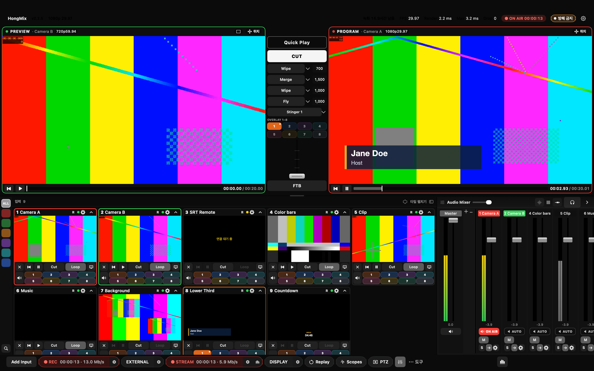

메인 화면은 vMix와 같은 배치입니다.

| 영역 | 역할 |
|---|---|
| **PREVIEW** (왼쪽 모니터) | 다음에 내보낼 화면. 여기서 다음 장면을 준비합니다. |
| **PROGRAM** (오른쪽 모니터) | 지금 방송에 나가는 화면. 송출·녹화·외부 출력되는 화면입니다. |
| **전환 열** (두 모니터 사이) | **Quick Play**, **CUT**, 전환 버튼 4개, **OVERLAY 1–8**, Stinger 버튼, **T-바**, **FTB** |
| **입력 타일** (아래) | 입력마다 타일 하나. 타일을 클릭하면 Preview로 갑니다. |
| **Audio Mixer** (오른쪽) | Master, 버스, 오디오가 있는 입력의 채널 스트립 |
| **아래쪽 바** | **Add Input**, **REC**, **EXTERNAL**, **STREAM**, **DISPLAY**, **Replay**, **Scopes**, **PTZ**, 오디오 믹서 보이기/숨기기, **도구**, Statistics |
| **위쪽 상태 표시** | **FPS**, **Render**, **Max**, **Drop**, **방해 금지** 버튼, 송출·녹화 표시 |

참고:
- 기본 스킨은 **Black & White**입니다. PROGRAM은 빨강, PREVIEW는 초록이고 색은 의미가 있는 곳에만 씁니다. 예전 화면(**기본**: Output 초록, Preview 주황, 버튼 이름 Record / External / Stream / Display)은 **설정 › 일반 › 화면 모양 › 스킨**에서 고릅니다.
- **Render**는 한 프레임을 그리는 데 걸린 시간입니다. 프레임 시간(59.94p ≈ 16.7ms)보다 작으면 정상입니다. **Drop**은 버린 출력 프레임 수입니다.
- 동영상 입력은 모니터 아래에 재생 바가 나옵니다: 처음으로 · 재생/일시정지 · 위치 바(클릭·드래그로 이동) · 시간. 위치 바를 우클릭하면 **Mark In** / **Mark Out**을 지정합니다. 시간을 클릭하면 경과 ↔ 남은 시간이 바뀌고, 끝나기 10초 전부터 빨간색이 됩니다.

### 입력 타일 조작

| 조작 | 동작 |
|---|---|
| 화면 클릭 | 그 입력을 Preview로 |
| 더블클릭 | 입력 설정 열기 (스트림 입력은 연결 설정) |
| 제목 우클릭 | 타일 접기/펼치기, 그 밖의 메뉴 |
| 드래그 | 순서 바꾸기 |
| **×** | 확인 후 입력 닫기 (위쪽 **Undo**로 되살릴 수 있습니다). **다시 묻지 않기**를 고르거나 **설정 › 일반 › 실수 방지**에서 다시 켭니다. |
| ⏮ / ▶ ❚❚ | 처음부터, 재생/일시정지 (미디어 입력) |
| **Cut** | 이 입력을 바로 Program으로 |
| **Loop** | 반복 재생 켜기/끄기 |
| 모니터 아이콘 | 별도 창으로 크게 보기 |
| 스피커 | 입력 소리 끄기/켜기 |
| **1–8** | 오버레이 1~8에 넣기/빼기 |

### 아래쪽 바 **도구** 메뉴

**MultiCorder** 시작/중지와 설정, **모든 출력 보기…**, **Overlay 설정…**, **Rundown / 큐시트**, **스케줄러…**, **자막…**, **송출 전 점검…**, **상황판 / 블랙박스…**, **스냅샷 저장**.

---

## 3. 입력 추가

아래쪽 **Add Input** 또는 **⌘I**로 입력 추가 창을 엽니다. 왼쪽에서 종류를 고르고 오른쪽 옵션을 채운 뒤 **확인**을 누릅니다. 종류 이름은 두 언어 모두 영어로 표시됩니다.

### 카메라·캡처 카드

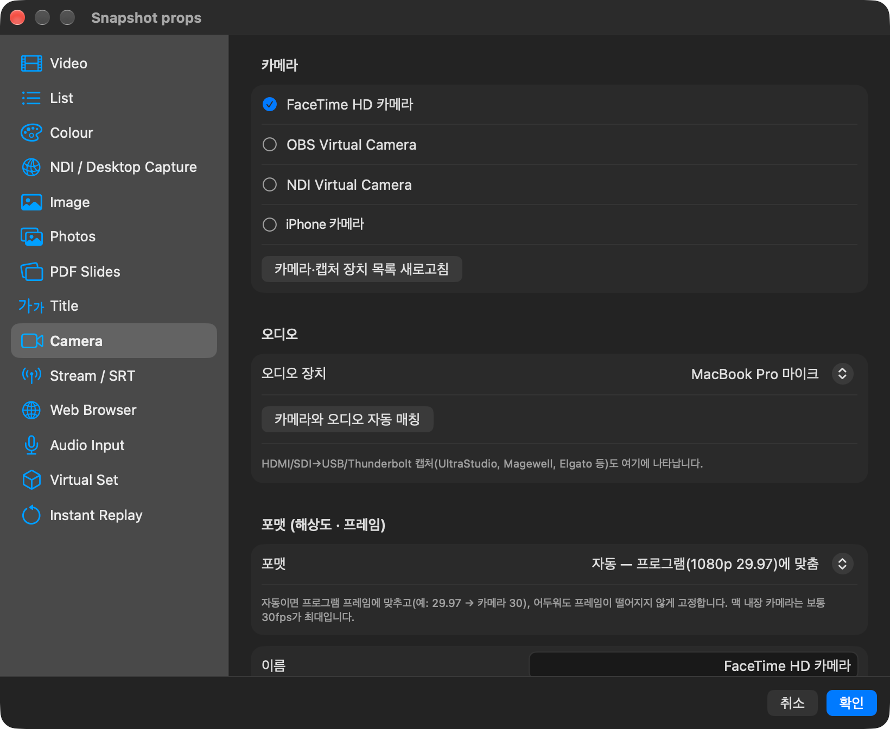

1. **Add Input**을 누르고 **Camera**를 고릅니다.
2. 장치를 고릅니다. 내장 카메라와 HDMI/SDI→USB/Thunderbolt 캡처 장치(UltraStudio, Magewell, Elgato 등)가 나타납니다. 장치가 안 보이면 새로고침 버튼을 누르세요.
3. **포맷 (해상도 · 프레임)**을 고릅니다. **자동**이면 프로그램 프레임에 맞추고, 장치가 지원하는 모드를 직접 고를 수도 있습니다.
4. **오디오 장치**를 고르거나 **카메라와 오디오 자동 매칭**을 켜 둡니다.
5. **확인**을 누릅니다. 카메라·마이크 권한을 물으면 **허용**을 누르세요.

"카메라 권한이 거부됨"이 보이면 **시스템 설정 › 개인정보 보호 및 보안 › 카메라**에서 HongMix를 허용하세요.

### 동영상·이미지·오디오 파일

Finder에서 끌어다 놓는 것이 가장 빠릅니다.

1. 동영상, 이미지, 사진 폴더, PDF를 입력 영역에 놓습니다. 파일마다 새 입력이 생깁니다.
2. 여러 동영상을 **Option** 키와 함께 놓으면 차례로 재생하는 **List** 입력 하나가 됩니다.
3. **Command** 키와 함께 기존 타일에 놓으면 확인 후 그 입력의 파일을 바꿉니다.

입력 추가 창에서도 추가할 수 있습니다.

- **Video**: 입력 하나에 파일 하나. 옵션: **반복 재생 (Loop)**, Auto Play, Auto Pause, Auto Restart, 하드웨어 디코더(VideoToolbox).
- **List**: 파일을 여러 개 고르면 한 입력에서 위에서부터 차례로 재생합니다. 나중에 입력 설정의 **목록** 탭에서 추가·삭제·순서 변경·섞기·더블클릭 재생·리스트 반복을 설정합니다.
- **Image**: PNG(투명 지원), JPG 등. 투명 PNG는 오버레이 로고로 쓰기 좋습니다.
- **Photos**, **PDF·PowerPoint 슬라이드**: PDF, PPT, PPTX, Keynote, ODP 파일을 그대로 추가합니다. macOS 미리보기로 변환하므로 Office나 Keynote를 설치할 필요가 없습니다. 숨긴 슬라이드는 건너뛰며 애니메이션·전환 효과는 유지하지 않습니다. Preview·Program 아래 버튼, 입력 타일의 **‹ n / N ›**, 웹 리모컨 또는 **NextPicture** / **PreviousPicture** 단축키로 넘깁니다. 단축키의 **입력**을 비우면 Program, 없으면 Preview를 제어합니다.

MP4, MOV(ProRes 4444 알파 포함), MXF, TS, MKV, AVI, MP3, WAV 등을 지원합니다. 확장자만으로 내부 코덱 지원이 보장되지는 않습니다. 새 동영상 입력은 **Loop**가 꺼진 상태로 시작합니다 (기본값은 **설정 › 일반 › 재생 설정 › 새 영상 입력 기본 루프**에서 바꿉니다).

### SRT·RTMP 등 스트림 입력

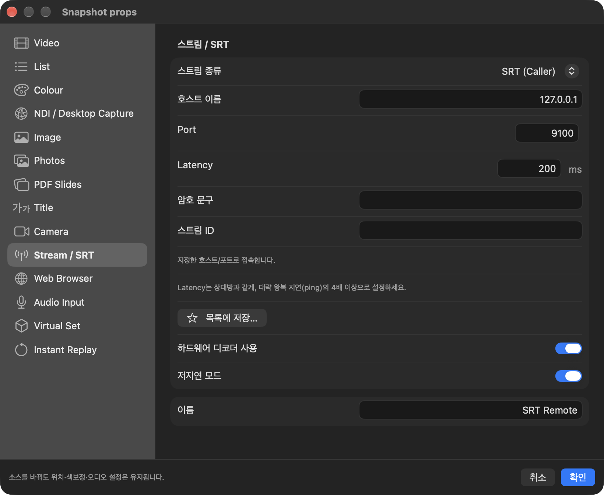

1. **Add Input**을 누르고 **Stream / SRT**를 고릅니다.
2. 종류를 고릅니다: **SRT (Caller)**, **SRT (Listener)**, **SRT (Rendezvous)**, 푸시를 받는 **RTMP (Server)**, **RTMP / HLS / HTTP (URL)**, RTSP over UDP/TCP, Transport Stream over UDP/TCP.
3. SRT는 호스트, 포트, **Latency**, 필요하면 암호와 Stream ID를 넣습니다. 예: 현장 인코더가 `srt://192.0.2.10:9000`으로 Caller 접속하면 HongMix는 9000번 포트의 Listener입니다.
4. **확인**을 누릅니다.

**최근·저장한 SRT**: SRT 설정 맨 위에 최근에 쓴 SRT 연결이 나옵니다. 항목을 클릭하면 칸이 채워집니다. **목록에 저장…**(또는 항목 우클릭)으로 연결을 이름 붙여 저장합니다.

**Latency 안내**: Latency는 상대방과 같게, 대략 왕복 지연(ping)의 4배 이상으로 설정하세요. 연결되어 있는 동안 설정 화면에 RTT, 손실, 최근 드롭 패킷, 권장 Latency가 표시됩니다. **권장값 넣기**를 누르면 바로 적용됩니다.

**나중에 수정하기**: 스트림 입력 타일을 더블클릭하면 연결 설정(주소, 포트, 모드, Latency, 암호)이 바로 열립니다.

### NDI

1. **Add Input**을 누르고 **NDI / Desktop Capture**를 고릅니다.
2. 같은 네트워크의 NDI 소스를 자동으로 찾습니다. 필요하면 새로 고침을 누르거나 이름을 직접 입력합니다(예: `MACHINE (Source)`).
3. 필요하면 **저대역폭**을 켭니다.
4. 다른 서브넷의 장비는 **설정 › 네트워크 › NDI 추가 검색 IP**에 IP를 넣으세요.

### 화면·창 캡처

1. **Add Input** → **NDI / Desktop Capture** → **화면 캡처**를 고릅니다.
2. 디스플레이나 창을 고릅니다. 옵션: **소리 캡처**(창은 그 앱 소리만, 디스플레이는 HongMix를 뺀 맥 전체 소리), **커서 표시**, 프레임레이트.
3. 처음에는 시스템 설정에서 **화면 및 시스템 오디오 녹음**을 허용하세요.

### 웹 브라우저

1. **Add Input** → **Web Browser**를 고르고 주소를 넣습니다.
2. 내장 Chromium 엔진을 씁니다. 배경색이 없는 페이지는 **투명 배경**을 켜면 알파가 생깁니다.
3. 모니터에서 페이지를 마우스·키보드로 바로 조작할 수 있습니다. **Esc**를 누르거나 다른 곳을 클릭하면 스위처 단축키로 돌아갑니다.

### 타이틀

**Add Input** → **Title**에서 모든 템플릿을 미리보기로 보고 고릅니다 ([8장](#8-타이틀자막) 참고).

### 컬러

**Add Input** → **Colour**: SMPTE 컬러바, 검정, 흰색, **투명 (Transparent)**, 사용자 지정(불투명도 포함). 투명 컬러 입력은 레이어로 분할 화면을 만들 때 바탕으로 씁니다.

### 오디오 전용

**Add Input** → **Audio Input**을 고르고 장치(마이크, 오디오 인터페이스)를 선택합니다.

### 가상 입력

가상 입력은 다른 입력과 같은 화면을 다시 디코딩하지 않고 보여 줍니다. 위치·자르기·레이어는 따로, 재생·소리는 원본을 따라갑니다.

1. 입력 타일을 우클릭합니다.
2. **가상 입력 복사**를 고릅니다.

### 그 밖의 종류

**Virtual Set**(앞쪽 이미지와 진행자 위치를 정하는 가상 세트)과 **Instant Replay**도 입력 추가에 있습니다.

### 신호 끊김과 백업

라이브 입력(SRT, NDI, 카메라)의 입력 설정 → **일반** 탭 → **신호 끊김 / 페일오버**에서 끊겼을 때 보여 줄 화면과 **백업 입력**을 정합니다. 송출 중 입력이 끊기면 자동으로 백업으로 넘어가고, 신호가 돌아오면 원래 입력으로 복귀합니다.

---

## 4. 화면 전환

기본 원리: **PREVIEW**에서 준비하고 **PROGRAM**으로 보냅니다.

### 기본 순서

1. 입력 타일을 클릭합니다. PREVIEW에 나타납니다.
2. **CUT**(또는 **Space**)을 누르면 바로 바뀌고, 전환 버튼을 누르면 효과와 함께 바뀝니다.
3. 원래 Program에 있던 입력이 Preview로 오므로 CUT을 다시 누르면 되돌아갑니다.

### 전환 열

| 조작 | 동작 |
|---|---|
| 트랜지션 탭 | **AUTO**와 T-바가 사용할 슬롯 선택. 우클릭하면 효과 변경. **⌥1~4**는 슬롯을 바로 실행 |
| 효과와 시간 | 선택한 슬롯의 효과와 0~5초 길이를 슬라이더로 설정 |
| **CUT** | Preview를 Program으로 즉시 전환 |
| **AUTO** | 두 번째 줄에 표시된 선택 효과와 시간으로 전환 |
| **Quick Play** | 1번 전환 실행 (기본 0.5초 페이드). 단축키 **Return** |
| 가로 **T-바** | 오른쪽으로 밀어 선택한 트랜지션으로 수동 전환 |
| **OVERLAY 1–8** | 원형 버튼으로 오버레이 채널 넣기/빼기 ([5장](#5-오버레이-18) 참고) |
| Stinger | 미디어 입력과 컷 지점을 고른 뒤 실행. Loop가 켜져 있어도 한 번만 재생되고 실제 끝에서 빠짐. API: `SetStinger Input=… Value=컷지점ms` |
| **FTB** | Fade To Black (오디오도 함께 페이드). 다시 누르면 돌아옵니다. |

### 단축키

| 키 | 동작 |
|---|---|
| Space | Cut |
| Return | Quick Play |
| 1 ~ 9 | 입력 1~9를 Preview로 |
| ⌘1 ~ ⌘9 | 입력 1~9를 바로 Program으로 (Cut) |
| ⌥1 ~ ⌥4 | 전환 버튼 1~4 |
| ⇧⌘B | FTB |
| ⌘I | 입력 추가 |
| ⌘N / ⌘O / ⌘S | 새 프로젝트 / 열기 / 저장 (5초마다 자동 저장) |
| ⌘W | 현재 도구 창·시트 닫기 (메인 스위처와 Display 출력은 닫지 않음) |

**설정 › 단축키**에서 어떤 키에든 기능을 지정할 수 있습니다 (vMix 기본 세트 제공).

---

## 5. 오버레이 1~8

오버레이는 하단 자막, 로고, PIP처럼 입력을 Program 위에 겹쳐 올립니다. 오버레이 채널은 8개입니다.

### 오버레이에 넣기

1. 입력 타일의 숫자 **1–8** 중 하나를 누릅니다.
2. 그 채널로 입력이 Program 위에 페이드로 올라갑니다. 숫자에 불이 들어오면 그 채널로 송출 중입니다.
3. 같은 숫자를 다시 누르면 내려갑니다.

### 전환 열의 OVERLAY 1–8

각 버튼은 그 채널에 마지막으로 넣었던 입력을 다시 올리거나 내립니다. 먼저 타일 버튼으로 입력을 지정하세요.

### 오버레이 설정

**도구 › Overlay 설정…**에서 채널별 효과·시간·PIP 위치와 Stinger를 설정합니다.

---

## 6. 입력 설정

입력 타일을 더블클릭하거나 ⚙ 메뉴의 **속성…**으로 입력 설정을 엽니다. 탭: **일반**, **색 보정**, **Key / Fill & Key**, **위치**, **레이어**, **오디오 설정**, 입력에 따라 **재생 설정**, **목록**, **트리거**, **PTZ**. Program과 같은 실시간 미리보기가 오른쪽에 고정되고 왼쪽 설정만 스크롤됩니다.

### 위치

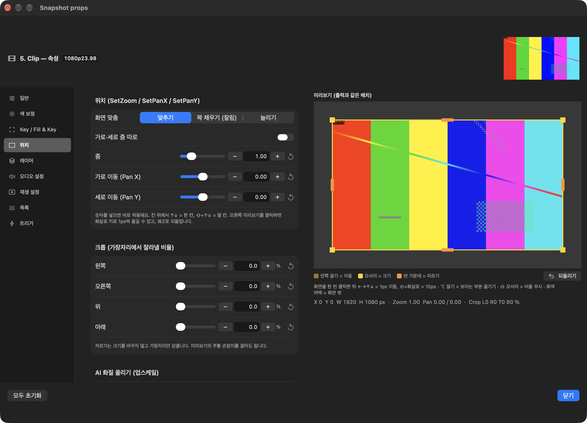

화면에서 바로 편집합니다.

- 상자 안쪽을 끌면 이동, 노란 모서리를 끌면 크기 조절.
- 주황 변 손잡이를 끌면 자르기. **Option**-끌기로 잘린 범위 안에서 보이는 부분을 옮깁니다.
- 화면 둘레의 회색 여백 덕분에 화면 밖으로 나간 상자와 손잡이도 잡을 수 있습니다.

숫자로 정확히 넣기:

1. 칸에 숫자를 넣으면 바로 적용됩니다. 값은 출력 픽셀 단위입니다.
2. 칸 옆 **−** / **+** 또는 화살표 키를 씁니다: **↑↓** = 한 칸, **⇧+↑↓** = 열 칸.
3. **불투명도**와 **회전**도 같은 방식입니다.

그 밖의 조작: **맞추기**(원본 전체 보이기), **채우기**(화면을 채우고 가장자리 잘림), **늘리기**(비율 무시하고 채우기), LED 와이드 화면용 가로·세로 줌 따로, **가운데 정렬**, **화면에 맞추기**, **위치 초기화**.

**AI 화질 올리기 (업스케일)**: Apple Silicon과 macOS 26 이상에서 Apple 실시간 초해상도 모델로 저해상도 소스를 선명하게 키웁니다. 입력이 Program, Preview 또는 송출 중 레이어에 올라가기 전에는 대기 상태("송출이나 Preview에 올리면 시작합니다")라 화면에 안 나가는 입력에 GPU를 쓰지 않습니다.

### 레이어 (분할 화면·PIP)

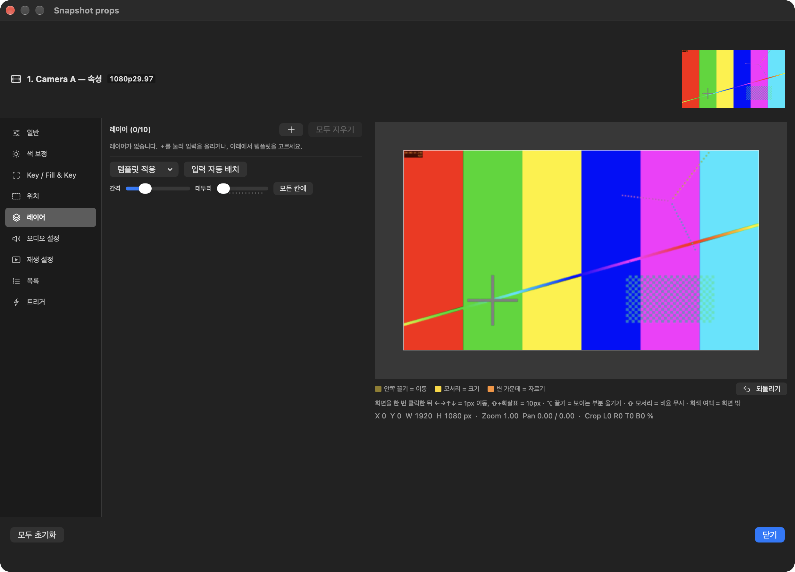

4분할 화면 만들기:

1. **Add Input** → **Colour** → **투명 (Transparent)**(또는 바탕색)을 추가합니다.
2. 그 입력의 설정을 열고 **레이어** 탭을 고릅니다.
3. **템플릿 적용**에서 배치를 고릅니다: 2분할, 3분할, 4분할(2×2), 9분할(3×3), 16분할, 1+3, 1+5, PIP 등.
4. 칸마다 입력을 고르거나 **입력 자동 배치**로 빈 칸에 입력 1, 2, 3… 순서로 넣습니다.
5. **맞추기** / **채우기**, **간격**, **테두리**를 정합니다.
6. 미리보기에서 상자를 끌어 미세 조정한 뒤, 이 입력을 Program이나 오버레이로 내보냅니다.

레이어 편집:

- **여러 개 선택**: **⇧**-클릭 또는 **⌘A**. 그다음 정렬(왼쪽·오른쪽·위·아래 맞춤, 가로·세로 가운데 맞춤), **가로 간격 같게** / **세로 간격 같게**, **크기 같게**(너비만, 높이만, 너비와 높이)를 화면·선택한 상자들·처음 선택한 상자 기준으로 맞춥니다.
- **스냅**: 레이어를 움직이면 화면과 다른 레이어의 가장자리·가운데에 붙습니다.
- **자르기**: 자르기 모드, 변 손잡이, 방향별 슬라이더로 자릅니다. 회전한 레이어도 회전하지 않은 레이어처럼 그 상자 변이 함께 움직입니다.
- **화면에 맞추기**, **가운데**, **원래 비율**, **전체 화면**, **위치 복사** / **붙여넣기**, **잠금**, **불투명도**, **회전**.
- **투명 배경만 잘라내기**: 타이틀·PNG 레이어의 빈 투명 여백을 없애 채우기가 실제 그래픽 기준으로 적용되게 합니다. 쓸 수 없는 소스는 이유를 바로 표시합니다.
- **프리셋**: **현재 위치를 프리셋으로 저장…**으로 위치·크기·자르기·회전·불투명도·테두리·채우기/맞추기를 저장합니다(소스 입력은 저장하지 않음). 어느 입력, 어느 프로젝트에서든 다시 적용할 수 있습니다.
- **되돌리기**(⌘Z)로 마지막 변경을 되돌립니다.

### 색 보정

밝기·대비·채도 등 조절과 **LUT**(3D `.cube` 파일, 강도 0–100%)를 지원합니다. S-Log3, V-Log, C-Log 같은 Log 카메라를 Rec.709로 바꾸거나 룩을 입힙니다. GPU에서 처리합니다.

### Key

**Key / Fill & Key**: 크로마키, 알파 처리, 그리고 크로마키 없이 사람만 남기는 **AI 배경 제거**. 투명·블러·이미지 배경과 Fast·Balanced·Accurate 품질을 고릅니다. 59.94p는 Fast를 권장합니다. 방송 전에 실제 카메라와 조명으로 꼭 시험하세요.

### 트리거

입력이 Program에 들어가거나 빠질 때, 오버레이에 들어가거나 빠질 때, 재생이 끝났을 때, 카운트다운이 0이 됐을 때 기능을 자동으로 실행합니다. 예: 오프닝 영상이 끝나면 카메라 1로 Fade. "이 입력"을 고르면 자기 자신, ms 단위 지연을 넣을 수 있고 ▶로 바로 시험합니다.

### PTZ

라이브 입력의 **PTZ** 탭에서 카메라 IP와 프리셋을 설정합니다. 아래쪽 **PTZ** 버튼은 제어 창을 엽니다: **1–9** 카메라 선택, **W/A/S/D** 이동, **Q/E** 줌, **Z/X** 포커스, **F** 자동 초점, 창에 표시된 프리셋 키. 키를 떼거나 창에서 벗어나면 카메라가 멈춥니다.

### 카테고리

입력의 ⚙ 메뉴 › **카테고리**로 색 카테고리를 지정합니다. 입력 타일 왼쪽 색 탭으로 걸러 보고, 탭을 우클릭하면 이름을 바꾸며, 돋보기로 이름·번호를 검색합니다.

---

## 7. 오디오 믹서

아래쪽 바의 슬라이더 버튼으로 믹서를 보이거나 숨깁니다. 창 버튼을 누르면 Audio Mixer를 별도 창으로 옮기고, 그 창을 닫으면 메인 스위처로 돌아옵니다.

### 표시되는 채널

- **Master**와 사용 중인 버스는 항상 표시됩니다. **+ Bus**로 버스 A~G를 추가합니다.
- 미디어 입력은 오디오 트랙이 확인되는 즉시 스트립이 나타나고, 오디오가 없는 입력은 숨겨집니다. 라이브 입력은 실제 소리가 들어오면 나타납니다.
- 믹서 제목 옆 파형 버튼은 레벨 미터를 접고 펼칩니다. 화살표는 입력 스트립 전체를 접고 펼칩니다. 입력별로는 **오디오 설정 › 믹서에 표시**.

### 채널 조작

| 조작 | 동작 |
|---|---|
| 페이더 | 볼륨 |
| 음소거 | 소리 끄기/켜기 (타일의 스피커 버튼과 같음) |
| **M**, **A**, **B** … | Master·버스로 보내기 |
| **Solo** (헤드폰) | 이 채널만 헤드폰으로 듣기 |
| **→** (**Audio Auto**) | 화면이 Program에 있을 때만 소리 켜기 |
| ⚙ | 오디오 설정: EQ, 컴프레서, 게이트, 딜레이, 채널 모드, 자동 더킹 |

격자 아이콘은 **오디오 버스 매니저**(입력 × 버스를 한 화면에서 라우팅)를 엽니다. 헤드폰 볼륨을 정하고 **모니터**를 누르면 맥 기본 출력으로 듣습니다. Solo가 켜져 있으면 Solo 신호를 듣습니다.

**자동 더킹**(입력 ⚙ › 오디오 설정): 진행자 마이크에는 "이 입력이 말하면 다른 소리를 줄임", 음악에는 "이 입력을 줄임"을 켭니다. 기본값: 줄이는 양 −15 dB, 감지 레벨 −38 dB, 복귀 시간 0.9초.

---

## 8. 타이틀(자막)

### 타이틀 추가

1. **Add Input**을 누르고 **Title**을 고릅니다.
2. 갤러리에서 템플릿을 고릅니다 (하단 자막, 전체 화면, LIVE/소셜/로고, 카운트다운, 시계, 스코어보드, 티커 등). 직접 만든 디자인은 ★로 표시됩니다.
3. **확인**을 누르고 타일의 **1–8** 버튼으로 오버레이에 올립니다.

### 글자와 디자인 편집

1. 입력의 ⚙ 메뉴에서 **타이틀 편집…**을 고릅니다.
2. 칸에 글자를 입력합니다. 큰 미리보기에서 글자와 박스를 끌어 위치·크기를 바꿉니다.
3. 색, 그라데이션, 그림자, 외곽선, 폰트, 등장/퇴장 효과(페이드·슬라이드·와이프·팝)를 바꿉니다.
4. 필요하면 필드를 추가하거나 지웁니다.

### 프리셋

**현재 텍스트를 프리셋으로 저장**으로 저장해 두고, 방송 중에 프리셋을 넘기며 씁니다 (예: 출연자마다 프리셋 하나).

### 디자인 공유

**내 템플릿으로 저장…**은 디자인을 입력 추가 갤러리에 넣습니다. **파일로 내보내기…**로 다른 맥과 공유합니다.

### 카운트다운

카운트다운 타이틀은 Program이나 오버레이에 올리는 순간 줄어들기 시작합니다 (끝난 상태였으면 처음부터). 끄려면 타이틀 편집의 카운트다운에서 **Output/오버레이에 올리면 자동 시작**을 해제합니다. 시작·일시정지·정지는 웹 리모트에서도 할 수 있습니다.

API 예: `SetText Input=3 SelectedName=Headline.Text Value=안녕하세요`

---

## 9. 출력

아래쪽 바의 출력 버튼은 두 부분입니다. 본체는 시작/중지, 톱니바퀴는 설정입니다.

### 녹화 (REC)

1. **REC**의 톱니바퀴를 눌러 **녹화 설정**을 엽니다.
2. 폴더, 컨테이너(MP4, MOV 또는 MPEG-TS), 코덱(H.264, HEVC 또는 ProRes 422), 비트레이트를 고릅니다. ProRes는 MOV를 사용합니다.
3. 선택: N분마다 새 파일, **백업 녹화 (두 번째 디스크)**, 첫 디스크가 차면 다른 디스크로 이어서 녹화, 멀티트랙 오디오(버스를 추가 트랙으로).
4. **REC**를 눌러 시작합니다. 위쪽에 예상 녹화 가능 시간이 표시됩니다.

### 송출 (STREAM)

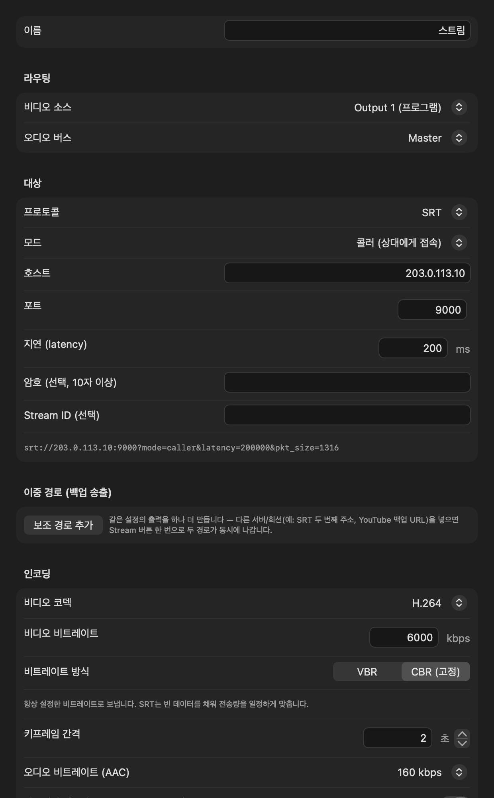

1. **STREAM**의 톱니바퀴를 누릅니다.
2. 송출 대상을 추가합니다: RTMP(YouTube, Twitch 등: 서버 주소와 스트림 키), SRT(Caller 또는 Listener), 사용자 URL.
3. 인코딩에서 비디오 코덱(H.264 또는 HEVC), **비디오 비트레이트**, **비트레이트 방식**을 정합니다.
   - **VBR**: 설정한 비트레이트를 넘지 않게 보냅니다. 단순한 화면에서는 더 적게 나갑니다.
   - **CBR (고정)**: 항상 설정한 비트레이트로 보냅니다. SRT는 빈 데이터를 채워 전송량을 일정하게 맞춥니다. 인코더가 CBR을 지원하지 않으면 최대값을 고정한 VBR로 송출하고 알려 줍니다.
4. 선택: **이중 경로 (백업 송출)**로 같은 방송을 두 번째 서버로도 보냅니다. **방송 딜레이**(5초~6시간)를 쓰면 사고 때 빨간 **DUMP**로 지연 구간을 버리고 즉시 실시간으로 돌아갑니다.
5. **STREAM**을 누릅니다. 문제가 보이면 송출 전 점검 창이 먼저 뜨고, 그래도 시작할지 고를 수 있습니다.

연결 중·재연결·오류 상태에서는 **STREAM**이 주황으로 깜빡이고, 연결되면 빨간색이 됩니다. 옆의 **송출 모니터**는 비트레이트·드롭·SRT RTT/손실·재연결을 보여 줍니다.

**리턴 피드**(출력 추가 › 리턴 피드)는 현장에 프로그램 화면을 되돌려 보내는 SRT 리스너(포트 9998)입니다. STREAM과 따로 동작합니다.

### EXTERNAL (NDI·DeckLink)

1. **EXTERNAL**의 톱니바퀴를 눌러 **외부 출력 설정 (NDI · DeckLink)**을 엽니다.
2. **외부 출력 추가**에서 NDI(네트워크로 프로그램 송출) 또는 DeckLink(Blackmagic 카드의 SDI/HDMI)를 고릅니다. 오버레이용 **Fill & Key**도 지원합니다.
3. **EXTERNAL**을 눌러 시작합니다.

### DISPLAY (전체 화면·모니터)


1. **DISPLAY**의 톱니바퀴를 눌러 디스플레이 출력 설정을 엽니다.
2. **모니터별 출력**에서 연결된 모니터마다 보여 줄 화면(Program, Preview, 멀티뷰 등) 또는 **끔**을 고릅니다. **모니터 번호 표시**는 모든 모니터에 번호를 3초 동안 크게 띄웁니다.
3. 선택: **이 모니터에 항상 고정**, 또는 **출력 창**을 다른 모니터나 데스크탑으로 옮긴 뒤 녹색 버튼으로 전체 화면.
4. **DISPLAY**를 눌러 디스플레이 출력을 켜고 끕니다.

전체 화면 출력 닫기: **Esc**, 더블클릭, 우클릭. 모니터 연결이 빠지면 출력을 닫았다가 다시 연결되면 자동으로 다시 엽니다.

### MultiView 여러 개

1. **도구 › 모든 출력 보기…**에서 MultiView를 추가하고 편집기를 엽니다.
2. 2+8, 8+2, 왼쪽 큰 화면, 오른쪽 큰 화면, 2×2, 3×3, 4×4 중 하나를 고릅니다.
3. 칸마다 보여 줄 화면과 선택적인 이름을 정하고, 이름표를 **화면 안** 또는 **화면 아래**에 놓습니다. 자동 이름은 **입력 이름 포함**(기본) 또는 **PREVIEW · PROGRAM**만 표시하도록 고릅니다.
4. MultiView를 Output 2~4, NDI/DeckLink 출력, 디스플레이 모니터 또는 출력 창으로 보냅니다. 부하가 커지면 Program보다 MultiView의 프레임레이트를 먼저 낮춥니다.

### Talent Cue (무대 타이머)

**도구 › Talent Cue…**에서 카운트다운·카운트업, 색상 구간, 준비한 메시지·직접 입력한 메시지, 깜빡임, 대기 화면, 블랙아웃을 조작합니다. 발표자 화면을 입력으로 쓰려면 **Talent Display** 입력을 추가합니다.

사회자에게는 Talent Cue에 나오는 보호된 휴대폰 링크를 복사해 전달합니다. 별도 비밀 키를 쓰며 Talent Cue만 조작합니다. 링크를 공개하거나 일반 원격 제어 비밀번호로 재사용하지 마세요.

### 출력 창

**도구 › 모든 출력 보기…**에 연결한 모니터와 모든 출력 창이 나옵니다. 창을 추가하고 이름을 바꾸며 Program, Preview, MultiView, 개별 입력, Talent Display 중 하나를 고른 뒤 필요한 데스크탑이나 모니터로 옮깁니다.

### MultiCorder (입력별 ISO 녹화)

1. **도구 › MultiCorder 설정…**에서 녹화할 입력을 고릅니다 (또는 입력에서 **이 입력을 MultiCorder로 녹화**를 켭니다).
2. **도구 › MultiCorder 시작**을 고릅니다. 입력마다 따로 파일로 녹화됩니다.

### 그 밖의 도구

- **도구 › 스케줄러…**: 정한 시각·요일에 송출 시작·녹화·컷 등 어떤 기능이든 자동 실행.
- **도구 › Rundown / 큐시트**: 방송 순서와 항목별 실행 기능. **NEXT**로 다음 항목 실행.
- **도구 › 스냅샷 저장**: 현재 Program을 PNG로 저장.
- **Scopes**(아래쪽 바): 웨이브폼·RGB 퍼레이드·벡터스코프·히스토그램. **+**로 스코프 창을 더 열어 카메라마다 따로 볼 수 있습니다.

---

## 10. 리플레이와 실시간 자막

### 인스턴트 리플레이

1. 아래쪽 **Replay**를 누르고 리플레이 설정을 엽니다.
2. 리플레이 소스(CAM 1–4, 최대 4개), 녹화 형식, 저장 위치를 고릅니다.
3. 녹화를 시작하고 장면을 마크한 뒤 일반 속도나 슬로모션으로 재생합니다.
4. 내보내기: 클립의 ⬇를 누릅니다 (여러 개는 Command-클릭). 16:9·9:16·1:1, 한 각도/모든 각도, 일반·50%·AI 슬로모션, 0~2초 핸들, H.264·HEVC·ProRes를 고릅니다. 백그라운드에서 처리됩니다.

### 실시간 자막

1. **도구 › 자막…**을 고릅니다.
2. 오디오 소스(Master 또는 버스 A~G)와 **말하는 언어**를 고릅니다. 필요하면 번역을 켭니다.
3. **자막 입력 추가**를 누르고, 생긴 **실시간 자막** 입력을 오버레이로 올립니다.
4. **자막 시작**을 누릅니다. 처음에는 **음성 인식** 권한을 허용하세요.

음성 인식은 맥 안에서 처리됩니다. 자막 모양(오른쪽 열·시네마·밴드·사용자)과 최소 줄 표시 시간을 정합니다. **자막 줄 수**는 원문, **번역 줄 수**(1~4, 기본 2)는 그 아래 번역에 각각 적용됩니다. 원문과 번역은 같이 바뀌며, 설정한 줄이 다 들어가지 않으면 자막 영역이 위로 늘어납니다. `~/Movies/HongMix`에 `.srt` 파일이 저장됩니다. macOS 26 이상에서는 새 온디바이스 엔진을 씁니다.

---

## 11. 방송 안전 기능

### 시작 전 점검

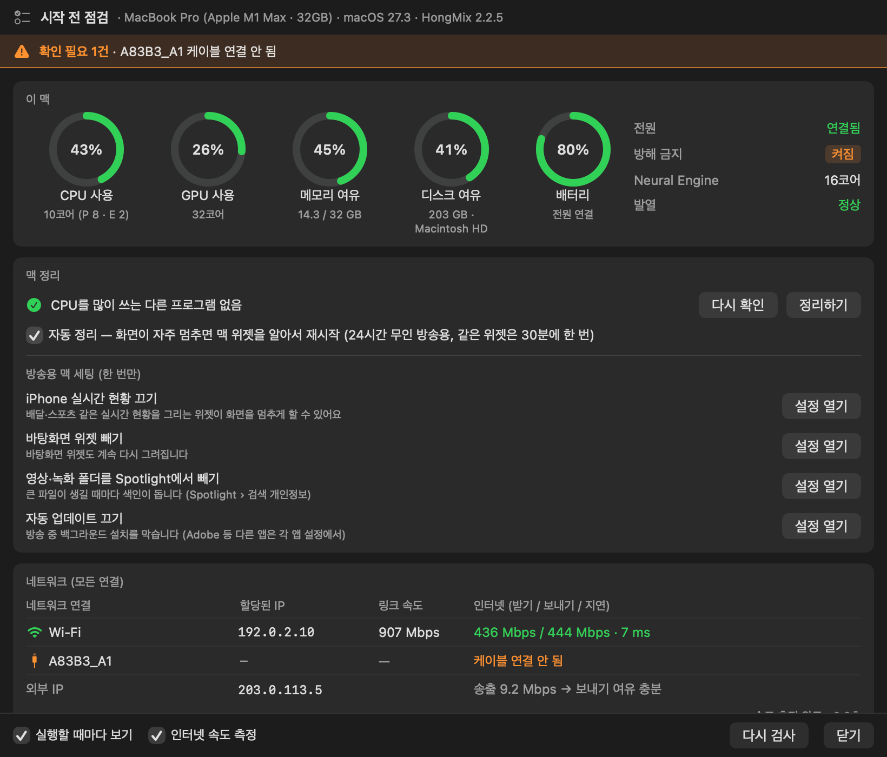

시작 전 점검은 앱을 켤 때 열립니다 (끄려면 **설정 › 일반 › 방송 안전 › 실행할 때 시작 전 점검 보기**). 표시 내용:

- **이 맥**: CPU·GPU 사용, 메모리·디스크 여유, 배터리·전원 어댑터, 발열, 방해 금지.
- **네트워크 (모든 연결)**: 연결마다 할당된 IP, 링크 속도, 선택 시 인터넷 속도(받기 / 보내기 / 지연)와 외부 IP.

속도 측정과 외부 IP 확인은 Cloudflare 속도 측정 서버에 접속하며, 핫스팟은 데이터를 아끼려고 건너뜁니다. **시작 전 점검에서 인터넷 속도 측정**으로 끌 수 있습니다. **다시 검사**로 새로 확인합니다.

별도의 **송출 전 점검**(**도구 › 송출 전 점검…**)은 방송 자체를 점검합니다: Output 신호, 라이브 입력, 백업 지정, SRT 품질, 송출 주소, 녹화 디스크, 오디오(무음·클리핑), 렌더러, FTB를 초록/노랑/빨강으로 보여 줍니다.

### 방해 금지

방송 중 전화·문자·알림 창이 키보드, 마우스, Companion 제어를 가져갈 수 있습니다.

1. **설정 › 일반 › 방송 안전**에서 **HongMix를 켜면 방해 금지 켜기**와 **HongMix를 끄면 방해 금지 끄기**를 켭니다.
2. 처음에는 **승인…**을 눌러 방해 금지 단축어를 설치합니다.
3. 위쪽 바의 **방해 금지** 버튼이 상태를 보여 주고, 누르면 켜고 끕니다.

상태는 앱을 켤 때, 버튼을 누를 때, HongMix로 돌아올 때만 확인합니다 (주기적으로 확인하지 않음).

### 신호 끊김 페일오버

라이브 입력마다 **백업 입력**을 지정하세요 (입력 설정 › **일반** › **신호 끊김 / 페일오버**, [3장](#신호-끊김과-백업) 참고). 송출 전 점검이 백업 없는 라이브 입력을 경고합니다.

### 사고 기록 (블랙박스)

송출·녹화 중 신호 끊김, 프레임 드롭, 무음, SRT 손실, 출력 오류가 생기면 전후 약 10초의 Program 화면과 함께 기록합니다.

- 위치: `~/Movies/HongMix/Incidents` (요약은 `incidents.txt`)
- **도구 › 상황판 / 블랙박스…**에서 SRT 링크 신호등, 최근 2분 RTT·손실·전송률 그래프, 권장 Latency, 사고 목록을 봅니다. **보고서 저장…**으로 텍스트 보고서를 만듭니다.
- SRT 사고는 사고 폴더마다 `srt.txt`에 직전 30초 기록(버퍼, Latency, RTT, 손실, 드롭, 재전송, Mbps, fps)과 **판정**을 남깁니다.

| 판정 | 의미 |
|---|---|
| 연결 끊김 | 보내는 쪽이나 네트워크가 연결을 닫음 |
| 데이터가 안 들어옴 | 보내는 쪽이 멈췄거나 경로가 막힘 |
| HongMix가 너무 느리게 읽음 | HongMix 쪽 문제 (제보해 주세요) |
| 회선 문제 | RTT·손실에 비해 Latency가 짧음 → Latency를 올리세요 |
| 보내는 쪽에서 버림 | 재전송 없이 빠짐 (송신 대역 제한·과부하) |
| 회선 손실 | 재전송으로도 다 못 살림 → 회선 확인, Latency를 올리면 도움 |
| 회선 손실 (복구 중) | 재전송으로 복구됨, 화면 영향 없음 |

---

## 12. 웹 리모트와 탤리

2.2.5~2.2.6 새 기능: 웹 리모트는 스위처를 그대로 브라우저로 옮긴 것으로, 앱과 같은 배치와 이름을 씁니다. 같은 네트워크의 노트북, 아이패드, 휴대폰에서 씁니다.

### 원격 제어 켜기

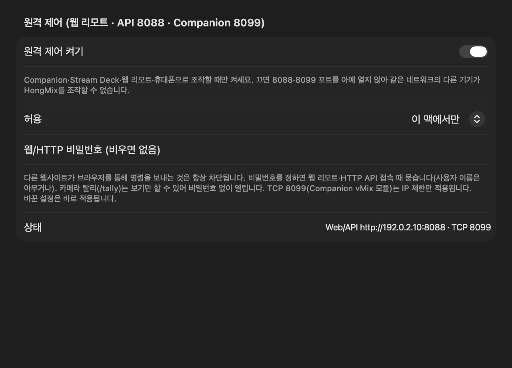

원격 제어는 **기본으로 꺼져** 있습니다. 꺼져 있으면 8088·8099 포트를 아예 열지 않습니다.

1. **설정**(⌘,)을 열고 **네트워크**를 고릅니다.
2. **원격 제어 (웹 리모트 · API 8088 · Companion 8099)**에서 **원격 제어 켜기**를 켭니다.
3. **허용**에서 **같은 네트워크의 장비 (Companion·Stream Deck·휴대폰)** 또는 **이 맥에서만**을 고릅니다.
4. 선택: **허용할 IP만**(쉼표로 구분, 비우면 모두)과 **웹/HTTP 비밀번호**(비우면 없음). 비밀번호를 정하면 브라우저가 묻습니다 (사용자 이름은 아무거나).

바꾼 설정은 바로 적용됩니다. 다른 웹사이트가 브라우저를 통해 보내는 명령은 항상 차단됩니다.

### 웹 리모트 열기

1. 맥의 IP 주소를 확인합니다 (설정의 **원격 제어 연결 주소** 또는 시작 전 점검).
2. 다른 기기의 브라우저에서 `http://<맥 IP>:8088/`을 엽니다. 예: `http://192.0.2.10:8088/`

### 데스크톱 배치 (가로 1100px 이상: 노트북, 데스크톱, 아이패드 가로)

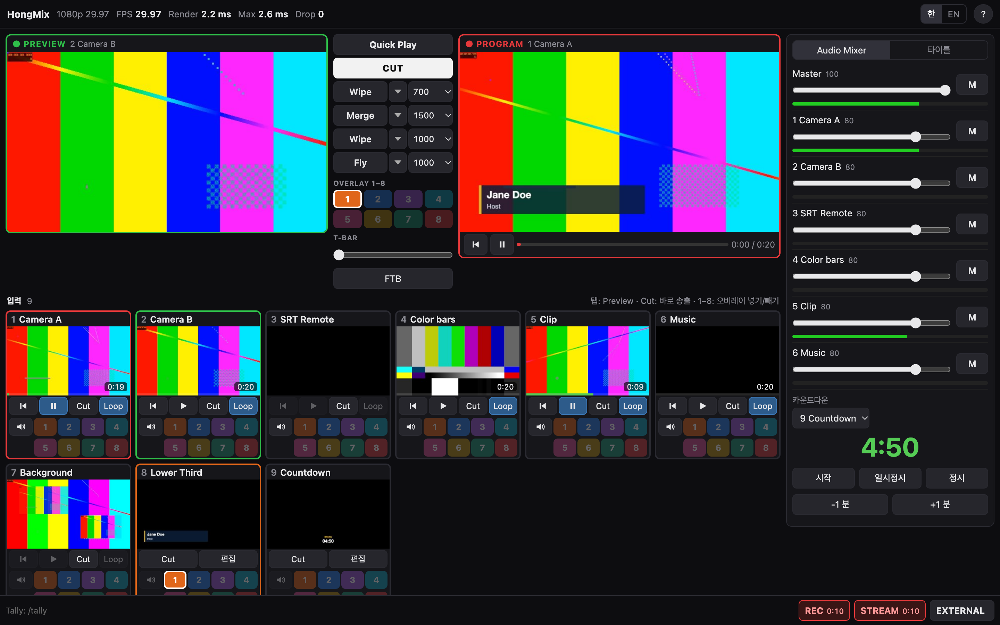

앱과 같은 모습입니다.

- **PREVIEW** · 가운데 열 · **PROGRAM**. 가운데 열에는 **Quick Play**, **CUT**, 효과 **▾**와 시간(ms)이 있는 전환 버튼 4개, **OVERLAY 1–8** 뱅크, **T-BAR**, **FTB**가 있습니다.
- **PROGRAM** 아래에 송출 중인 미디어의 재생 바가 있습니다. 바를 누르면 그 위치로 이동합니다.
- **입력 타일**: ⏮, ▶/❚❚, **Cut**, **Loop**, 스피커(음소거), 오버레이 버튼 **1–8**.
- 오른쪽에 **Audio Mixer / 타이틀** 패널.
- 아래에 **REC**, **STREAM**, **EXTERNAL**.
- 위쪽 상태: **FPS**, **Render**, **Max**, **Drop**, SRT 입력마다 RTT·손실·버린 패킷.
- **한 / EN**으로 언어를 바꿉니다 (기기마다 기억). **?**는 사용법을 엽니다.
- **화질** 메뉴(위쪽)로 PREVIEW·PROGRAM 화면의 움직임과 네트워크 사용량을 고릅니다 (기기마다 기억):
  - **부드럽게** — 초당 15장, 화면 하나에 약 1~5 Mbps. 같은 Wi-Fi에서 몇 대가 볼 때.
  - **보통** (기본) — 초당 8장, 약 0.6~1.5 Mbps.
  - **절약** — 초당 2장, 약 0.2 Mbps. Wi-Fi가 약하거나 휴대폰 데이터로 볼 때.
  - 화면이 보이지 않을 때(휴대폰의 오디오·타이틀 탭, 다른 앱으로 전환)에는 영상 전송을 멈춰 네트워크와 HongMix 부담을 줄입니다. 여러 기기가 같은 화면을 봐도 HongMix는 한 번만 만들어 나눠 보냅니다.

### 조작

| 조작 | 결과 |
|---|---|
| 타일 탭 | 그 입력이 PREVIEW로 |
| 타일의 **Cut** | 그 입력이 바로 PROGRAM으로 |
| 타일의 **1–8** | 그 입력을 해당 오버레이에 넣고, 다시 누르면 뺍니다. 불이 켜진 번호가 송출 중입니다. |
| 가운데 **OVERLAY 1–8** | 각 오버레이에 마지막으로 넣은 입력을 다시 넣거나 뺍니다 |
| **CUT** | PREVIEW를 PROGRAM으로 전환 |
| 전환 버튼 | 옆에서 고른 효과와 시간으로 전환 |
| **T-BAR** | 끝까지 밀면 전환이 끝납니다 |
| ⏮ / ▶❚❚ / **Loop** / 스피커 | 처음부터, 재생·일시정지, 반복, 음소거 |
| **REC** / **STREAM** / **EXTERNAL** | 시작하거나 멈출 때 항상 확인 창이 뜹니다 |

**Audio Mixer**: Master와 오디오가 있는 입력마다 볼륨 슬라이더, 음소거, 레벨 미터. 카운트다운 타이틀의 시작·일시정지·정지도 여기서 합니다.

**타이틀**: 타이틀 입력을 고르고 글자 칸을 고칩니다. 입력하는 동안에는 방송에 나가지 않습니다. **적용**을 눌러야 화면에 나가고, **변경 취소**로 되돌립니다. 프리셋 넘기기와 IN / OUT도 있습니다.

### 아이패드 세로·작은 창 (700~1099px)

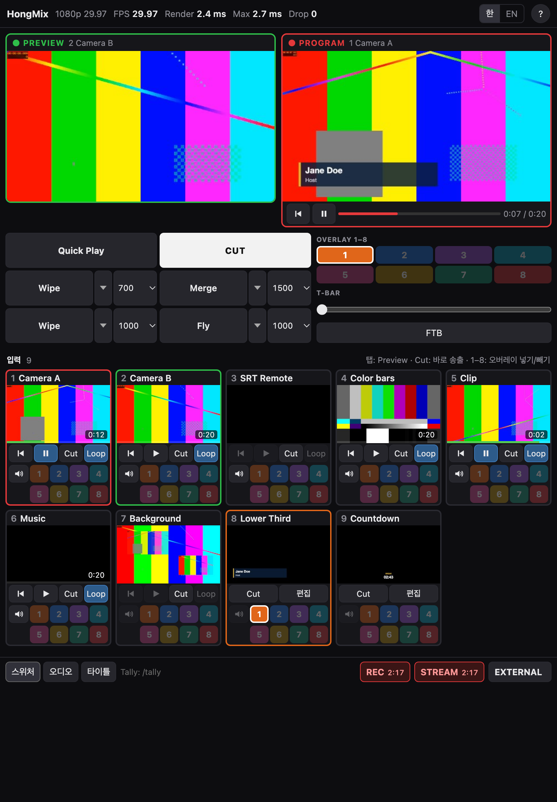

PREVIEW | PROGRAM을 나란히, 그 아래 전환 줄과 입력 타일이 옵니다. Audio Mixer와 타이틀은 아래 탭으로 엽니다.

### 휴대폰 (700px 미만)

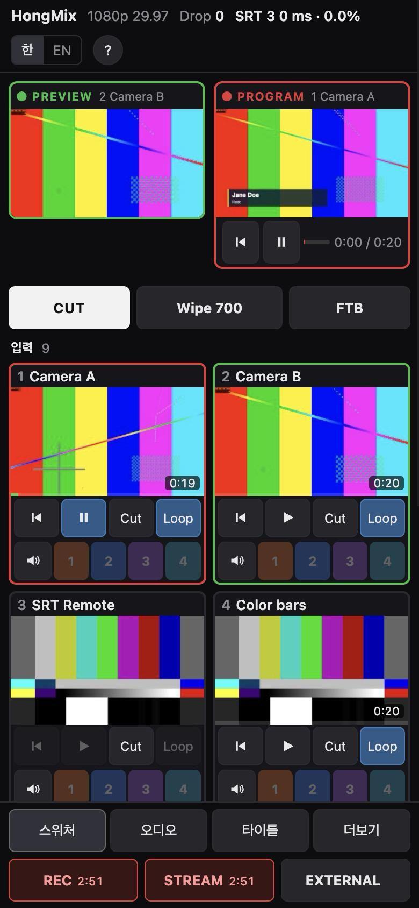

작은 PREVIEW | PROGRAM, **CUT** · 전환 · **FTB** 줄, 2열 입력 타일. 아래 탭: **스위처**, **오디오**, **타이틀**, **더보기**(오버레이 뱅크, 전환 4개, T-Bar). 터치 화면에서는 손가락 크기 버튼으로 바뀝니다.

### 카메라 탤리

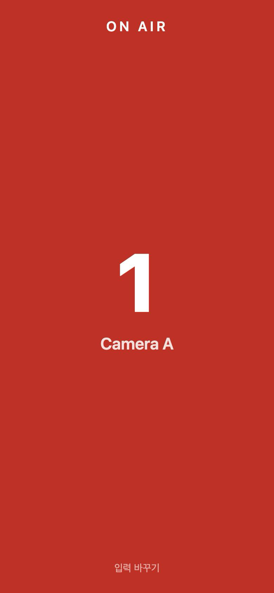

1. 카메라맨 휴대폰에서 `http://<맥 IP>:8088/tally`를 엽니다.
2. 그 카메라의 입력을 고릅니다.
3. 입력이 Program에 있으면 빨간 화면에 **ON AIR**, Preview에 있으면 초록 화면에 **PREVIEW**가 표시됩니다. **입력 바꾸기**로 다른 입력을 고릅니다.

탤리는 보기 전용이라 아무것도 전환할 수 없으므로 HTTP 비밀번호 없이 열립니다 (IP 제한은 적용). 휴대폰 화면이 꺼지지 않게 유지하며, 안내가 나오면 한 번 탭하세요.

---

## 13. Companion · Stream Deck · API

HongMix는 vMix API를 그대로 지원하므로 기존 컨트롤러를 그대로 쓸 수 있습니다. 먼저 원격 제어를 켜세요 ([12장](#원격-제어-켜기)).

| 방식 | 주소 |
|---|---|
| HTTP Web API | `http://<맥 IP>:8088/api/?Function=Cut` |
| TCP API | 포트 **8099** (`FUNCTION Cut`) |
| 웹 리모트 | `http://<맥 IP>:8088/` |
| 탤리 | `http://<맥 IP>:8088/tally` |

### Bitfocus Companion / Stream Deck

1. Companion에서 **vMix** 모듈을 추가합니다.
2. 맥의 IP(예: `192.0.2.10`)와 포트 **8088**을 넣습니다. 상태 피드백에는 TCP 8099도 씁니다.
3. 평소처럼 vMix 액션(Cut, Fade, 오버레이, SetText, StartStreaming 등)을 씁니다.

참고: TCP 8099에는 HTTP 비밀번호가 아닌 IP 제한만 적용됩니다.

### 예시

```
http://192.0.2.10:8088/api/?Function=PreviewInput&Input=2
http://192.0.2.10:8088/api/?Function=Fade&Duration=1000
http://192.0.2.10:8088/api/?Function=OverlayInput1In&Input=5
http://192.0.2.10:8088/api/?Function=SetText&Input=3&SelectedName=Headline.Text&Value=Hello
http://192.0.2.10:8088/api/?Function=LayerPreset&Input=4&Value=1,Interview
```

HongMix 전용 함수: `SetFitMode`, `SetZoomX` / `SetZoomY`, `LayerLayout`, `SetLayer`, `LayerPreset` / `LayerPresetSave`, `SetLUT`, `SetDelay` / `DelayDump`, `RundownNext`, 더킹 함수 등. 함수 없이 `/api/`를 부르면 vMix 형식 XML 상태를 돌려주며, SRT 입력마다 `<inputSrtStats>`가 들어 있습니다.

전체 목록: [docs/FUNCTIONS.md](../FUNCTIONS.md)

**MIDI**: **설정 › MIDI**에서 학습 모드, 컨트롤러 템플릿, LED 탤리를 설정합니다. 방송 전에 모든 할당을 시험하세요.

---

## 14. 일반 설정

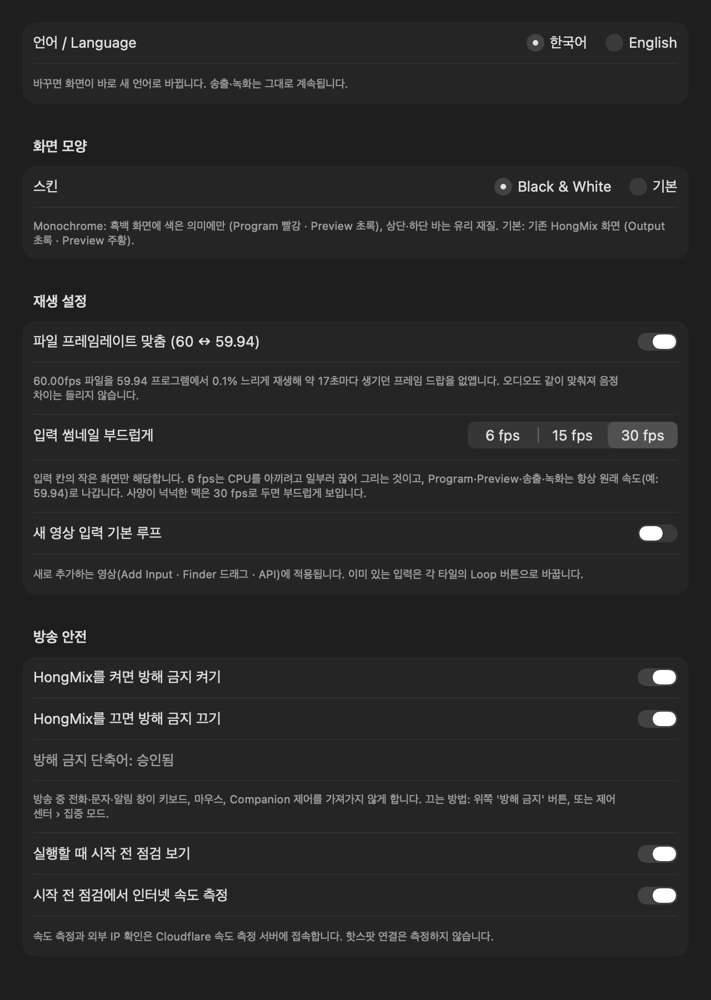

**⌘,**로 **설정**을 엽니다. 탭: **비디오**, **네트워크**, **일반**, **정보**, **단축키**, **MIDI**.

### 일반

| 설정 | 설명 |
|---|---|
| **언어 / Language** | 한국어 또는 English. 화면이 바로 바뀌고 송출·녹화는 그대로 계속됩니다. |
| **화면 모양 › 스킨** | **Black & White**(기본값) 또는 **기본**(예전 HongMix 화면) |
| **화면 모양 › 하드웨어 룩** | 콘솔 형식 믹서 채널과 입체 조작계. 끄면 이전의 평면 화면을 씁니다. |
| **화면 모양 › 배경에 금속 질감** | 하드웨어 룩 배경에 은은한 금속 질감을 더합니다. 기본으로 꺼져 있습니다. |
| **재생 설정 › 파일 프레임레이트 맞춤 (60 ↔ 59.94)** | 60.00fps 파일을 59.94 프로그램에서 0.1% 느리게 재생해 약 17초마다 생기던 프레임 드롭을 없앱니다. 오디오도 함께 맞춥니다. |
| **재생 설정 › 입력 썸네일 부드럽게** | 입력 타일의 작은 화면만 6·15·30fps. Program·Preview·송출·녹화는 항상 원래 속도입니다. |
| **재생 설정 › 새 영상 입력 기본 루프** | 새로 추가하는 영상의 Loop 기본값 |
| **실수 방지 › 입력을 닫을 때 확인** | 타일의 **×**나 메뉴로 입력을 닫기 전에 묻습니다. **다시 묻지 않기**를 선택한 뒤 여기서 다시 켤 수 있습니다. |
| **방송 안전** | 켜고 끌 때 방해 금지, 실행할 때 시작 전 점검, 인터넷 속도 측정 |
| **Backstage** | 기본으로 꺼져 있습니다. 켜면 보조 앱이 Talent Display를 유지하고 HongMix 충돌·강제 종료 후 자동으로 다시 실행합니다(2분 안에 최대 3회). 송출·녹화는 보호하지 않습니다. |

### 비디오

**프로그램 포맷**(해상도·프레임). 출력을 모두 중지한 뒤 바꿀 수 있습니다. 입력은 해상도·비율과 관계없이 프로그램 포맷에 맞춰 스케일됩니다.

### 네트워크

NDI 추가 검색 IP, NDI 런타임·웹 브라우저 엔진·DeckLink 상태, **원격 제어** ([12장](#원격-제어-켜기)).

---

## 15. 문제 해결과 자주 묻는 질문

**앱이 열리지 않습니다 ("확인되지 않은 개발자").**
응용 프로그램 폴더에서 HongMix를 우클릭 → **열기** → **열기** ([1장](#처음-실행)).

**카메라·마이크가 안 보입니다.**
**시스템 설정 › 개인정보 보호 및 보안 › 카메라 / 마이크**에서 HongMix를 허용한 뒤, 입력 추가 › Camera에서 새로고침을 누르세요.

**화면 캡처가 검거나 느립니다.**
HongMix에 **화면 및 시스템 오디오 녹음**을 허용하고, macOS가 요청하면 HongMix를 다시 실행하세요.

**NDI 소스가 안 보입니다.**
HongMix에 **로컬 네트워크**를 허용하세요. 다른 서브넷이면 **설정 › 네트워크**에 소스 IP를 넣습니다.

**SRT 화면이 깨지거나 끊깁니다.**
1. **도구 › 상황판 / 블랙박스…** 또는 SRT 설정(타일 더블클릭)에서 RTT와 손실을 확인합니다.
2. Latency를 RTT의 4배 이상, 양쪽 같게 맞춥니다. **권장값 넣기**를 누르세요.
3. 다시 끊기면 `~/Movies/HongMix/Incidents/incidents.txt`와 `srt.txt`의 판정을 확인합니다.
4. 2.2.3 이상인지 확인하세요. 이전 버전은 60fps에서 몇 분마다 SRT 입력이 끊길 수 있었습니다.

**수신 장비가 59.94를 58.94로 표시합니다.**
HongMix 2.3.0 이상으로 업데이트하세요. H.264 송출·녹화 헤더에 프레임레이트 정보가 기록됩니다.

**웹 리모트나 Companion이 연결되지 않습니다.**
휴대폰·아이패드에서 웹 리모트가 안 열리면 차례대로 확인하세요.
1. **설정 › 네트워크 › 원격 제어 켜기**가 켜져 있나요?
2. **허용**이 **같은 네트워크의 장비**인가요? **이 맥에서만**이면 휴대폰은 물론 같은 맥의 브라우저에서도 `192.168…` 같은 주소로는 열리지 않고, 상태에 `localhost · 이 맥에서만`이 표시됩니다.
3. 주소는 **상태** 줄에 나온 그대로 입력합니다 (예: `http://192.0.2.10:8088`). `https`가 아니라 `http`입니다.
4. 휴대폰이 맥과 **같은 Wi-Fi**인가요? 모바일 데이터, 게스트 Wi-Fi, VPN이 켜져 있으면 열리지 않습니다.
5. **허용할 IP만 (쉼표로 구분, 비우면 모두)** 칸에 주소를 적었다면 휴대폰 IP도 들어 있어야 합니다.
6. 비밀번호를 정했다면 브라우저가 묻습니다 (사용자 이름은 아무거나). 탈리(`/tally`)는 비밀번호 없이 열립니다.
7. HongMix에 **로컬 네트워크** 권한을 허용하세요. macOS 방화벽을 켰다면 HongMix의 들어오는 연결을 허용합니다.

**Render가 높거나 Drop이 늘어납니다.**
- **입력 썸네일 부드럽게**를 6fps로 낮춥니다.
- 59.94p에서 AI 배경 제거는 **Fast**를 쓰고, 필요 없는 곳의 AI 화질 올리기는 끕니다.
- CPU로 디코딩되는 파일은 제안이 나오면 최적화 미디어(ProRes)를 만듭니다.
- 맥을 전원에 연결하고 시작 전 점검에서 발열 상태를 확인합니다.
- 아래쪽 바의 **Statistics**(막대 아이콘)에서 입력별 fps, 늦은 프레임, 최근 2분 상태 그래프를 봅니다.

**메뉴 막대 아이콘이 깜빡입니다.**
2.2.0에서 해결되었습니다. 방해 금지 상태를 더 이상 주기적으로 확인하지 않습니다.

**입력을 실수로 닫았습니다.**
타일의 **×**나 메뉴로 닫을 때는 먼저 확인합니다. 마지막에 닫은 입력은 위쪽 **Undo**로 되살립니다. **다시 묻지 않기**를 골랐다면 **설정 › 일반 › 실수 방지**에서 다시 켜세요.

**HongMix가 예기치 않게 종료됐습니다. 충돌 보고서는 어디에 있나요?**
다음 실행 때 HongMix가 가장 최근 보고서를 안내하고 Finder에서 바로 보여 줍니다. 해당 `.ips` 또는 `.crash` 파일을 GitHub 이슈에 첨부해 주세요.

**59.94 프로그램에서 60.00fps 파일을 써도 되나요?**
네. **설정 › 일반 › 재생 설정**에서 **파일 프레임레이트 맞춤**을 켜세요.

---

## 16. 시스템 요구 사항과 저작권 고지

### 요구 사항

- Apple Silicon 맥 (M1 이후)
- macOS 14 이상 (실시간 자막은 macOS 26 이상에서 새 엔진 사용, AI 화질 올리기는 Apple Silicon과 macOS 26 이상 필요)
- 선택: SDI/HDMI용 Blackmagic DeckLink / UltraStudio, 네트워크의 NDI 장비

### 만든 사람과 라이선스

- 만든 사람: 홍승훈 (Hong Seunghoon), 대한민국
- 오픈소스 구성 요소(FFmpeg, libsrt, NDI 런타임, Chromium 등)와 라이선스: **설정 › 정보 › 고지 보기**, [docs/THIRD-PARTY-NOTICES.txt](../THIRD-PARTY-NOTICES.txt)
- 의견·버그 제보: [github.com/HongMix/HongMix/issues](https://github.com/HongMix/HongMix/issues)

vMix는 StudioCoast Pty Ltd의 상표입니다. HongMix는 독립 프로젝트이며 StudioCoast와 제휴하거나 보증받지 않았습니다. NDI®는 Vizrt NDI AB의 등록 상표이고, DeckLink는 Blackmagic Design Pty Ltd의 상표입니다.
